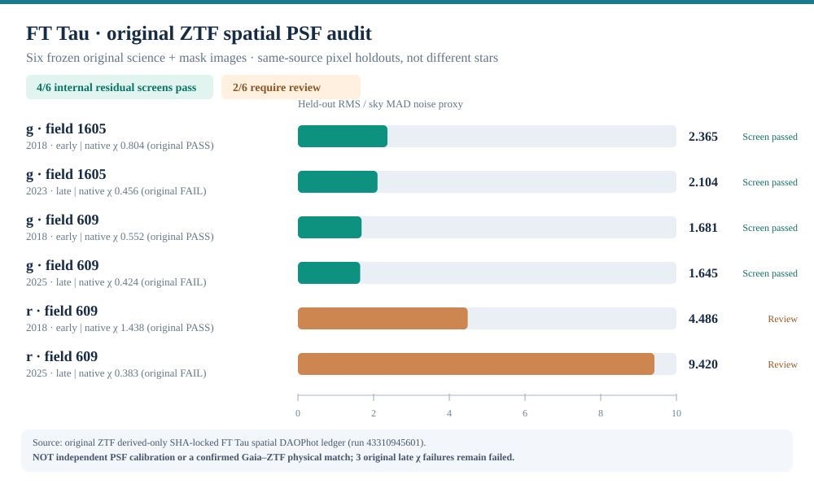

# StellarForge v2.1 — empezar aquí

**Versión del software: 2.1.0 (13 de noviembre de 2026).** [Repositorio público](https://github.com/ismaelberja/stellarforge).

StellarForge es un proyecto personal de **Python científico, análisis de datos, ingeniería de datos y automatización** aplicado a catálogos Gaia DR3, observaciones ZTF/IRSA, imágenes FITS, coordenadas WCS y modelos PSF. La dirección científica es de Ismael Berja Ruiz; el desarrollo incluye asistencia de IA, pruebas automatizadas y documentación transparente.

## ¿Está preparado para el CV?

**Sí, como proyecto de software científico reproducible, sujeto a que la versión final supere la integración de GitHub Actions.** Dispone de código Python, CLI, pruebas, GitHub Actions, auditoría de resultados originales y documentación ES/EN.

**No equivale a una publicación científica ni a un descubrimiento:** no se ha autenticado físicamente la identidad Gaia↔ZTF de los cuatro identificadores ZTF ni una nueva variabilidad/compañera. Una consulta externa a SIMBAD sí ha verificado la equivalencia de **nombre catalográfico** entre FT Tau y Gaia DR3 **149623711269425408**.

## Qué datos sustentan los resultados

La base histórica v2.0 conserva **532 miembros de Taurus (467 con Gaia), 2.212 registros de consultas originales y 16 ajustes de PSF en cuatro exposiciones históricas** (13 controles provisionales superados; tres en revisión).

Los estudios posteriores analizaron **seis exposiciones originales fijadas de FT Tau**, con seis modelos PSF espaciales DAOPhot: 6/6 modelos numéricamente evaluados, 4/6 controles internos de residuos provisionalmente superados y 2/6 imágenes r/609 pendientes de revisión. Los datos no se suman como una nueva población de estrellas únicas. Las tres detecciones originales con χ inferior a 0,5 permanecen **rechazadas por su criterio inicial**.

- [Informe completo del software y sus límites](docs/V21_REPRODUCIBILITY_AND_SCIENCE_LIMITS.md).
- [Manifiesto de evidencia auditable v2.1](RELEASE_MANIFEST_v2.1.json) y [v2.0 histórico](RELEASE_MANIFEST_v2.0.json).
- [Resultados de FT Tau con PSF original](research/taurus_variability/R2_REAL_FTTAU_SIX_NATIVE_SPATIAL_DAO_RESULTS.md).
- [Comprobación externa de alias SIMBAD/Gaia](research/taurus_variability/R2_REAL_FTTAU_SIMBAD_GAIA_EXACT_ALIAS_RESULTS.md).

## Cómo ejecutarlo

Con Git y Python 3.10+; versión probada por CI: Python 3.11.

```bash
git clone https://github.com/ismaelberja/stellarforge.git
cd stellarforge
python -m pip install -e ".[test,analysis,images]"
python -m pytest -q
python scripts/audit_v21_release_manifest.py
python scripts/audit_v2_release_manifest.py
stellarforge --version
stellarforge plan-gaia --ra 70 --dec 20 --radius-deg 0.1 --max-rows 10
```

Las pruebas convencionales no necesitan conectarse a Gaia, SIMBAD o ZTF ni acceder a archivos FITS privados. Para Windows/PowerShell, consulta [la guía detallada](docs/V21_GUIA_ES.md).

## Gráficos y fotos



Este es un **gráfico construido a partir de resultados reales**, no una fotografía del cielo. Las imágenes de portada son **ilustraciones generadas con IA**, no datos originales de telescopios. [Trazabilidad visual](docs/V21_VISUAL_EVIDENCE.md).

## Documentos para usar profesionalmente

[Textos en español e inglés para CV, LinkedIn y entrevistas](docs/V21_PORTFOLIO_CV_ES_EN.md) · [Notas de versión 2.1](RELEASE_NOTES_v2.1.md).

La versión 2.1 se cierra como **ingeniería de software**, una vez verificada la CI en `main`. La investigación original sobre identidad física y calibración instrumental sigue abierta; para una publicación científica necesitará nuevas validaciones independientes.

Documento de entrada a la versión anterior: [guía v2.0 histórica](docs/V2_GUIA_ES.md).
