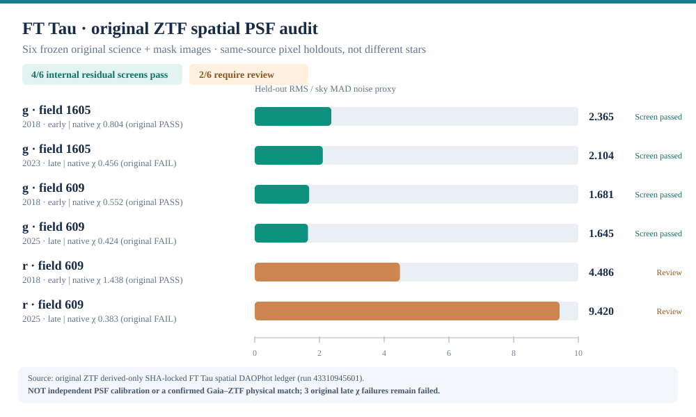

# StellarForge v2.1 — empezar aquí

**Versión del software: 2.1.0 (13 de noviembre de 2026).** [Repositorio público](https://github.com/ismaelberja/stellarforge).

StellarForge es un proyecto personal de **Python científico, análisis de datos, ingeniería de datos y automatización** aplicado a catálogos Gaia DR3, observaciones ZTF/IRSA, imágenes FITS, coordenadas WCS y modelos PSF. La dirección científica es de Ismael Berja Ruiz; el desarrollo incluye asistencia de IA, pruebas automatizadas y documentación transparente.

## ¿Está preparado para el CV?

**Sí, como proyecto de software científico reproducible, sujeto a que la versión final supere la integración de GitHub Actions.** Dispone de código Python, CLI, pruebas, GitHub Actions, auditoría de resultados originales y documentación ES/EN.

**No equivale a una publicación científica ni a un descubrimiento:** no se ha autenticado físicamente la identidad Gaia↔ZTF de los cuatro identificadores ZTF ni una nueva variabilidad/compañera. Una consulta externa a SIMBAD sí ha verificado la equivalencia de **nombre catalográfico** entre FT Tau y Gaia DR3 **149623711269425408**.

**Novedad de investigación R2 (13 de noviembre de 2026):** ya hemos contrastado los **24 identificadores Gaia y sus posiciones contra la Tabla 2 original de Luhman (2023), descargada realmente de la editorial**, no solamente contra una copia de terceros. Los 24 coinciden. También hemos concluido la **auditoría de acceso e identificación de las 24 fuentes**: ZTF ha respondido con datos posicionales para 22/24, pero **ninguna asociación física Gaia–ZTF supera aún todos los criterios científicos**. El resultado de este examen es **NO-GO para comenzar análisis astrofísico de variabilidad R3**. [Informe científico R2 con tabla de las 24 estrellas](research/taurus_variability/R2_FINAL_24_SOURCE_SCREENING_DECISION.md) · [evidencia original de la editorial](reports/taurus_variability_r2/R2_PUBLISHER_LUHMAN2023_ORIGINAL_24_OF_24_NO_RAW.json).

## R5 — revisión crítica de bibliografía y sesgos (14/11/2026)

Hecho: **revisión metodológica R5**, contrastando las fuentes originales con la bibliografía científica y los manuales de Gaia y ZTF. La tabla original de Luhman confirma los 24 identificadores Gaia y sus posiciones; en cambio, **ningún ObjectID ZTF está aún demostrado físicamente como una de esas estrellas**. De los seis ObjectIDs de la prueba, tres devolvieron datos (591 mediciones aceptadas por el filtro `catflags` bit 15) y otros tres tuvieron errores de tiempo de espera. No debemos confundir **24 estrellas técnicas**, **seis ObjectIDs** y **684 registros fotométricos**; tampoco interpretar el filtro bit 15 como una selección completamente limpia `catflags=0`.

Hemos comparado las metodologías con Luhman (2023), Mas et al. (2026) y la documentación de Gaia DR3/IRSA ZTF. La revisión **desautoriza por ahora reclamar nuevos periodos estelares, variabilidad de FT Tau/CIDA 11, nuevas compañeras y tasas poblacionales**. **Sí se puede completar R6 como estudio científico metodológico de viabilidad y limitaciones**, bien documentado, sin inventar descubrimientos.

[Leer la revisión científica R5](research/taurus_variability/R5_FINAL_CRITICAL_VALIDATION_AND_SELECTION_RESULTS.md) · [Gráfico que separa los tres tipos de datos](docs/figures/taurus-r5-original-source-denominators-no-funnel.svg) · [Libro de decisión con 8 criterios](reports/taurus_variability_r5/R5_CRITICAL_VALIDATION_AND_SELECTION_DECISION_NO_RAW.json).

## Investigación R4 — por qué no basta con disponer de muchos datos

Ya hemos añadido un **análisis R4 con cifras originales de ZTF y un gráfico real de cobertura temporal**. De las tres series técnicas recuperadas (591 observaciones que superan los filtros), **dos tienen dos intervalos completos de 365 días consecutivos sin medidas aceptadas**; la tercera no presenta intervalos de ese tamaño totalmente vacíos. Los otros tres identificadores ZTF no devolvieron una respuesta del servidor, por lo que sus observaciones son **desconocidas**, no cero.

Para explicar por qué esto impide calcular periodos fiables a partir de simples recuentos, hemos creado **dos calendarios de observación totalmente simulados** para cada fuente, con el mismo número real de puntos por intervalo y la misma duración: sus supuestos resultados de una prueba matemática a un día son distintos. **Ninguno de esos periodos o tiempos inventados es una medición astronómica real.** Los identificadores ZTF siguen sin estar autenticados físicamente como estrellas Gaia, por lo que R4 está completada **solo como estudio metodológico**, no como descubrimiento de variabilidad. [Informe científico de R4](research/taurus_variability/R4_REAL_ZTF_SAMPLING_WINDOW_FEASIBILITY_RESULTS.md) · [Gráfico científico real](docs/figures/taurus-r4-original-ztf-dr24-relative-365day-cadence.svg).

## Avance científico R3: acceso a fotometría ZTF (14/11/2026)

Hemos realizado una consulta auténtica al archivo público de ZTF DR24 sobre **seis ObjectIDs ya establecidos** alrededor de FT Tau y CIDA 11. **Tres** devolvieron datos originales (684 registros, **591 observaciones aceptadas** tras el filtro de calidad instrumental) y cumplen como series técnicas los límites de **30 observaciones y 90 días**. Las otras tres consultas agotaron el tiempo de respuesta; un único reintento con mayor tiempo también agotó el plazo. **No significa que esas estrellas no tengan datos.**

**Seguimos sin identificar físicamente las fuentes ZTF como las estrellas Gaia.** Por tanto, estos registros **no son todavía curvas de luz científicamente atribuidas a FT Tau o CIDA 11**; no hemos calculado periodos, clasificado variabilidad ni descubierto compañeras. El software y las pruebas sí están verificados. [Informe R3 con los seis identificadores y resultados reales](research/taurus_variability/R3_REAL_SIX_ORIGINAL_ZTF_DR24_QC_RESULTS.md).

## Qué datos sustentan los resultados

La base histórica v2.0 conserva **532 miembros de Taurus (467 con Gaia), 2.212 registros de consultas originales y 16 ajustes de PSF en cuatro exposiciones históricas** (13 controles provisionales superados; tres en revisión).

Los estudios posteriores analizaron **seis exposiciones originales fijadas de FT Tau**, con seis modelos PSF espaciales DAOPhot: 6/6 modelos numéricamente evaluados, 4/6 controles internos de residuos provisionalmente superados y 2/6 imágenes r/609 pendientes de revisión. Los datos no se suman como una nueva población de estrellas únicas. Las tres detecciones originales con χ inferior a 0,5 permanecen **rechazadas por su criterio inicial**.

- [Informe completo del software y sus límites](docs/V21_REPRODUCIBILITY_AND_SCIENCE_LIMITS.md).
- [Manifiesto de evidencia auditable v2.1](RELEASE_MANIFEST_v2.1.json) y [v2.0 histórico](RELEASE_MANIFEST_v2.0.json).
- [Resultados de FT Tau con PSF original](research/taurus_variability/R2_REAL_FTTAU_SIX_NATIVE_SPATIAL_DAO_RESULTS.md).
- [Comprobación externa de alias SIMBAD/Gaia](research/taurus_variability/R2_REAL_FTTAU_SIMBAD_GAIA_EXACT_ALIAS_RESULTS.md).

## Cómo ejecutarlo

Con Git y Python 3.10+; versión probada por CI: Python 3.11.

```bash
git clone https://github.com/ismaelberja/stellarforge.git
cd stellarforge
python -m pip install -e ".[test,analysis,images]"
python -m pytest -q
python scripts/audit_v21_release_manifest.py
python scripts/audit_v2_release_manifest.py
stellarforge --version
stellarforge plan-gaia --ra 70 --dec 20 --radius-deg 0.1 --max-rows 10
```

Las pruebas convencionales no necesitan conectarse a Gaia, SIMBAD o ZTF ni acceder a archivos FITS privados. Para Windows/PowerShell, consulta [la guía detallada](docs/V21_GUIA_ES.md).

## Gráficos y fotos



Este es un **gráfico construido a partir de resultados reales**, no una fotografía del cielo. Las imágenes de portada son **ilustraciones generadas con IA**, no datos originales de telescopios. [Trazabilidad visual](docs/V21_VISUAL_EVIDENCE.md).

## Documentos para usar profesionalmente

[Textos en español e inglés para CV, LinkedIn y entrevistas](docs/V21_PORTFOLIO_CV_ES_EN.md) · [Notas de versión 2.1](RELEASE_NOTES_v2.1.md).

La versión 2.1 se cierra como **ingeniería de software**, una vez verificada la CI en `main`. La investigación original sobre identidad física y calibración instrumental sigue abierta; para una publicación científica necesitará nuevas validaciones independientes.

Documento de entrada a la versión anterior: [guía v2.0 histórica](docs/V2_GUIA_ES.md).
