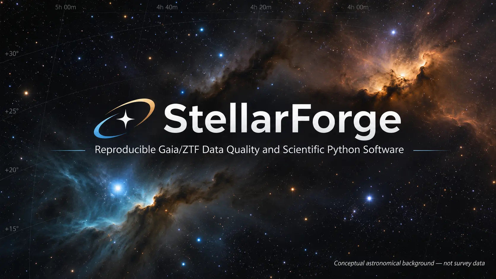
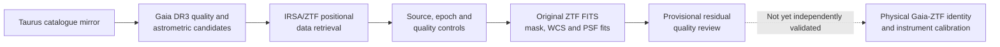
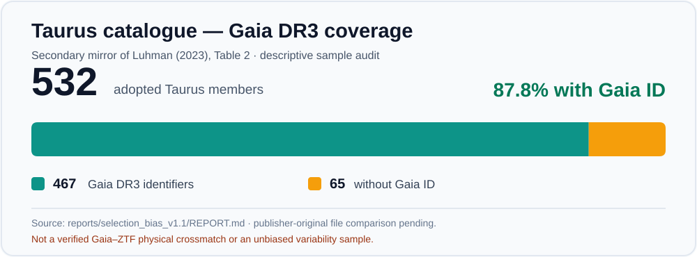
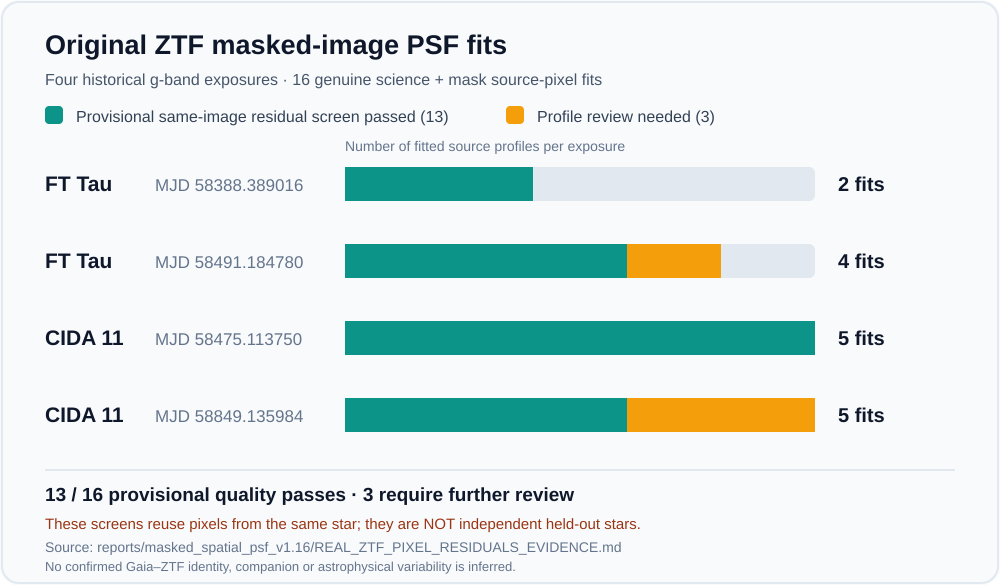
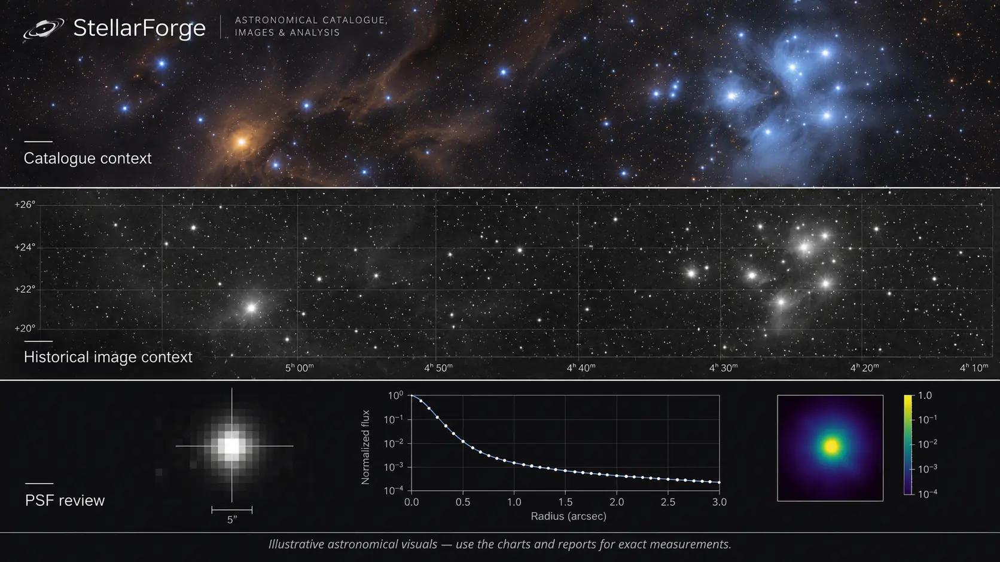

# StellarForge v2.0

**Scientific Python · Data engineering · Astronomy time series · Reproducible research**

[](https://github.com/ismaelberja/stellarforge/actions/workflows/tests.yml)
[](pyproject.toml)
[](RELEASE_MANIFEST_v2.0.json)



*Conceptual project artwork created with generative AI. **Not a photograph of Taurus or any Gaia/ZTF survey frame**; decorative grid coordinates are not measured astrometry.*

**Engineering release 2.0.0, 10 November 2026.** StellarForge is an open-to-inspection scientific-software portfolio project for quality-controlled astronomical data workflows around the Taurus young-star region. It combines traceable catalogue ingestion, Gaia DR3 astrometric checks, ZTF/IRSA light-curve analysis, original FITS science/mask inspection, and PSF reconstruction and testing.

**Author and scientific direction:** Ismael Berja Ruiz. Development includes AI-assisted implementation with regression testing, explicit observational provenance and human scientific review requirements.

> **Scientific boundary:** The software is tested and has processed real historical Gaia/ZTF survey products, but **physical Gaia–ZTF stellar identifications, independent instrument PSF/WCS calibration, and new astrophysical variability/companion discoveries are not confirmed**. The newer *different-whole-star empirical PSF* pipeline is tested synthetically; its strict original CIDA 11 live pilot is **not yet run**. A green CI badge is not proof of an astronomical discovery.

## See the work at a glance

**Evidence and illustration are different:** the flowchart and numbered charts below summarize documented research; the astronomy-inspired images are **AI-generated illustrations, not actual telescope photographs, measured PSF curves or source detections**.



**1. Catalogue audit — how much of the Taurus mirror has a Gaia DR3 identifier?**



*Real catalogue-mirror counts from [the v1.1 selection-bias audit](reports/selection_bias_v1.1/REPORT.md). The mirror has not been checked byte-for-byte against the publisher's original table.*

**2. Real original ZTF images — how many source-profile fits passed preliminary checks?**



*This chart comes from [the real v1.16 science-pixel report](reports/masked_spatial_psf_v1.16/REAL_ZTF_PIXEL_RESIDUALS_EVIDENCE.md). These are original image fits and **same-star pixel-holdout screens**, not independent new-star empirical PSF validation; the three reviews are not companion detections.*

[Visual data provenance and limits](docs/V2_VISUAL_EVIDENCE.md)

### Visual concept — astronomy and PSF analysis



*AI-generated illustrative composite only. **The stars, coordinate grid, radial-profile curve, colour map and scale bar are fictional graphics, not authentic measurements.** For genuine observational measurements use the original ZTF [v1.16 report](reports/masked_spatial_psf_v1.16/REAL_ZTF_PIXEL_RESIDUALS_EVIDENCE.md) and the two audited charts above.*

## What the software does

- **Catalogues and source provenance:** audits an externally supplied 532-member Taurus catalogue mirror, keeps its 467 Gaia DR3 identifiers traceable, and builds a deliberately **nonrepresentative 24-source technical seed** without assigning unverifiable disc classes.
- **Time-domain data:** constructs safe Gaia/IRSA queries, retrieves and hashes original survey responses, validates quality flags and separates ZTF object IDs, filters and observation epochs. Explores period and event diagnostics **without automatically assigning a physical variable-star class**.
- **Real image QA:** checks ZTF science FITS, celestial WCS coordinates, original detector bitmasks, source-profile quality, spatial DAOPhot models and held-out *same-source* pixel residuals across historic exposures.
- **Scientific falsification:** handles missing data and survey HTTP errors as technical outcomes; distinguishes source-identification uncertainty from measurement quality; adds strict Gaia-only different-star holdouts, synthetic PSF perturbation tests and explicit evidence gates.
- **Engineering quality:** modular Python package, CLI, pytest, GitHub Actions, versioned research reports and bilingual reproduction guides. Original raw survey files are not committed.

## Results and evidence boundaries

| Category | Verified result | What it **does not** prove |
| --- | --- | --- |
| Catalogue mirror | 532 Taurus members; 467 Gaia DR3 IDs; 24-source technical seed | Publisher-original byte identity, unbiased source selection, disc classification |
| Original IRSA queries | 2,212 real positional-query photometry rows across six ZTF object IDs | Certain physical association with FT Tau or CIDA 11 |
| Original ZTF images | Four historical dated g-band science exposures (two per field) | Four new observations or a representative astronomical sample |
| Original DAOPhot PSF | Four center-PSF reconstructions checked against original survey center FITS products | Independent local star-specific PSF calibration |
| Original masked image profiles | 16 source-image PSF fits; **13** provisional same-source residual screens passed; **3** require review | Independent held-out-star validation or new companions |
| New empirical PSF method | Different whole-star training/validation and fail-closed 4-training/3-holdout pilot orchestration, tested with synthetic FITS | Completed real CIDA 11 empirical validation; absolute instrument error model |
| Automated verification | **752 passed** at the v1.22 main-branch baseline, with expanded v2.0 release checks | External survey source identity, physical variability, astrophysical discoveries |

See the [audited v2.0 evidence manifest](RELEASE_MANIFEST_v2.0.json), [real v1.16 science-pixel evidence](reports/masked_spatial_psf_v1.16/REAL_ZTF_PIXEL_RESIDUALS_EVIDENCE.md), and [v2.0 reproducibility and science limits](docs/V2_REPRODUCIBILITY_AND_SCIENCE_LIMITS.md).

### Why the three flagged source profiles matter

The three historic high-positive-residual source profiles from v1.16 are **quality-review cases**, not confirmed 7-sigma astrophysical detections. Possible causes include PSF mismatch, source crowding, structured sky or correlated detector noise. They remain open for independent multi-epoch/multi-band research.

## Quick start

Requires **Python 3.10+**. Python 3.11 is used in GitHub CI.

```bash
git clone https://github.com/ismaelberja/stellarforge.git
cd stellarforge
python -m pip install -e ".[test,analysis,images]"
python -m pytest -q

# Both commands only print a query plan; they do not contact an archive:
stellarforge plan-gaia --ra 70 --dec 20 --radius-deg 0.1 --max-rows 10
stellarforge plan-ztf --ra 70 --dec 20 --radius-arcsec 2

# Verify the v2.0 historical evidence contract, offline:
python scripts/audit_v2_release_manifest.py
```

For the complete CLI, run `stellarforge --help`. The historical raw archive is **not needed** for normal installation, offline tests or query planning.

## Reproducing the original-data pilot (optional and manual)

The [original CIDA 11 FITS + Gaia pilot](.github/workflows/v120-original-empirical-psf-pilot.yml) uses live Gaia/IRSA data and was deliberately designed for **manual dispatch**. If you have the privately recovered two-target original IRSA source ZIP, first check its historic pinned SHA using:

```bash
python scripts/check_v122_historic_source_zip.py /private/path/ztf-historic-source-run.zip
```

That ZIP contains **historic positional-query responses, not the original CCD FITS**. Running the actual pilot also requires fresh access to Gaia DR3 and IRSA original source-mask-science products. Archive availability, source quality, mask/WCS and sample-size failures must be reported rather than converted into non-detections. The archive SHA matches the [no-raw v1.22 recovery receipt](data/research_seed/V122_ORIGINAL_IRSA_ARTIFACT_RECEIPT_NO_RAW.json); the ZIP itself remains outside Git.

Read the [Spanish practical guide](docs/V2_GUIA_ES.md) or [complete reproducibility checklist](docs/V2_REPRODUCIBILITY_AND_SCIENCE_LIMITS.md).

## Project structure and documentation

| Path | Purpose |
| --- | --- |
| `src/stellarforge/` | Data-quality, astrometry, time series, original FITS/PSF and scientific validation modules |
| `scripts/` | Bounded original-data runners and reproducibility audits |
| `tests/` | Unit, synthetic FITS and no-network integration/regression tests |
| `data/research_seed/` | Technical source seed and **derived, no-raw** evidence receipts |
| `reports/` | Research evidence, clearly labelled as original historic observations or simulations |
| `.github/workflows/` | Default offline CI and separately dispatched real-data workflows |
| `docs/` | Methods, limitations, bilingual guides and [archived v1.22 long-form README](docs/HISTORIC_README_v1.22.md) |

For a concise explanation suitable for recruiting and interviews, see [StellarForge on a CV — English/Spanish](docs/V2_PORTFOLIO_CV_ES_EN.md). The [research status](docs/PROJECT_STATUS.md), [roadmap](docs/ROADMAP.md) and [release notes](RELEASE_NOTES_v2.0.md) remain available for deeper technical review.

## Optional independent astronomy research continuation — Taurus R1–R2

**New genuine Gaia DR3 R2 catalogue check (11 November 2026):** all 24 frozen technical Taurus Gaia IDs were found in two real exact-ID queries; 17 met preliminary Gaia-only astrometric quality gates, 7 have RUWE ≥ 1.4. **Zero Gaia–ZTF physical source identities were independently confirmed**, and source/crowding validation is still outstanding. [Actual original-data R2 report](research/taurus_variability/R2_REAL_GAIA_24_EXACT_ID_SCREEN.md) · [GitHub Actions original run](https://github.com/ismaelberja/stellarforge/actions/runs/43029175432).

## Optional independent astronomy research continuation — Taurus R1

**The v2.0 engineering portfolio remains complete.** A **separate R1 feasibility
study** now pre-registers a research question about optical variability
of the 24 **nonrepresentative** pre-existing Taurus technical candidates.
It has **not validated any physical Gaia-to-ZTF associations or confirmed
new stellar variability**. No additional live survey observations have been
acquired in R1. A six-stage, risk-gated plan is available:

- [R1 science protocol and source-identity gates](research/taurus_variability/R1_PREREGISTERED_SCIENCE_PROTOCOL.md)
- [R1–R6 research roadmap and completion criteria](research/taurus_variability/R1_TO_R6_RESEARCH_PLAN.md)

You may already share the v2.0 **software** project professionally;
the independent **scientific study** is explicitly a new work in progress.

## Status after v2.0

**Portfolio software: complete for this version. Scientific validation: ongoing and inconclusive.**

A defensible external PSF/WCS calibration or discovery will require independent Gaia–ZTF source identification, knowledge of original ZTF DAOPhot training stars (or another independent source of calibration), exposure-specific instrument noise and statistically interpretable multi-epoch science. Until then, no source candidate here is a confirmed new physical object or variability event.
