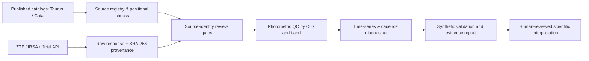

# StellarForge

**Scientific Python · Time-series analysis · Data engineering · Reproducible research**

[](https://github.com/ismaelberja/stellarforge/actions/workflows/tests.yml)
[](docs/PROJECT_STATUS.md)
[](pyproject.toml)

StellarForge is an evolving scientific-software project for **processing multi-survey astronomy data and investigating stellar variability**. It focuses on traceable data ingestion, observation-quality controls, irregular time-series analysis, and carefully qualified source associations.

**Created and scientifically directed by Ismael Berja Ruiz**, with AI-assisted software development and human review of scientific methodology.

> **Research status (v1.22, November 2026):** Working code, official ZTF *position-query responses* and reproducible Gaia/ZTF positional and independent Gaia-field screening are available. The Gaia–ZTF astrophysical identities and any physical variability events **have not been independently confirmed**. This is a software/research portfolio project, **not an announcement of an astronomical discovery**.

The **v1.19** research-software phase implements a fresh empirical PSF with whole-star train/validation splits and diagonal/correlated sky-noise diagnostic gates. It passed **686 synthetic and regression tests**; **the new method has not been applied to additional real ZTF frames** and does not establish an independently calibrated original ZTF PSF. [Full scope](docs/PHASE119_EMPIRICAL_STAR_PSF_AND_CCD_NOISE.md) · [Spanish guide](docs/PHASE119_GUIA_ES.md) · [Release notes](RELEASE_NOTES_v1.19.md).

**v1.20 (10 November 2026):** a preregistered strict CIDA 11 4-training/3-held-out Gaia field-source cohort, genuine ZTF science/mask/WCS registration gates and a **manual-only original-image pilot workflow** have been implemented. Automated verification remains **synthetic/offline**. The manual v1.20 original-data workflow has **not yet been run** and no real independent PSF calibration or new astrophysical result is claimed. [Scientific protocol](docs/PHASE120_ORIGINAL_REGISTERED_STAR_COHORT.md) · [Spanish guide](docs/PHASE120_GUIA_ES.md) · [Notes](RELEASE_NOTES_v1.20.md).

**v1.21 scientific QA:** artifact expiry/provenance checks; anti-overclaim gates for incomplete original 3+2 whole-star observational profiles; training-star leave-one-out sensitivity; synthetic known secondary-source profile falsification. **743/743 offline tests passed**, with NO new real original ZTF star holdout data. The historic original acquisition artifact expires **12 November 2026 08:47:05 UTC**. Its original ZTF real-data validation workflow remains **manual and unrun**. [Scientific audit](docs/PHASE121_FALSIFICATION_PROVENANCE_AND_RELEASE_GATES.md) · [Guía en español](docs/PHASE121_GUIA_ES.md).

**v1.22 archive & reproducibility milestone:** recovered the exact original 181,170-byte v1.2 IRSA positional acquisition ZIP privately before GitHub artifact expiry, matching the original SHA-256 in GitHub Actions metadata. The ZIP remains **outside Git**. A pinned SHA + inner-manifest validator and complete **synthetic, offline** v1.20 two-exposure pipeline success/rejected-heldout tests now pass. **752/752** automated tests passed before final docs packaging; **the real manual CIDA 11 original-image empirical PSF workflow has NOT run**. [Science method](docs/PHASE122_HISTORIC_SOURCE_RECOVERY_AND_REAL_PILOT_GATES.md) · [Guía en español](docs/PHASE122_GUIA_ES.md) · [No-raw receipt](data/research_seed/V122_ORIGINAL_IRSA_ARTIFACT_RECEIPT_NO_RAW.json).

## At a glance

| Engineering result | Verified scope |
|---|---|
| **752 automated tests passed (v1.22)** | Verified exact historic GitHub Actions original ZIP digest, synthetic ZIP manifest failure tests, and complete offline mocked original-data pipeline success/reject controls. **No new real PSF science result.** |
| **743 automated tests passed (v1.21)** | Added synthetic science-falsification, archive expiry and evidence-quality tests. **No new real ZTF stellar PSF calibration.** |
| **708 automated tests passed (v1.20 early CI)** | Expanded 4+3 fixed strict Gaia-only original CIDA 11 source-cohort and original-format FITS/WCS/mask synthetic registration and no-network runner gates. **No v1.20 live archive run yet.** |
| **686 automated tests passed (v1.19)** | New source-disjoint synthetic empirical PSF holdout, valid ZTF mask/registration gates and detector-noise estimators. **Synthetic-only: no new real-image validation.** |
| **661 automated tests passed (v1.18)** | GitHub Actions v1.18 official original 8/8 ZTF PSF-processing logs, strict/exploratory FT Tau Gaia sampling and two same-new-source original masked science-pixel PSF fits (9 November 2026) |
| **2,212 real photometric rows retrieved** | Two official IRSA cone searches around published positions for FT Tau and CIDA 11, **not yet authenticated as those stars** |
| **Six ZTF object identifiers** | Kept separate by source ID, filter and field rather than blended |
| **Two independent Gaia DR3 15″ field audits** | No *additional catalogued Gaia* sources returned near either target; unresolved companions are not excluded |
| **Real FITS pixel/WCS screening** | Five of six ZTF OID-band groups were screened in v1.5; no identity or blend clearance claimed |
| **Multi-epoch real-image evidence** | 12 individual ZTF science FITS images processed in v1.7, two distinct epochs in every OID/band group; no calibrated source identity |
| **Gaia-backed ZTF reference pilot (v1.8)** | 8 catalogue-screened Gaia reference candidates, 13 real FITS reference-image model fits; provisional local translations in 3 exposures, no full WCS calibration |
| **Formal Gaia 5D uncertainty + annual parallax (v1.9)** | All ten Gaia cross-correlations propagated at four actual observation dates for two DR3 sources; not a ZTF astrometric error budget |
| **Gaia reference-image holdout QA (v1.10)** | 13 archived real reference models, four science exposures; 3 inclusive / 2 strict holdout-eligible; no calibrated WCS |
| **Per-reference annual parallax + Gaia 5D formal covariance (v1.11)** | 8 candidate Gaia references plus two targets, 13 original image-model offsets reassessed: minor LOO RMS changes but still no independently calibrated ZTF WCS |
| **Original science FITS image remeasurement (v1.12)** | Two 20-request runs on the same epochs: initial 9 complete fits/9 HTTP 503; finalized 12 complete fits (1 target, 11 references), 9 provisionally model-consistent references, 8 HTTP 503; no calibrated instrument PSF/WCS |
| **Official ZTF bad-pixel masks and native center PSFs (v1.13)** | Two runs on the same four science dates: four reference-core source masks aligned in first run, no target mask accessible; 16/20 and 20/20 mask/source pairs HTTP 503 across runs. **All four unique 23×23 native field-center PSF stamps retrieved across the two runs**, not local star-specific PSFs. |
| **Native ZTF PSF-fit catalogue candidate cross-identification (v1.14)** | All four original full `psfcat.fits` tables read (27,207 per-exposure PSF-fit source records), 16/20 provisional Gaia-position PSF quality candidate screens; all four native spatial `sciimgdao.psf` files retrieved but **not** evaluated at source coordinates |
| **DAOPhot spatial PSF model reconstruction (v1.15)** | All 4 original ASCII GAUSSIAN + 3 × 47 × 47 spatial lookup models decoded; **4/4** reconstructions match actual native center FITS stamps (cosine ≥0.999999); **16/16** provisional ZTF native candidate positions modeled as 23 × 23 PSF shapes. **No independent star-by-star PSF calibration or physical crossmatch** |
| **Actual original masked science-pixel local PSF fits (v1.16)** | 16/16 candidate original dated science+`mskimg.fits` pairs WCS-aligned and fitted with fixed spatial DAOPhot PSF amplitude + local sky plane in DN. 13 provisional same-image checkerboard residual screens pass; 3 require review. **No independently authenticated Gaia/ZTF star IDs or calibrated WCS/PSF errors.** |
| **New Gaia-source-disjoint real stellar field controls (v1.17)** | Four new Gaia-only selected CIDA 11 field source IDs **not in the original 10 source sample**; 6/8 actual original ZTF source×epoch masked PSF fits, all six pass provisional same-source pixel residual QA. **FT Tau had 0 eligible new controls.** 0 native source hits among 32 fixed ±25″ shifted-sky probes; **not a calibrated false-match rate or independent ZTF PSF training-star holdout.** |
| **Original PSF-training log audit and FT Tau exploratory controls (v1.18)** | **8/8 official ZTF processing logs** retrieved for four real exposures, but **0 complete PSF-building source-ID rosters verified**. Strict Gaia FT Tau controls remain 0; a separately labeled **exploratory** stratum finds 4 new FT Tau Gaia IDs, of which **one distinct source** yields **two** masked science-pixel PSF fits passing same-image residual QA across two epochs. 0/32 shifted-source catalogue hits; no independent instrument calibration. |
| **532 Taurus catalog members audited** | Pinned third-party Luhman (2023) Table 2 mirror; original publisher-file comparison pending |
| **24-star technical pilot** | Real published coordinates, not a representative or disk-classified scientific population |

The official requests and SHA-256 checksums are documented in the [v1.2 observational transport audit](reports/observational_intake_v1.2/RAW_TRANSPORT_AUDIT.md). The [v1.3 provisional astrometric report](reports/astrometry_v1.3/PROVISIONAL_POSITIONS_REPORT.md) finds median epoch-corrected Gaia/ZTF position separations of 0.063–0.092 arcsec across six curves, **without confirming any astrophysical source identity**. **Raw ZTF downloads and private research artifacts are not committed to Git.**

## v1.18 — original ZTF PSF-training log provenance and exploratory FT Tau source coverage

The [verified original-data v1.18 report](reports/psf_training_ft_tau_v1.18/REAL_ZTF_LOG_AUDIT_AND_EXPLORATORY_FT_TAU.md) audits the true archived ZTF `sciimlog.txt` and `log.txt` processing files for **all four original historical science exposures** (FT Tau/CIDA 11). **All 8 original logs were retrieved and SHA-256-provenanced**, with more than 100 PSF/DAOPhot-referencing reduction lines in each of the four science-processing logs. Crucially, **none provided a validated complete original DAOPhot PSF *training-star* source-ID roster**. Fitted source `psfcat.fits` detections must never be misrepresented as PSF-building stars; Gaia control IDs are **not proven independent of native ZTF PSF training**.

A fresh FT Tau Gaia DR3 wide-cone audit still finds **0** unused stars meeting the unchanged strict v1.17 quality/isolation criteria. A **separate exploratory tier**, with explicitly wider photometric/astrometric/isolation/field-radius limits declared before looking at the current ZTF pixel data, identified **four** new Gaia-only candidate sources. **One distinct source (Gaia DR3 149623298952568064) was eligible for genuine WCS-aligned original `sciimg.fits`+`mskimg.fits` masked source-PSF pixel fits at two FT Tau original epochs**, with **both** provisional same-image pixel-residual screens passing (RMS/skyMAD **0.9203 and 0.9554**). The other six source×epoch native catalogue/profile checks were ineligible or required review; they are not physical sky nondetections. **32 fixed shifted sky probes returned zero native source matches**, not a calibrated contamination rate.

**661 automated regression tests pass.** The stricter FT Tau sample remains empty and the new exploratory source is not certified isolated, physically cross-identified with ZTF, or withheld from ZTF's own PSF training. [Exact quality tiers and scientific limitations](docs/PHASE118_PSF_TRAINING_LOGS_AND_EXPLORATORY_FTTAU.md). No companion/variability detection or absolute WCS/PSF uncertainty is claimed.

## v1.17 — new Gaia-only selected field controls disjoint from earlier source samples

The [real v1.17 observational evidence](reports/new_gaia_holdouts_v1.17/REAL_DISJOINT_GAIA_CONTROL_AND_SHIFTED_SKY_RESULTS.md) extends the original ZTF masked science-pixel PSF analysis to **new Gaia DR3 source IDs selected without viewing the ZTF fit results**. Two fresh independent Gaia wide-cone queries found 50 catalogued entries near FT Tau and 250 near CIDA 11. After excluding **all ten old target/reference Gaia IDs** and applying original quality/brightness/isolation rules, **FT Tau had zero eligible new stars**, whereas CIDA 11 had 20 eligible Gaia-only candidates before budget; four spatially distributed new Gaia sources were selected covering four sky quadrants.

On the **same two original CIDA 11 science exposure dates**, the four new Gaia candidate IDs yielded **six of eight** original `sciimg.fits`+`mskimg.fits` source-pixel PSF model fits, all six passing the provisional same-source image checkerboard residual screen. The two unfit source×date combinations failed original ZTF PSFfit catalogue eligibility. The first date has four fitted distinct new sources (descriptive median RMS/annular sky MAD ≈0.981); the second has only two and is explicitly **insufficient for a per-exposure distinct-star comparison**.

In addition, **32 fixed 25-arcsec shifted-sky positional probes** across those two dates matched **zero** native ZTF PSFcat detections within 1″. They sample local catalogue chance proximity, **not a calibrated source association probability**.

**Critical scientific independence limitation:** these four Gaia IDs are absent from StellarForge's earlier selected sources but their **membership in ZTF's original DAOPhot PSF-model training set is unknown**. The new fits therefore are *previously unseen source tests*, **not independently calibrated instrumental PSFs, absolute WCS uncertainties or verified physical Gaia–ZTF crossmatches**. **636 automated tests pass.** [Methods and rigorous science caveats](docs/PHASE117_DISJOINT_GAIA_SOURCE_HOLDOUTS_AND_SHIFTED_SKY_NULLS.md).

## v1.16 — original ZTF science pixels with independently WCS-aligned detector bitmasks

The new [real-data source audit](reports/masked_spatial_psf_v1.16/REAL_ZTF_PIXEL_RESIDUALS_EVIDENCE.md) goes beyond PSF reconstruction: it **fits the original ZTF spatial DAOPhot model to actual same-dated `sciimg.fits` science-image pixels and `mskimg.fits` bad-pixel masks**. The original source's `psfcat.fits` native full-detector `xpos/ypos` fixes the spatial model; original mask/science celestial WCS must agree within 0.05 pixel and source subpixel phase within 0.22 pixel before fitting.

All **16/16** eligible original source pairs were successfully opened with WCS-aligned masks and zero disqualifying ZTF 6141 bad/saturation bits in their 4.5-pixel nominal cores. The model **amplitude and local sky plane** were fitted in original detector Digital Numbers (DN) using one checkerboard subset of source pixels, and residuals evaluated on the other subset **of the exact same source image**. **Thirteen** candidate profiles passed the *provisional* residual/noise engineering screen; **three** (one FT Tau target, one CIDA 11 target and one CIDA 11 field reference at their original selected dates) require review due to relatively high positive residual peaks. **614 automated tests passed**.

**No detections or astrophysical source identities were confirmed.** The residual noise is an annular MAD proxy, not a calibrated CCD variance; checkerboard withheld pixels are **not independent held-out stars**. Current ZTF source positions/PSFs stem from the same native extraction pipeline, and high Gaia RUWE for CIDA 11 remains a concern. The 13/16 success fraction measures software-screen outcomes **within the preselected candidate sample only**, not a physical stellar population, completeness or binary rate. [Detailed methods and rigorous scientific limits](docs/PHASE116_ORIGINAL_MASKED_PSF_PIXEL_RESIDUALS.md).

## v1.15 — genuine original ZTF spatial DAOPhot source-position PSF reconstruction

For all **four original dated ZTF science exposures**, v1.15 now actually **parses/evaluates the original `sciimgdao.psf` spatially varying DAOPhot lookup files**, rather than merely downloading them. All four original files contain a `GAUSSIAN` analytic component plus **three 47×47 half-image-pixel-sampled spatial correction arrays**, supporting an approximate, position-dependent **23×23 model PSF** at the full CCD-quadrant `xpos/ypos` coordinates from the original native PSF-fit catalogues.

[Direct original-data results](reports/spatial_daophot_v1.15/REAL_DAOPHOT_CENTER_AND_LOCAL_SHAPES.md): **all four** numerical reconstructions at the actual native detector center agree with their separately retrieved **official `sciimgdaopsfcent.fits` field-center PSF FITS** stamps (cosine **0.999999–1.000000**, normalized L1 **0.000278–0.000984**), and the model evaluates at **all sixteen** prescreened candidate source detector positions. **590 automated tests pass**.

**Scope of verification matters:** the original native field-center image and the spatial DAOPhot lookup come from the **same ZTF pipeline**, so matching them validates our **file interpretation and approximate model reconstruction**, *not* the PSF against held-out real observed stars. The cubic interpolation is a controlled approximation, not a bitwise-exact reproduction of native DAOPhot. Individual source positions still need original science and bitmask pixel residual checks, independently authenticated Gaia–ZTF identities, and detector WCS/PSF uncertainty validation. [Methods, format details and scientific limits](docs/PHASE115_DAOPHOT_SPATIAL_MODEL_VALIDATION.md).

## v1.14 — original native ZTF PSF-fit catalogues and Gaia candidate source screens

The v1.14 pilot successfully retrieved and inspected **all four official full original `psfcat.fits` PSF-fit catalogue FITS tables** associated with our four historic dated ZTF science exposures, totaling **27,207 original PSF-fit extraction rows**. It checks the **native per-exposure source counter, sky and native CCD coordinates, PSF-fit `chi`, `sharp`, SNR, and original mask-derived catalogue flags** against **20 Gaia target/reference position predictions** propagated to each original epoch using Gaia 5D formal astrometry and geometric annual parallax.

The [actual observed-data evidence](reports/native_psfcat_v1.14/REAL_ZTF_GAIA_PSF_CATALOGUE_EVIDENCE.md) identifies **16/20 provisional, uniquely assigned nearby ZTF PSF catalogue detections** that pass conservative positional/profile/quality screens (13 reference-position checks and 3 target-position checks). Three model profiles require review under the selected `chi` lower-bound criterion and one technical reference has no catalogued PSF-fit detection near its predicted position. The 16 nominal candidate offsets range **0.032641–0.345256 arcsec**, median **0.1258465 arcsec**, **not a ZTF instrumental astrometric accuracy estimate or a verified physical Gaia–ZTF association**.

All **four original `sciimgdao.psf` spatially varying DAOPhot files** were downloaded and SHA-provenanced, but **were not decoded or evaluated** as local PSFs at the target/reference native detector `xpos/ypos`. The project still needs actual source-local PSF and instrument WCS calibration, reliable independent Gaia–ZTF physical identification, and a realistic error budget. **564 automated tests pass.** [Official native catalogue methods and scientific limits](docs/PHASE114_NATIVE_PSF_CATALOGUE_AND_SPATIAL_MODEL_GATE.md).

## v1.13 — official ZTF detector masks and native field-center PSF products

The real-data workflow now reads original NASA/IPAC ZTF **`mskimg.fits` detector bad-pixel masks** paired with the **same dated `sciimg.fits` cutout**, requiring identical pixel shapes and **independently checked celestial WCS grid registration** before interpreting pixel flags. The official disqualifying bit template is **6141**; extracted-source markers (bits 1 and 11) are not detector-defect flags. It also parses original **`sciimgdaopsfcent.fits` field-center PSF stamps** (not local star-specific PSFs), without placing raw FITS arrays in the public repository.

The [two official observed-data pilots](reports/original_masks_psf_v1.13/REAL_ZTF_MASK_AND_NATIVE_CENTER_PSF_EVIDENCE.md) each attempted the **same 20 preregistered technical target/reference centers** on four original science frames; they do **not** constitute independent astronomical observations. **Four reference candidate cores** had both accessible, WCS-aligned original science+mask cutouts with **zero documented disqualifying core bits or saturated pixels**; **16 other source-pair requests returned HTTP 503**. **No target-star mask was successfully retrieved**. Two real **23×23** native field-center PSF stamps were parsed in the first run. **A second bounded run recovered the other two original field-center PSF files**, so all four unique official field-center stamps are available across the two runs. However, the repeat had **20/20 mask/science HTTP 503** versus 16/20 initially; the four first-run masked reference cores have not been independently repeated. Both runs passed **533 automated tests**.

These are real **instrument-product quality screens**, not evidence that the underlying source is isolated, a local PSF/photometric calibration is complete, or Gaia–ZTF source identity and WCS precision have been independently established. [Full scientific caveats and official ZTF bit definitions](docs/PHASE113_OFFICIAL_ZTF_MASK_AND_NATIVE_CENTER_PSF.md).

## v1.12 — original ZTF science FITS pixel-level centroid model sensitivity

The new v1.12 workflow returns to **original dated `sciimg.fits` pixels** and computes two genuinely different centroid algorithms on the **same** FITS image: the previous constrained elliptical Gaussian, plus a new independent-code **sigma-clipped sky-plane / positive-flux aperture centroid** with moment-shape, signal, time-header and explicit saturation-mask limitations. Predicted target/reference locations use each source's formal Gaia 5D model and its annual geometric parallax, but **source identities are still unconfirmed**.

The [real ZTF image audit](reports/real_fits_v1.12/REAL_TWO_CENTROID_MODEL_QA.md) contains **two successful 20-request runs on exactly the same historical exposures**, so they are **not 40 independent astronomical observations**. In the final-code run, eight cutouts returned **HTTP 503**, while **12 images produced both centroid models** (one target and 11 Gaia reference candidates); **nine reference candidates** passed provisional internal model agreement. The median separation of estimators in those 12 images was **0.104720″**, **model sensitivity, not absolute astrometric accuracy**. In a CIDA 11 frame with four provisional candidate references, internal held-out disagreement was **0.064675″ (Gaussian) versus 0.155762″ (aperture)**; **the target cutout was inaccessible** in this final run. The initial run produced different access counts (nine complete fits, nine HTTP 503, two inconclusive pixel screens), and the four overlapping successfully downloaded FITS files had matching byte SHA-256. Only **one of four exposure groups** had three or more cross-model references in either run.

**506 automated tests passed**. This milestone demonstrates that making a scientifically defendable statement about detector WCS/PSF and physical variability requires **official ZTF bad-pixel masks and instrument PSF products, plus genuine held-out field-star calibration**, not merely a small Gaussian centroid residual.

[Methods and explicit scientific limits](docs/PHASE112_PIXEL_CENTROID_AND_WCS_LIMITS.md). No raw original FITS pixels or ZTF light curves are in the public Git history.

## v1.11 — reference-star-specific Gaia annual parallax and formal covariance

Rather than applying Gaia corrections only to FT Tau and CIDA 11, v1.11 **queries all eight Gaia DR3 candidate reference stars plus the two target Gaia sources** and applies each star's **own epoch-dependent geometric annual parallax** to the original derived real ZTF image-model residuals. Its Gaia five-parameter formal source uncertainty includes **all ten catalogue correlations**; the original image pixels are not refitted and the source identities remain unverified.

The result is scientifically informative: the reference holdout RMS changes from **0.075782″ to 0.075770″ (FT Tau)** and **0.093046″ to 0.092971″ (CIDA 11)**, after respective changes of merely **0.012 and 0.075 mas**. These shifts are **much smaller than** the internal ~76–93 mas reference disagreement, and the same **two of four exposures** satisfy strict reference model quality. This is **not** a validated ZTF WCS accuracy, PSF error or discovery. **484 automated tests pass**.

[Official Gaia DR3 source-by-source results](reports/reference_parallax_v1.11/REAL_GAIA_REFERENCE_PARALLAX_LOO.md) · [Methods and limitations](docs/PHASE111_GAIA_REFERENCE_PARALLAX_AND_FORMAL_COVARIANCE.md).

## v1.10 — held-out Gaia candidate reference consistency

The v1.10 audit **reuses 13 genuine derived Gaia-reference image model fits from four original ZTF science exposures**, now preserved in a small SHA-provenance-checked public dataset so that short-lived GitHub artifacts cannot break reproducibility. Without re-downloading FITS images, **leave-one-reference-out** median-shift diagnostics test how much the nominal image offset changes when a reference is withheld, with explicit **strict vs inclusive PSF-model review gates**.

**Three of four exposures** have three or more inclusive fitted references; **only two** still have enough references after excluding flagged Gaussian image models. One later CIDA 11 frame drops from five references to two and **cannot** support the stricter check. The holdout disagreement is roughly **0.076 arcsec for FT Tau** and **0.093 arcsec for one CIDA 11 frame**, but these values are **not independently calibrated ZTF WCS/PSF uncertainty**, and no Gaia–ZTF identity or physical motion is confirmed.

[Actual v1.10 holdout findings](reports/holdout_v1.10/REAL_REFERENCE_HOLDOUT_EVIDENCE.md) · [Methods and limitations](docs/PHASE110_REFERENCE_HOLDOUT_QA.md) · **468 passing tests**.

## v1.9 — Gaia five-parameter covariance and annual parallax

The independent public Gaia DR3 source query now retrieves **all five astrometric parameters, their formal uncertainties and all ten pairwise correlations** for the FT Tau and CIDA 11 pilot. A bounded Astropy calculation adds **epoch-dependent geometric annual parallax** to the existing proper-motion model, propagates the **full 5×5 Gaia formal covariance** and explicitly flags the limitations of the high-RUWE CIDA 11 astrometric fit.

For four real ZTF exposure MJDs, the annual east correction ranges from **+6.79 to −4.78 mas for FT Tau** and **−1.36 to −2.25 mas for CIDA 11**; these are corrections to the **Gaia-predicted catalogue position**, not measured ZTF motions. Gaia-only formal east sigmas are ~0.07 mas for FT Tau and ~0.44–0.58 mas for CIDA 11. **Instrumental WCS/PSF and source identity have not been validated**, and the CIDA 11 covariance may substantially underestimate its real astrometric uncertainty.

[Full real v1.9 scientific evidence](reports/gaia_formal_v1.9/GAIA_COVARIANCE_AND_ANNUAL_PARALLAX.md) | [Explicit mathematical assumptions](docs/PHASE19_GAIA_FORMAL_5P_AND_PARALLAX.md) | **444 passing automated tests**.

## v1.8 — Gaia DR3 reference candidates and genuine ZTF FITS image checks

Rather than treating unclassified image brightness peaks as PSF standards, the v1.8 pilot uses **independent Gaia DR3 quality-screened candidate references**. Wider Gaia TAP cones around FT Tau and CIDA 11 returned 50 and 250 catalogue entries, of which **3 and 5 candidates** met conservative brightness, RUWE, astrometric and isolation requirements. For a limited one-g-band-per-target pilot, the program retrieved **four target FITS science frames** and attempted 16 **same-exposure, differently centered** Gaia candidate cutouts, successfully modeling 13 reference images.

Three target exposures had at least three usable independent candidate references, permitting **preliminary local east/north offset translations** (not independently calibrated full WCS). A fourth had only one suitable reference and is explicitly inconclusive. We now have **422 passing tests**; original raw FITS pixels and third-party catalogue CSVs remain outside Git. CIDA 11's high Gaia RUWE and full Gaia parallax/covariance are still unresolved.

[Read the real v1.8 candidate-reference and offset evidence](reports/gaia_reference_v1.8/REAL_REFERENCE_CANDIDATE_EVIDENCE.md) and [methods/scientific safeguards](docs/PHASE18_GAIA_REFERENCE_STAR_CANDIDATES.md). **Gaia candidates do not establish clean stellar PSFs, confirmed source identity or physical variability.**

## v1.7 — repeated science exposures and same-image shape controls

The [v1.7 real ZTF FITS audit](reports/field_controls_v1.7/REAL_MULTIEPOCH_AND_CONTROL_LIMITS.md) has now **processed 12 individual science frames** from six distinct ZTF OID/filter groups — **two independent FITS SHA-256s for each group**, including two g-band and two r-band CIDA 11 science images. This moves beyond the unavailable repeatability of v1.6. Observed *WCS-referenced Gaussian proxy centroid-residual differences* across each two-frame pair are **0.024–0.097 arcsec**, but **these are not independent astrometric accuracies, validated source matches, physical motions or discoveries**.

An initial 90-arcsec **same-image radial profile control** survey found **no images with at least two usable comparison brightness peaks**. Such peaks would themselves need catalog authentication before they could become stellar PSF standards; the current field does **not** support empirical PSF calibration or a claim of absent blending. The new implementation includes bounded requests, independent science-epoch deduplication, source-hash checks and **400 automated passing tests**. All raw FITS/CSV bytes are excluded from the public repository.

## v1.6 — quantitative image-profile proxies and repeatability gates

StellarForge now attempts a bounded robust fit of **one elliptical 2D Gaussian plus a tilted local background** to actual ZTF science cutouts. It reports provisional image-profile widths, signed centroid offsets and model residuals. A separate module checks whether **two or more distinct science frames** of the same ZTF OID and filter can be compared without mixing reference-image coadds.

- **Three FT Tau science images were successfully fitted** in the live v1.6 audit; all showed sizable positive residuals under the deliberately simple Gaussian model and are marked **review required**, not as new companions or astrophysical detections.
- **No CIDA 11 science frame was fitted** during the v1.6 acquisition because of intermittent archive access, and **zero OID/filter groups** had two independent usable science images. Multi-epoch repeatability therefore remains unmeasured.
- **387 automated tests passed**, including fully synthetic fit, WCS, residual and independent-exposure safeguards.
- Raw ZTF FITS pixels remain **in memory only**; the public GitHub repository publishes aggregate diagnostics, not original image or photometric records.

[Read the v1.6 quantitative shape audit](reports/psf_v1.6/REAL_GAUSSIAN_FIT_REVIEW.md) and [its methods and limitations](docs/PHASE16_PSF_PROXY_AND_REPEATED_SCIENCE_EXPOSURES.md). **A Gaussian model is not a calibrated ZTF PSF and its residuals are not evidence of a binary.**

## v1.5 — real FITS pixels and WCS screening

StellarForge now opens small **real ZTF FITS image cutouts** in memory (rather than inspecting only their transport headers), validates celestial WCS and checks local intensity maxima near the **provisional** Gaia-predicted target coordinates.

- **5/6 OID/filter groups successfully image-screened**: four for FT Tau and one for CIDA 11 (three actual science exposures and two reference-image coadds).
- Five local maxima within **0.50 arcsec** of the predicted coordinate, with **no additional maxima above the specific threshold** within 12 arcsec. This is *not a PSF fit* and does **not** prove that the sources are uncontaminated or physically matched.
- The CIDA 11 g cutout could not be downloaded (HTTP 503). Missing archive access is not a ZTF non-detection.
- **373 tests passed**, with synthetic FITS and WCS corner-case coverage. Original raw FITS pixels remain outside the public Git history.

[Read the full v1.5 real-image evidence and limitations](reports/real_fits_v1.5/PIXEL_WCS_RESULTS.md). The next stage must independently assess PSF shape, deblending, Gaia astrometric uncertainty and imaging alternatives.

## v1.4 — independent Gaia field and ZTF image checks

The independent public Gaia DR3 TAP cone searches for **FT Tau** and **CIDA 11** each returned only the intended Gaia source within 15 arcsec. This does **not** certify an uncontaminated field: unresolved binaries, faint or red sources, nebulosity and blends can escape the catalog search. CIDA 11 has an unusually high **Gaia RUWE = 8.57**, so its astrometry requires special attention.

StellarForge now builds **official ZTF science and reference FITS cutout links from the actual historical exposure metadata** and checks FITS transport without publishing image pixels. The IRSA service intermittently returned HTTP 503; only FITS *headers* were inspected, not images or PSFs.

- [v1.4 independent Gaia and FITS access results](reports/field_review_v1.4/GAIA_NEIGHBOURS_AND_IRSA_IMAGES.md)
- [v1.4 methods and limits](docs/PHASE14_INDEPENDENT_GAIA_AND_ZTF_IMAGE_QA.md)
- [Observed live Gaia/IRSA field audit](https://github.com/ismaelberja/stellarforge/actions/runs/42004372822)

**All source identity, contamination and physical-event claims remain unverified.**

## What the software does

- **Survey-aware data acquisition:** build and validate Gaia DR3 and IRSA/ZTF requests; record query provenance, hashes, response errors and evidence-gate status.
- **Photometric quality control:** retain photometric errors, instrumental flags, original time conventions, passbands and distinct ZTF `oid` identifiers.
- **Time-series analysis:** uncertainty-aware summary statistics, provisional Lomb–Scargle searches, window/alias diagnostics and exact cadence-coverage calculations.
- **Candidate screening and falsification:** heuristic excursions, chromatic diagnostics, source-identity cautions and simulated instrumental-control tests.
- **Reproducible engineering:** Python package, command-line interface, unit/integration tests, GitHub Actions and versioned scientific limitations.

### Processing architecture



**Important:** The pipeline does not automatically certify Gaia–ZTF associations, disk classes, or physical dipper/burster events.

## Run it locally

Requirements: **Python 3.10+** and Git.

```bash
git clone https://github.com/ismaelberja/stellarforge.git
cd stellarforge
python -m pip install -e '.[test,analysis]'
python -m pytest -q

# Offline examples — no external archive access required
stellarforge plan-ztf --ra 65 --dec 25 --radius-arcsec 2 --bands g r
python scripts/run_v11_selection_bias.py
```

The planning coordinates are an **engineering example**, not an authenticated science target. Generated plots and analysis outputs may be written to local ignored folders. Live data access is optional; respect archive usage policies.

To reproduce the **v1.2 observational intake** privately:

```bash
python scripts/ci_observational_pilot.py reports/generated/local_irsa_pilot --fail-if-empty
```

This performs two pre-registered requests to the official IRSA endpoint, saves raw responses **locally in ignored directories**, and marks all source identities as unverified. Do not upload raw files until reuse permissions, provenance and associations have been checked.

## Scientific integrity and limitations

- Taurus membership is based on **Luhman (2023)**, *AJ*, 165, 37 ([DOI](https://doi.org/10.3847/1538-3881/ac9da3)). The working table is a pinned **third-party mirror**, not yet independently matched against the publisher's file.
- Official ZTF observations were downloaded via positional searches, but **search results are not confirmed counterparts**. FT Tau yields multiple ZTF IDs per band/field, requiring image-level blending assessment.
- Benchmarks labeled **SYNTHETIC** are engineering exercises, not measured real-survey sensitivity, accuracy or false-positive rates.
- No astrophysical event rate, disk-class frequency or new source discovery is claimed. Relevant remaining checks include image review, full astrometric uncertainties, independent labels and injection/recovery with actual observing cadences.
- Human scientific interpretation and responsible survey citation are required before any paper or astrophysical classification.

## Project documentation

- [Current status and next milestones](docs/PROJECT_STATUS.md)
- [v1.18 original ZTF processing logs and exploratory FT Tau source results](reports/psf_training_ft_tau_v1.18/REAL_ZTF_LOG_AUDIT_AND_EXPLORATORY_FT_TAU.md)
- [v1.17 new Gaia-disjoint source holdout and shifted-sky real ZTF results](reports/new_gaia_holdouts_v1.17/REAL_DISJOINT_GAIA_CONTROL_AND_SHIFTED_SKY_RESULTS.md)
- [v1.16 actual ZTF original source masked PSF pixels and real residual quality results](reports/masked_spatial_psf_v1.16/REAL_ZTF_PIXEL_RESIDUALS_EVIDENCE.md)
- [v1.15 original ZTF spatial DAOPhot PSF models and real official center checks](reports/spatial_daophot_v1.15/REAL_DAOPHOT_CENTER_AND_LOCAL_SHAPES.md)
- [v1.14 original ZTF native PSF catalogue and Gaia candidate evidence](reports/native_psfcat_v1.14/REAL_ZTF_GAIA_PSF_CATALOGUE_EVIDENCE.md)
- [v1.13 real original ZTF detector mask and native PSF evidence](reports/original_masks_psf_v1.13/REAL_ZTF_MASK_AND_NATIVE_CENTER_PSF_EVIDENCE.md)
- [v1.12 original science FITS Gaussian-vs-aperture real image quality audit](reports/real_fits_v1.12/REAL_TWO_CENTROID_MODEL_QA.md)
- [v1.11 real Gaia reference parallax and formal covariance sensitivity](reports/reference_parallax_v1.11/REAL_GAIA_REFERENCE_PARALLAX_LOO.md)
- [v1.10 real reference-star holdout evidence](reports/holdout_v1.10/REAL_REFERENCE_HOLDOUT_EVIDENCE.md)
- [v1.9 official Gaia five-parameter covariance and annual parallax](reports/gaia_formal_v1.9/GAIA_COVARIANCE_AND_ANNUAL_PARALLAX.md)
- [v1.8 Gaia DR3 reference-candidate and ZTF same-exposure audit](reports/gaia_reference_v1.8/REAL_REFERENCE_CANDIDATE_EVIDENCE.md)
- [v1.7 real-image science-epoch and same-field control evidence](reports/field_controls_v1.7/REAL_MULTIEPOCH_AND_CONTROL_LIMITS.md)
- [v1.6 real Gaussian profile and repeatability audit](reports/psf_v1.6/REAL_GAUSSIAN_FIT_REVIEW.md)
- [v1.5 real FITS pixel and WCS audit](reports/real_fits_v1.5/PIXEL_WCS_RESULTS.md)
- [v1.4 Gaia-neighbour and ZTF image-access audit](reports/field_review_v1.4/GAIA_NEIGHBOURS_AND_IRSA_IMAGES.md)
- [v1.3 per-epoch provisional astrometric report](reports/astrometry_v1.3/PROVISIONAL_POSITIONS_REPORT.md)
- [v1.2 IRSA data transport audit](reports/observational_intake_v1.2/RAW_TRANSPORT_AUDIT.md)
- [Data sources, citations and limitations](docs/DATA_SOURCES.md)
- [Validation plan](docs/VALIDATION.md)
- [Spanish getting-started guide](EMPEZAR_AQUI.md)
- [Engineering and scientific history](RESEARCH_HISTORY.md)
- [v1.18 release notes](RELEASE_NOTES_v1.18.md)
- [v1.17 release notes](RELEASE_NOTES_v1.17.md)
- [v1.16 release notes](RELEASE_NOTES_v1.16.md)
- [v1.15 release notes](RELEASE_NOTES_v1.15.md)
- [v1.14 release notes](RELEASE_NOTES_v1.14.md)
- [v1.13 release notes](RELEASE_NOTES_v1.13.md)
- [v1.12 release notes](RELEASE_NOTES_v1.12.md)
- [v1.11 release notes](RELEASE_NOTES_v1.11.md)
- [v1.10 release notes](RELEASE_NOTES_v1.10.md)
- [v1.9 release notes](RELEASE_NOTES_v1.9.md)
- [v1.8 release notes](RELEASE_NOTES_v1.8.md)
- [v1.7 release notes](RELEASE_NOTES_v1.7.md)
- [v1.6 release notes](RELEASE_NOTES_v1.6.md)
- [v1.4 release notes](RELEASE_NOTES_v1.4.md)
- [Contribution guidelines](CONTRIBUTING.md)

## Roadmap

1. **Next — independently rebuilt training-star-limited PSF and realistic CCD/WCS error:** v1.18 read all eight publicly archived ZTF processing logs but still **cannot certify source-level DAOPhot model training membership**. The strict FT Tau control sample remains empty; a separate exploratory stratum yields only one new distinct Gaia source fitted on two dates. Seek explicit original PSF-training star rosters or **build a new, externally controlled reference-star PSF** with true distinct-source holdout, multi-epoch/multi-band CCD noise and independent Gaia–ZTF source validation before asserting WCS/PSF precision or astrophysical anomalies.
2. **Observational validation:** real-cadence injection/recovery, field-star controls, uncertainty budgets and documented false positives.
3. **Scientific reporting:** independently reviewed candidate dossiers, reproducible figures and optional interactive tools.

To reproduce the v1.3 provisional screen, run `python scripts/run_v13_astrometric_review.py /path/to/IRSA_artifact.zip`. It emits summary files into an ignored directory and never adds individual ZTF measurements to Git.

The repository will continue to improve through incremental versions, tests and reviewed pull requests.

**Code reuse:** Public visibility is for transparent portfolio review. No reuse license has been selected yet; permissions are not granted automatically by publication. Original survey/catalog data remain subject to their respective citation and usage policies.
