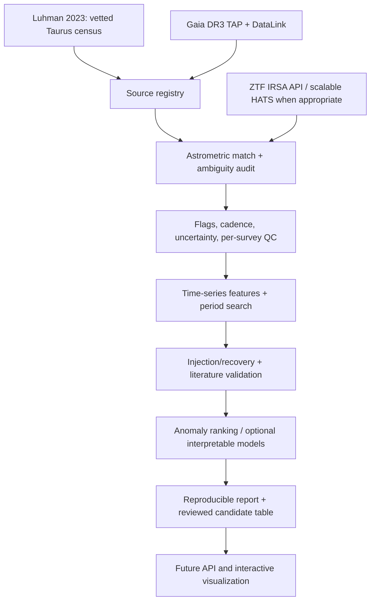

# StellarForge

**Multi-Survey Stellar Variability & Anomaly Detection Platform**  
*An open, reproducible research-software project at the intersection of astrophysics, data engineering and machine learning.*

**Status: ACTIVE RESEARCH v1.1** — Literature-based Taurus coordinates and preliminary per-epoch Gaia/ZTF source-association screening are implemented. Two official ZTF requests for FT Tau and CIDA 11 were attempted in this environment and both failed due to networking (`URLError`); **no official ZTF light curve for Taurus has been acquired or authenticated**. All object-identification and disk-interpretation gates remain open. This is an **internal, not-yet-published** research project.

**Research and scientific direction:** Ismael Berja Ruiz.  
**Development approach:** iterative work with AI coding assistance, explicit review of methods and results. The researcher must validate scientific interpretations and any eventual publication.

## Current milestone — v1.1: quantitative selection bias and cohort design

**325 local tests passed.** The Luhman (2023) Taurus Table 2 mirror has 532 adopted members, of which 467 carry Gaia DR3 source IDs. Among the remaining 65 without Gaia identifiers, 64 also lack an assigned named kinematic group. This is an important completeness warning: using only group-assigned Gaia entries systematically excludes a subset of the Taurus census.

The 24-star prototype is *technical*, not a representative sampling of young-star or disk-bearing populations. The new study explains the 12≤G≤17 restriction, the 289 Gaia-and-group-eligible records, and the deliberately group-balanced pilot. It does **not** infer Class II / Class III labels or any astrophysical event rates. The input is a pinned third-party mirror whose bytes still require comparison with the publisher's original.

- [Selection-bias research report](reports/selection_bias_v1.1/REPORT.md)
- [Machine-readable audit](reports/selection_bias_v1.1/MIRROR_SELECTION_AUDIT.json)
- [Group-size comparison](reports/selection_bias_v1.1/TAURUS_GROUP_SELECTION_REAL_CATALOG.png)
- [Gaia identification coverage](reports/selection_bias_v1.1/TAURUS_GAIA_ID_AVAILABILITY_REAL_CATALOG.png)
- [Research methods and limitations](docs/PHASE11_SELECTION_FUNCTION_AND_GAIA_BIAS.md)

Reproduce offline:

```bash
python -m pip install -e '.[test,analysis]'
python -m pytest -q
python scripts/run_v11_selection_bias.py
```

**Science maturity:** pilot selection audit implemented; FT Tau / CIDA 11 official ZTF light curves and definitive source associations not yet verified. The current public ZTF release is DR24 (Jan 2026), but no query outcome from it is claimed here.

## Previous milestone — v1.0: operational private IRSA pilot and multi-band diagnostics

The v1.0 working package adds (i) a **manual-only GitHub Actions workflow** that can attempt the two pre-registered official ZTF queries for FT Tau and CIDA 11 on a network-enabled runner and privately archive raw response bytes, (ii) a fail-closed observational intake and evidence triage report, and (iii) strictly one-to-one, time-gated **g−r color diagnostics** with propagated uncertainties. Raw source tables never enter Git history, and no astronomical detection is claimed from a cone-search response.

**Verification note:** the original environment could not reach the IRSA API. **A live official-source pilot and review of its outcome remain the next scientific gates.** Until then, zero authentic Taurus ZTF light curves and zero astrophysical candidates are confirmed.

```bash
python -m pip install -e '.[test,analysis]'
python -m pytest -q
python scripts/run_v10_pilot.py               # offline, no HTTP
python scripts/run_v10_pilot.py --execute     # only with network; 2 requests
```

**Historical verification:** 320 tests passed for v1.0. The complete v1.1 package has 325 passing local tests; GitHub import status must be verified independently.

[Detailed phase 10 protocol](docs/PHASE10_REAL_DATA_OPERATIONS_AND_CHROMATICITY.md) · [Release notes](RELEASE_NOTES_v1.0.md)

## Prior milestone — v0.9: per-epoch source identity and evidentiary dossiers

**303 automated tests passed in the v0.9 release.** The new `src/stellarforge/epoch_evidence.py` evaluates individual ZTF photometric positions against Gaia coordinates propagated from J2016.0 to each actual observation's MJD. Multiple `oid` entries, bands, missing measurements, and positional ambiguity are assessed without ever declaring an independent astrophysical cross-match.

The source-evidence engine (`src/stellarforge/observational_dossier.py`) builds standalone **FT Tau and CIDA 11 dossiers** and an offline [research evidence dashboard](reports/observational_gates_v0.9/STELLARFORGE_V09_EVIDENCE_DASHBOARD.html). It differentiates missing network data from missing astronomical coverage, refuses false source authentication via locally editable SHA256 manifests, and explicitly records remaining science review gates. The [per-epoch catalogue prediction](reports/observational_gates_v0.9/TAURUS_TWO_STARS_CATALOG_PROPAGATION.png) is based on **real published proper motions**, **not ZTF observations**.

**Actual acquisition outcome:** the two calls to the official IRSA ZTF API were attempted but both failed with `URLError`; [machine-readable report](reports/observational_gates_v0.9/RUN_SUMMARY.json). **Zero verified Taurus ZTF curves and zero new astronomical detections.** This is a documented infrastructure blocker, not evidence of a non-variable star.

[Phase 9 methods and limitations](docs/PHASE9_PER_EPOCH_ASTROMETRY_AND_EVIDENCE_GATES.md) · [Release notes](RELEASE_NOTES_v0.9.md).

```bash
python -m pip install -e '.[analysis,test]'
python -m pytest -q                         # 303 passing tests
python scripts/run_v09_pipeline.py        # offline evidence dossiers, no network
python scripts/plot_v09_catalog_motion.py # catalog-derived sky motion, not ZTF
# Only when network access exists, with exactly two real queries:
python scripts/run_v09_pipeline.py --execute
```


## Prior milestone — v0.8: observed-format integration and exact cadence geometry

**Research status:** 24 genuine *catalogue positions*, **zero confirmed Taurus ZTF counterparts or light curves**, and **239 passing automated tests**. The project is still internal. No scientific discoveries, disk-class labels or ML model trained on real Taurus photometry have been claimed.

- **Fixed a serious real-survey compatibility issue:** ZTF photometry can include **both** `mjd` and `hjd` on the same record. The reader now checks consistency (including the 2,400,000.5-day reference offset), keeps an explicit priority of MJD > HMJD > HJD, and *does not secretly convert time scales*. Read [Phase 8 report](docs/PHASE8_OBSERVATIONAL_EVIDENCE_AND_CADENCE.md).
- **Offline observational-format check:** processed eight photometric records published in a third-party [ZTF-style CSV example](https://github.com/gvard/lcurvemaker/blob/6e4228493d88985da0cfe1a75415988796879a4c/data/raw/rybka2-zi1.csv). Six pass bit-mask QC and two are rejected (`catflags=32768`). This *secondary* copy has not been independently byte-verified against IRSA; it is **not Taurus**, **not a reliable event sample**, and its raw bytes are not redistributed. [Auditable report](reports/observational_format_v0.8/REPORT.md) · [chart](reports/observational_format_v0.8/OBSERVATIONAL_SAMPLE_NOT_TAURUS.png).
- **Exact cadence-window calculation:** given observation dates and a hypothetical event duration, the code calculates the exact fraction of possible start times that contain at least two sampled epochs. This is **geometrical coverage**, not the physical event probability or photometric detectability. Validated analytically and against independent numerical quadrature.
- **24-source observational readiness ledger:** deterministic provisional J2021.0 query positions, hashes and science gates for all 24 genuine catalog-coordinate seeds. **FT Tau and CIDA 11** remain the pre-registered two-target pilot, but their IRSA queries have **not been executed successfully**. [Readiness matrix](reports/readiness_v0.8/README.md).
- **Quality gates:** observations without a sidecar and matching SHA256 may not claim direct IRSA provenance; external secondary data cannot be relabeled as a science target. Every inferred source association remains explicitly unverified.

```bash
python -m pip install -e '.[analysis,test]'
python -m pytest -q                      # 239 passing tests
python scripts/build_v08_readiness.py   # 24-source status ledger; offline
# Once a genuine CSV has been downloaded and its SHA256 recorded:
python scripts/run_v08_observational_audit.py --input /path/to/response.csv \
  --output reports/generated/real_QC --origin direct_irsa \
  --source-url 'https://irsa.ipac.caltech.edu/cgi-bin/ZTF/nph_light_curves?...' \
  --expected-sha256 YOUR_VERIFIED_SHA256
```


## Latest milestone — v0.6: epoch-aware source review and instrumental falsification

**The project has now moved from detecting excursions to attempting to falsify them.**

- **Real source-catalog result:** calculated illustrative positions at J2021.0 for 24 published Taurus targets, using their listed Gaia-referenced J2016.0 positions and proper motions. Their apparent displacement has a **median of 0.113 arcsec**, **maximum of 0.145 arcsec**; 17/24 exceed 0.1 arcsec. These are literature-data calculations, **not observed ZTF crossmatches**. [Plot](reports/v0.6_catalog_astrometry/TAURUS_24_PROPER_MOTIONS_REAL_CATALOG.png) · [Audit](reports/v0.6_catalog_astrometry/ASTROMETRIC_ENGINEERING_AUDIT.json).
- **Matching:** a spherical tangent-vector epoch propagator, per-OID/photometric-band angular separation, crowded-field/ambiguous OID checks, and an explicit **unverified association** status. Full astrometric covariance, parallax, the true ZTF observation epoch and image/scene review are outstanding.
- **Event falsification:** a conservative multi-band review procedure tests whether a candidate is seen in independent filters and whether **three or more independently vetted nearby control stars** show a matching systematic shift. Missing or conflicting controls cause a hold, not a promotion.
- **Adversarial test:** **400 synthetic trials** over eight scenarios. All 50/50 injected coherent same-field calibration artifacts triggered the initial heuristic, but **0/50 were promoted for physical review** after the new control veto. All 50/50 strong artificial two-band fades and brightenings were promoted *in the idealized noise model*. These are **not real-survey precision, purity, completeness or measured false-positive rates**.
- **Software verification:** **170 automated unit/integration tests pass**. [Technical report](docs/PHASE6_ASTROMETRY_AND_FALSIFICATION.md) · [Synthetic challenge](reports/validation_v0.6/SYNTHETIC_V06_STRESS_TEST.json) · [Latest release notes](RELEASE_NOTES_v0.6.md).

```bash
python -m pip install -e '.[analysis,test]'
python -m pytest -q
python scripts/build_v06_astrometry_audit.py
python scripts/run_v06_systematics_validation.py
# To analyze an actual IRSA response already retrieved (not included):
python scripts/review_ztf_raw_v06.py --gaia-id 164800235906366976 \
  --ztf-file data/raw/<real_IRSA_response>.csv --out reports/generated/irsa_review.json
```

### Real catalogue proper motions (not ZTF light curves)


### Synthetic veto challenge (not stellar discoveries)


## Phase 4 milestone (v0.4): real member coordinates, not real light curves

We located a [pinned public mirror of Luhman (2023) Table 2](https://github.com/themariavincent/get_targets/blob/7b6a5c83eca81fc66e50cb4889ee35cb28861367/taurus_sources.txt), read its 532 fixed-width adopted-member rows, and verified 467 unique Gaia DR3 source IDs. This mirrors the published membership counts, but **the third-party copy has not yet been byte-compared to the original publisher table**. Missing Gaia IDs are explicitly preserved among the 65 remaining adopted members.

A reproducibly chosen **24-star technical seed spanning 13 kinematic groups** now contains genuine catalog positions and source identifiers: [source data](data/research_seed/TAURUS_24_PROVISIONAL_GAIA_POSITIONS.csv) · [real-coordinate sky plot](reports/TAURUS_24_PRELIMINARY_SKY_POSITIONS.png) · [24 IRSA URL plans, not fetched](reports/TAURUS_24_ZTF_QUERY_PLAN.csv). It is deliberately **not the scientific 12-Class-II / 12-Class-III pilot**, which still requires independent disk labels and scientific approval.

The new optional-science module `src/stellarforge/variability.py` extracts uncertainty-aware descriptive features and provisional, weighted floating-mean Lomb–Scargle periods while auditing window-function aliases. It **never automatically assigns dipping/bursting or physical period labels**. With *synthetic* injected 5.271-day periodic signals, the numerical benchmark recovered 24/24 high-signal trials, 24/24 seasonal-gap trials, and **15/24** low-signal sparse trials. These are **software tests only, not sensitivity on real ZTF photometry**. All synthetic example plots are watermarked accordingly.

**109 automated tests pass.** Full method, provenance, numerical limitations and next research gates: [Phase 4 technical report](docs/PHASE4_FIRST_REAL_CATALOG_AND_VARIABILITY.md).

```bash
python -m pip install -e '.[analysis,test]'
python -m pytest -q
stellarforge audit-technical-seed
stellarforge analyze-ztf --input examples/SYNTHETIC_output/photometry_good.csv \
  --output reports/generated/SYNTHETIC_diagnostics.json --min-period 2 --max-period 20
python scripts/run_synthetic_benchmark.py --trials 24
```

For a network-enabled research environment, the **pinned** original-table *mirror* can be downloaded with:

```bash
stellarforge fetch-luhman-2023 --output data/raw/luhman_2023_taurus_table2_mrt.txt
```

The downloader verifies the exact Git blob hash as well as the 532-row / 467-ID structural counts. **Publisher-byte crosscheck remains pending.**

## Latest research milestone — v0.7 (detectability and selection bias)

**New in this version:** the platform now includes an **injection/recovery experiment**, a 32-cell synthetic detectability grid, uncertainty intervals, and pre-registered request plans for **FT Tau** and **CIDA 11** using their real catalog positions. The main scientific lesson is that the v0.5 trigger is blind to low-amplitude episodes below its 0.18-mag hard floor, and short events can fall entirely between observations. The real-sample sensitivity must therefore be measured before interpreting any nondetections or event rates.

- **528 strictly synthetic tests of the detection pipeline:** 384 source-event injections and 144 null/artifact challenges; 3 generated figures and machine-readable metrics. No fake astrophysical results.
- **210 automated software tests** passed in this version.
- **Real science input so far:** 24 candidate coordinates from a pinned Luhman (2023) Table 2 third-party copy, with **two actual catalog stars** selected for an unexecuted ZTF access pilot.
- **Real ZTF photometry collected:** **0 rows** (network access to the official IRSA API is blocked in this environment). No source associations, dipper/burster discoveries or modern science model are claimed.
- **Release policy:** working versions are kept internal. No upload to the owner's public GitHub without instruction.

**[Complete v0.7 science report](docs/PHASE7_INJECTION_RECOVERY_AND_OBSERVATIONAL_READINESS.md)** · **[Release notes](RELEASE_NOTES_v0.7.md)** · **[Synthetic recovery grid](reports/validation_v0.7/SYNTHETIC_V07_RECOVERY_GRID.csv)** · **[Unexecuted two-star pilot](reports/observational_readiness_v0.7/TWO_STAR_PILOT_NOT_EXECUTED.json)**


```bash
python -m pip install -e '.[analysis,test]'
python -m pytest -q
python scripts/build_v07_two_star_pilot.py
python scripts/run_v07_selection_function.py
```

## Latest research milestone — v0.5 (ZTF batch pipeline and candidate events)

**Development status: active, not publication-ready.** The original Luhman (2023) Taurus member coordinates remain the reference. V0.5 adds a **restartable, checksummed 24-target IRSA acquisition pipeline** (dry-run by default) and an **explainable event screen** for possible fading/brightening episodes in separately QC-filtered ZTF curves. The detector does not claim confirmed dippers/bursters or physical mechanisms.

- **Real input currently verified:** the v0.4 literature-derived 24-object technical **coordinate** seed, subset of a 532-member third-party mirrored catalog (467 Gaia DR3 IDs). The publisher-byte comparison and independent disk labels remain outstanding.
- **Real ZTF light curves processed in this environment:** **0**. Direct archive access was unavailable; we did **not** fabricate observed curves. The program can acquire them later in a network-enabled environment using an explicit flag.
- **Code validation:** unit tests, real catalog metadata checks, SHA256 cache-protection tests and a 420-trial **synthetic** injection/recovery stress test. A crucial known failure: coherent calibration artifacts can look like episodes.
- **What comes next:** real IRSA photometry, source identification with proper motion and image checks, multi-band confirmation and injection/recovery using genuine observation cadences.

**[Synthetic validation results](reports/validation_v0.5/RESULTS_SYNTHETIC_ONLY.md)** · **[Scientific and operational documentation](docs/PHASE5_BATCH_AND_EVENTS.md)** · **[Batch acquisition runbook](docs/BATCH_RUNBOOK.md)** · **[v0.5 release notes](RELEASE_NOTES_v0.5.md)** · **[Synthetic validation report](reports/validation_v0.5/SYNTHETIC_event_stress_test.json)**

```bash
python -m pip install -e '.[analysis,test]'
python -m pytest -q
stellarforge batch-ztf --seed data/research_seed/TAURUS_24_PROVISIONAL_GAIA_POSITIONS.csv --output reports/generated/ztf_batch
python scripts/run_synthetic_event_validation.py
```

### Synthetic engineering validation (not stellar detections)


## The scientific problem

**Can an independently defined sample of young stars in the Taurus star-forming region be characterized in a repeatable, multi-survey variability workflow, and can unexpected variability be prioritized for careful physical review?**

The pilot population is the **532 adopted Taurus members** in Luhman (2023), *AJ*, 165, 37 ([DOI](https://doi.org/10.3847/1538-3881/ac9da3)). **532 is the literature-membership count, not the number of stars with usable Gaia or ZTF light curves.** The sample's accessibility, heterogeneity and observation-selection effects must be measured before any classifier is trained.

This is a **variability and candidate prioritization project**, not an automated YSO discovery claim. Physical hypotheses include rotational modulation, extinction dips, accretion-related brightenings and other variability. The same photometric morphology can arise from multiple mechanisms; confirmation requires external evidence.

## Why Gaia + ZTF?

- **Gaia DR3** provides parallaxes, positions, proper motions and variability metadata. Some sources have **epoch photometry via DataLink**, *not* as a normal table query on the TAP service.
- **ZTF** provides public multi-band, irregularly sampled optical light curves via the official IPAC/IRSA API, subject to coverage, magnitude, crowding and data-quality limitations.
- Different passbands/cadences require **survey-aware analysis**. We will not simply append Gaia G/BP/RP and ZTF g/r/i measurements as though they shared one photometric zero point.

## Non-negotiable research principles

1. **Membership is independent of variability**: use the literature-based Taurus census to define the initial target population and document missing Gaia IDs.
2. **Trace every input**: source DOI, precise query, observation time, release/version, download timestamp, checksums, license/acknowledgment.
3. **Cross-match carefully**: propagate Gaia ICRS positions from epoch J2016.0 to each relevant observation epoch when justified, and quantify ambiguity in crowded fields. A naive fixed-radius match is insufficient as a final scientific method.
4. **Preserve uncertainty**: magnitude errors, instrumental flags, time conventions and selection effects must be retained.
5. **Use scientifically defensible validation**: compare periods to literature where possible; control for sampling aliases, inject simulated signals into real cadences, test robustness by instrument, season and group.
6. **Avoid ML leakage**: split by astrophysical source, not by observations; do not use Gaia/other catalog labels derived from the same curves as an independent ground truth.
7. **Report failures and non-detections**: eligibility denominators, rejected measurements, missing light curves, and inconclusive cases are all results.
8. **No synthetic findings masquerading as real data**: tests use explicit engineering fixtures only.

## Research architecture (target)



## Phase-1 prototype implemented **now**

- Strict ICRS input validation and angular separation over RA wraparound.
- Explicitly *approximate* proper-motion propagation for geometry testing (not final astrometry).
- A validated IRSA ZTF light-curve query builder, plus single-target raw-response acquisition with SHA-256 and source URL provenance.
- A Gaia DR3 TAP query builder to inspect astrometry and `has_epoch_photometry`, with explicit DataLink instructions.
- A minimal offline-first CLI and **79 unit tests**, including mocked download tests.

### How to run (offline query planning)

Python 3.10+:

```bash
python -m pip install -e '.[test]'
python -m pytest -q
stellarforge plan-ztf --ra 65 --dec 25 --radius-arcsec 2 --bands g r
stellarforge plan-gaia --ra 65 --dec 25 --radius-deg 0.1 --max-rows 100
```

These coordinates are an **engineering example, not a validated Taurus target**. Running the commands above **does not download** data and does **not infer Taurus membership**.

For one **literature-verified target only**, the optional remote fetch can be invoked as:

```bash
stellarforge fetch-ztf --ra YOUR_VERIFIED_RA --dec YOUR_VERIFIED_DEC --output data/raw/example_ztf.tbl
```

The fetch command saves the raw response and a provenance JSON sidecar. **Parsing and scientific validation are deliberately deferred until the next milestone.** Never treat a successfully downloaded table as a scientifically accepted light curve.

For later, install `.[science,test]` to work with Astropy, Astroquery, Parquet and visualization.

## Scientific deliverables and engineering milestones

| Stage | Research output | Software output | Exit criterion |
|---|---|---|---|
| 1 — Protocol | Frozen hypothesis, literature and membership provenance | Tested geometry and query primitives | Scientific protocol reviewed |
| 2 — Pilot sample | Counts, missingness and sky coverage of vetted members | Target registry; Gaia/ZTF ingest with caching | Every rejection/match has a reason |
| 3 — Quality | Flux/magnitude and time-scale definitions | Per-band/per-survey QC, schema & data dictionary | QC auditable and tested |
| 4 — Variability | Periods, amplitude, colors, morphology | Feature-engineering pipeline | Recovery and alias diagnostics |
| 5 — Validation | Completeness, false positives, literature comparisons | Injection/recovery and error characterization | Quantified uncertainty/limitations |
| 6 — ML | Anomaly candidates with explanations | Baselines + robust cross-validation | Improvement over interpretable baseline |
| 7 — Scientific review | Object-by-object follow-up and caveats | Traceable candidate registry | Human-checked evidence |
| 8 — Product | Research catalog and reproducibility guide | FastAPI, web UI, tests and CI | External user can reproduce a case |

**This is an iterative research program, not eight tasks to compress into one coding session.** Phase transitions require evidence; an attractive website is not a substitute for scientific validity.

## Phase 2 engineering milestone: ZTF photometry ingestion and QC (v0.3)

The code now parses official-style IRSA `CSV` and fixed-width `IPAC_TABLE` responses, separates distinct ZTF object identifiers, passbands and time conventions, rejects flagged/invalid epochs, audits duplicates and provisional positional ambiguity, and outputs normalized photometry with SHA256 cross-checks. **This is not a claim that any real Taurus curve has been downloaded.**

- [Detailed ZTF ingestion protocol](docs/ZTF_PHOTOMETRY_QC.md)
- [Data access, scientific blockers and published evidence](docs/SOURCE_ACCESS_STATUS.md)
- [Spanish project status](EMPEZAR_AQUI.md)

Offline, explicitly synthetic demonstration:

```bash
python -m pip install -e ".[test]"
python -m pytest -q
stellarforge inspect-ztf --input examples/SYNTHETIC_ZTF_ONLY.csv \
  --output reports/generated/demo --target-ra 65 --target-dec 25 \
  --min-good-epochs 30
```

The synthetic example is not a Taurus observation. Never represent its output as a real variability discovery.

## Phase 1.5: literature membership and pilot design

Added in v0.2: rigorous CSV membership ingestion, exact Gaia-ID preservation, audit with SHA256 provenance, a deterministic **future** disk-stratified sample proposal and Gaia query planning by vetted IDs. A subset of 24 **real catalog-coordinate rows** was added later in v0.4 from a version-pinned third-party mirror. The scientifically approved sample remains open.

- [Membership table import and audit requirements](docs/CATALOG_IMPORT_CONTRACT.md)
- [Dipper/burster pilot selection protocol](docs/PILOT_SELECTION_PROTOCOL.md)
- [External data access status and blockers](docs/SOURCE_ACCESS_STATUS.md)

## Read the project documents

- [Scientific case and falsifiable hypotheses](docs/SCIENCE_CASE.md)
- [Research program and phase gates](docs/ROADMAP.md)
- [Source data and provenance](docs/DATA_SOURCES.md)
- [Engineering architecture](docs/ARCHITECTURE.md)
- [Validation and QA plan](docs/VALIDATION.md)
- [Known risks and mitigation](docs/RISK_REGISTER.md)
- [Research log](docs/RESEARCH_LOG.md)
- [Architecture decisions](docs/adr/0001-research-first.md)

## Sources and attribution

- Luhman, K. L. (2023), *A Census of the Taurus Star-forming Region and Neighboring Associations with Gaia*, *AJ*, **165**, 37, [DOI](https://doi.org/10.3847/1538-3881/ac9da3).
- ESA Gaia DR3 [archive documentation](https://gea.esac.esa.int/archive/documentation/GDR3/), including [epoch photometry via DataLink](https://gea.esac.esa.int/archive/documentation/GDR3/Gaia_archive/chap_datamodel/sec_dm_photometry/ssec_dm_epoch_photometry.html).
- IRSA/IPAC [official ZTF light-curve API](https://irsa.ipac.caltech.edu/docs/program_interface/ztf_lightcurve_api.html), including `BAD_CATFLAGS_MASK=32768` guidance.
- Roquette et al. (2026), *Exploring the variability of young stars with Gaia DR3 light curves*, *A&A*, [DOI](https://doi.org/10.1051/0004-6361/202554522).
- Gaia DR3 variable-YSO contamination and completeness caveats: [A&A 674, A21](https://cdsarc.cds.unistra.fr/viz-bin/cat/J/A+A/674/A21).

Only 24 real catalog-derived positions from an attributed public source are bundled for preliminary engineering; the original complete 532-row table and **all ZTF observational light curves** are not redistributed. Archive terms and attribution will be reviewed before any public science-data release.

## Scope limits

This v0.5 is a **research foundation with real Taurus source coordinates**, not a fully verified publisher catalog, a validated ZTF cross-match, an astrophysical variability result, or a trained ML system. The scientifically approved disk-class sample, observed light curves, physical models, deployment and candidate list remain future gates.