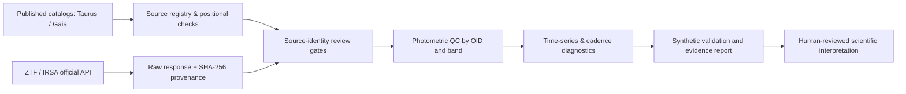

# StellarForge

**Scientific Python · Time-series analysis · Data engineering · Reproducible research**

[](https://github.com/ismaelberja/stellarforge/actions/workflows/tests.yml)
[](docs/PROJECT_STATUS.md)
[](pyproject.toml)

StellarForge is an evolving scientific-software project for **processing multi-survey astronomy data and investigating stellar variability**. It focuses on traceable data ingestion, observation-quality controls, irregular time-series analysis, and carefully qualified source associations.

**Created and scientifically directed by Ismael Berja Ruiz**, with AI-assisted software development and human review of scientific methodology.

> **Research status (v1.6, November 2026):** Working code, official ZTF *position-query responses* and reproducible Gaia/ZTF positional and independent Gaia-field screening are available. The Gaia–ZTF astrophysical identities and any physical variability events **have not been independently confirmed**. This is a software/research portfolio project, **not an announcement of an astronomical discovery**.

## At a glance

| Engineering result | Verified scope |
|---|---|
| **387 automated tests passed** | GitHub Actions v1.6 research branch (5 November 2026) |
| **2,212 real photometric rows retrieved** | Two official IRSA cone searches around published positions for FT Tau and CIDA 11, **not yet authenticated as those stars** |
| **Six ZTF object identifiers** | Kept separate by source ID, filter and field rather than blended |
| **Two independent Gaia DR3 15″ field audits** | No *additional catalogued Gaia* sources returned near either target; unresolved companions are not excluded |
| **Real FITS pixel/WCS screening** | Five of six ZTF OID-band groups were screened in v1.5; no identity or blend clearance claimed |
| **Provisional Gaussian image-profile analysis** | Three FT Tau science FITS images modeled in v1.6; all require PSF residual review; no multi-exposure evidence yet |
| **532 Taurus catalog members audited** | Pinned third-party Luhman (2023) Table 2 mirror; original publisher-file comparison pending |
| **24-star technical pilot** | Real published coordinates, not a representative or disk-classified scientific population |

The official requests and SHA-256 checksums are documented in the [v1.2 observational transport audit](reports/observational_intake_v1.2/RAW_TRANSPORT_AUDIT.md). The [v1.3 provisional astrometric report](reports/astrometry_v1.3/PROVISIONAL_POSITIONS_REPORT.md) finds median epoch-corrected Gaia/ZTF position separations of 0.063–0.092 arcsec across six curves, **without confirming any astrophysical source identity**. **Raw ZTF downloads and private research artifacts are not committed to Git.**

## v1.6 — quantitative image-profile proxies and repeatability gates

StellarForge now attempts a bounded robust fit of **one elliptical 2D Gaussian plus a tilted local background** to actual ZTF science cutouts. It reports provisional image-profile widths, signed centroid offsets and model residuals. A separate module checks whether **two or more distinct science frames** of the same ZTF OID and filter can be compared without mixing reference-image coadds.

- **Three FT Tau science images were successfully fitted** in the live v1.6 audit; all showed sizable positive residuals under the deliberately simple Gaussian model and are marked **review required**, not as new companions or astrophysical detections.
- **No CIDA 11 science frame was fitted** during the v1.6 acquisition because of intermittent archive access, and **zero OID/filter groups** had two independent usable science images. Multi-epoch repeatability therefore remains unmeasured.
- **387 automated tests passed**, including fully synthetic fit, WCS, residual and independent-exposure safeguards.
- Raw ZTF FITS pixels remain **in memory only**; the public GitHub repository publishes aggregate diagnostics, not original image or photometric records.

[Read the v1.6 quantitative shape audit](reports/psf_v1.6/REAL_GAUSSIAN_FIT_REVIEW.md) and [its methods and limitations](docs/PHASE16_PSF_PROXY_AND_REPEATED_SCIENCE_EXPOSURES.md). **A Gaussian model is not a calibrated ZTF PSF and its residuals are not evidence of a binary.**

## v1.5 — real FITS pixels and WCS screening

StellarForge now opens small **real ZTF FITS image cutouts** in memory (rather than inspecting only their transport headers), validates celestial WCS and checks local intensity maxima near the **provisional** Gaia-predicted target coordinates.

- **5/6 OID/filter groups successfully image-screened**: four for FT Tau and one for CIDA 11 (three actual science exposures and two reference-image coadds).
- Five local maxima within **0.50 arcsec** of the predicted coordinate, with **no additional maxima above the specific threshold** within 12 arcsec. This is *not a PSF fit* and does **not** prove that the sources are uncontaminated or physically matched.
- The CIDA 11 g cutout could not be downloaded (HTTP 503). Missing archive access is not a ZTF non-detection.
- **373 tests passed**, with synthetic FITS and WCS corner-case coverage. Original raw FITS pixels remain outside the public Git history.

[Read the full v1.5 real-image evidence and limitations](reports/real_fits_v1.5/PIXEL_WCS_RESULTS.md). The next stage must independently assess PSF shape, deblending, Gaia astrometric uncertainty and imaging alternatives.

## v1.4 — independent Gaia field and ZTF image checks

The independent public Gaia DR3 TAP cone searches for **FT Tau** and **CIDA 11** each returned only the intended Gaia source within 15 arcsec. This does **not** certify an uncontaminated field: unresolved binaries, faint or red sources, nebulosity and blends can escape the catalog search. CIDA 11 has an unusually high **Gaia RUWE = 8.57**, so its astrometry requires special attention.

StellarForge now builds **official ZTF science and reference FITS cutout links from the actual historical exposure metadata** and checks FITS transport without publishing image pixels. The IRSA service intermittently returned HTTP 503; only FITS *headers* were inspected, not images or PSFs.

- [v1.4 independent Gaia and FITS access results](reports/field_review_v1.4/GAIA_NEIGHBOURS_AND_IRSA_IMAGES.md)
- [v1.4 methods and limits](docs/PHASE14_INDEPENDENT_GAIA_AND_ZTF_IMAGE_QA.md)
- [Observed live Gaia/IRSA field audit](https://github.com/ismaelberja/stellarforge/actions/runs/42004372822)

**All source identity, contamination and physical-event claims remain unverified.**

## What the software does

- **Survey-aware data acquisition:** build and validate Gaia DR3 and IRSA/ZTF requests; record query provenance, hashes, response errors and evidence-gate status.
- **Photometric quality control:** retain photometric errors, instrumental flags, original time conventions, passbands and distinct ZTF `oid` identifiers.
- **Time-series analysis:** uncertainty-aware summary statistics, provisional Lomb–Scargle searches, window/alias diagnostics and exact cadence-coverage calculations.
- **Candidate screening and falsification:** heuristic excursions, chromatic diagnostics, source-identity cautions and simulated instrumental-control tests.
- **Reproducible engineering:** Python package, command-line interface, unit/integration tests, GitHub Actions and versioned scientific limitations.

### Processing architecture



**Important:** The pipeline does not automatically certify Gaia–ZTF associations, disk classes, or physical dipper/burster events.

## Run it locally

Requirements: **Python 3.10+** and Git.

```bash
git clone https://github.com/ismaelberja/stellarforge.git
cd stellarforge
python -m pip install -e '.[test,analysis]'
python -m pytest -q

# Offline examples — no external archive access required
stellarforge plan-ztf --ra 65 --dec 25 --radius-arcsec 2 --bands g r
python scripts/run_v11_selection_bias.py
```

The planning coordinates are an **engineering example**, not an authenticated science target. Generated plots and analysis outputs may be written to local ignored folders. Live data access is optional; respect archive usage policies.

To reproduce the **v1.2 observational intake** privately:

```bash
python scripts/ci_observational_pilot.py reports/generated/local_irsa_pilot --fail-if-empty
```

This performs two pre-registered requests to the official IRSA endpoint, saves raw responses **locally in ignored directories**, and marks all source identities as unverified. Do not upload raw files until reuse permissions, provenance and associations have been checked.

## Scientific integrity and limitations

- Taurus membership is based on **Luhman (2023)**, *AJ*, 165, 37 ([DOI](https://doi.org/10.3847/1538-3881/ac9da3)). The working table is a pinned **third-party mirror**, not yet independently matched against the publisher's file.
- Official ZTF observations were downloaded via positional searches, but **search results are not confirmed counterparts**. FT Tau yields multiple ZTF IDs per band/field, requiring image-level blending assessment.
- Benchmarks labeled **SYNTHETIC** are engineering exercises, not measured real-survey sensitivity, accuracy or false-positive rates.
- No astrophysical event rate, disk-class frequency or new source discovery is claimed. Relevant remaining checks include image review, full astrometric uncertainties, independent labels and injection/recovery with actual observing cadences.
- Human scientific interpretation and responsible survey citation are required before any paper or astrophysical classification.

## Project documentation

- [Current status and next milestones](docs/PROJECT_STATUS.md)
- [v1.6 real Gaussian profile and repeatability audit](reports/psf_v1.6/REAL_GAUSSIAN_FIT_REVIEW.md)
- [v1.5 real FITS pixel and WCS audit](reports/real_fits_v1.5/PIXEL_WCS_RESULTS.md)
- [v1.4 Gaia-neighbour and ZTF image-access audit](reports/field_review_v1.4/GAIA_NEIGHBOURS_AND_IRSA_IMAGES.md)
- [v1.3 per-epoch provisional astrometric report](reports/astrometry_v1.3/PROVISIONAL_POSITIONS_REPORT.md)
- [v1.2 IRSA data transport audit](reports/observational_intake_v1.2/RAW_TRANSPORT_AUDIT.md)
- [Data sources, citations and limitations](docs/DATA_SOURCES.md)
- [Validation plan](docs/VALIDATION.md)
- [Spanish getting-started guide](EMPEZAR_AQUI.md)
- [Engineering and scientific history](RESEARCH_HISTORY.md)
- [v1.6 release notes](RELEASE_NOTES_v1.6.md)
- [v1.4 release notes](RELEASE_NOTES_v1.4.md)
- [Contribution guidelines](CONTRIBUTING.md)

## Roadmap

1. **Next — empirical PSF and independent source validation:** compare with same-field stellar PSFs, obtain multiple usable science exposures, model WCS errors/PSF wings, test non-Gaia blends and full Gaia astrometric uncertainties; prioritize CIDA 11's high RUWE.
2. **Observational validation:** real-cadence injection/recovery, field-star controls, uncertainty budgets and documented false positives.
3. **Scientific reporting:** independently reviewed candidate dossiers, reproducible figures and optional interactive tools.

To reproduce the v1.3 provisional screen, run `python scripts/run_v13_astrometric_review.py /path/to/IRSA_artifact.zip`. It emits summary files into an ignored directory and never adds individual ZTF measurements to Git.

The repository will continue to improve through incremental versions, tests and reviewed pull requests.

**Code reuse:** Public visibility is for transparent portfolio review. No reuse license has been selected yet; permissions are not granted automatically by publication. Original survey/catalog data remain subject to their respective citation and usage policies.
