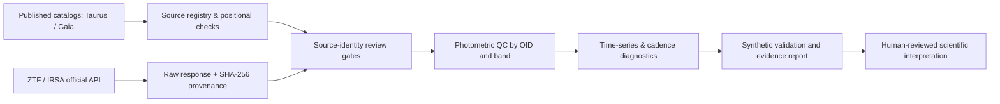

# StellarForge

**Scientific Python · Time-series analysis · Data engineering · Reproducible research**

[](https://github.com/ismaelberja/stellarforge/actions/workflows/tests.yml)
[](docs/PROJECT_STATUS.md)
[](pyproject.toml)

StellarForge is an evolving scientific-software project for **processing multi-survey astronomy data and investigating stellar variability**. It focuses on traceable data ingestion, observation-quality controls, irregular time-series analysis, and carefully qualified source associations.

**Created and scientifically directed by Ismael Berja Ruiz**, with AI-assisted software development and human review of scientific methodology.

> **Research status (v1.4, November 2026):** Working code, official ZTF *position-query responses* and reproducible Gaia/ZTF positional and independent Gaia-field screening are available. The Gaia–ZTF astrophysical identities and any physical variability events **have not been independently confirmed**. This is a software/research portfolio project, **not an announcement of an astronomical discovery**.

## At a glance

| Engineering result | Verified scope |
|---|---|
| **357 automated tests passed** | GitHub Actions on the v1.4 research branch (5 November 2026) |
| **2,212 real photometric rows retrieved** | Two official IRSA cone searches around published positions for FT Tau and CIDA 11, **not yet authenticated as those stars** |
| **Six ZTF object identifiers** | Kept separate by source ID, filter and field rather than blended |
| **Two independent Gaia DR3 15″ field audits** | No *additional catalogued Gaia* sources returned near either target; unresolved companions are not excluded |
| **Image access audited, not visually validated** | Official science/reference FITS links generated; several requests returned HTTP 503 |
| **532 Taurus catalog members audited** | Pinned third-party Luhman (2023) Table 2 mirror; original publisher-file comparison pending |
| **24-star technical pilot** | Real published coordinates, not a representative or disk-classified scientific population |

The official requests and SHA-256 checksums are documented in the [v1.2 observational transport audit](reports/observational_intake_v1.2/RAW_TRANSPORT_AUDIT.md). The [v1.3 provisional astrometric report](reports/astrometry_v1.3/PROVISIONAL_POSITIONS_REPORT.md) finds median epoch-corrected Gaia/ZTF position separations of 0.063–0.092 arcsec across six curves, **without confirming any astrophysical source identity**. **Raw ZTF downloads and private research artifacts are not committed to Git.**

## v1.4 — independent Gaia field and ZTF image checks

The independent public Gaia DR3 TAP cone searches for **FT Tau** and **CIDA 11** each returned only the intended Gaia source within 15 arcsec. This does **not** certify an uncontaminated field: unresolved binaries, faint or red sources, nebulosity and blends can escape the catalog search. CIDA 11 has an unusually high **Gaia RUWE = 8.57**, so its astrometry requires special attention.

StellarForge now builds **official ZTF science and reference FITS cutout links from the actual historical exposure metadata** and checks FITS transport without publishing image pixels. The IRSA service intermittently returned HTTP 503; only FITS *headers* were inspected, not images or PSFs.

- [v1.4 independent Gaia and FITS access results](reports/field_review_v1.4/GAIA_NEIGHBOURS_AND_IRSA_IMAGES.md)
- [v1.4 methods and limits](docs/PHASE14_INDEPENDENT_GAIA_AND_ZTF_IMAGE_QA.md)
- [Observed live Gaia/IRSA field audit](https://github.com/ismaelberja/stellarforge/actions/runs/42004372822)

**All source identity, contamination and physical-event claims remain unverified.**

## What the software does

- **Survey-aware data acquisition:** build and validate Gaia DR3 and IRSA/ZTF requests; record query provenance, hashes, response errors and evidence-gate status.
- **Photometric quality control:** retain photometric errors, instrumental flags, original time conventions, passbands and distinct ZTF `oid` identifiers.
- **Time-series analysis:** uncertainty-aware summary statistics, provisional Lomb–Scargle searches, window/alias diagnostics and exact cadence-coverage calculations.
- **Candidate screening and falsification:** heuristic excursions, chromatic diagnostics, source-identity cautions and simulated instrumental-control tests.
- **Reproducible engineering:** Python package, command-line interface, unit/integration tests, GitHub Actions and versioned scientific limitations.

### Processing architecture



**Important:** The pipeline does not automatically certify Gaia–ZTF associations, disk classes, or physical dipper/burster events.

## Run it locally

Requirements: **Python 3.10+** and Git.

```bash
git clone https://github.com/ismaelberja/stellarforge.git
cd stellarforge
python -m pip install -e '.[test,analysis]'
python -m pytest -q

# Offline examples — no external archive access required
stellarforge plan-ztf --ra 65 --dec 25 --radius-arcsec 2 --bands g r
python scripts/run_v11_selection_bias.py
```

The planning coordinates are an **engineering example**, not an authenticated science target. Generated plots and analysis outputs may be written to local ignored folders. Live data access is optional; respect archive usage policies.

To reproduce the **v1.2 observational intake** privately:

```bash
python scripts/ci_observational_pilot.py reports/generated/local_irsa_pilot --fail-if-empty
```

This performs two pre-registered requests to the official IRSA endpoint, saves raw responses **locally in ignored directories**, and marks all source identities as unverified. Do not upload raw files until reuse permissions, provenance and associations have been checked.

## Scientific integrity and limitations

- Taurus membership is based on **Luhman (2023)**, *AJ*, 165, 37 ([DOI](https://doi.org/10.3847/1538-3881/ac9da3)). The working table is a pinned **third-party mirror**, not yet independently matched against the publisher's file.
- Official ZTF observations were downloaded via positional searches, but **search results are not confirmed counterparts**. FT Tau yields multiple ZTF IDs per band/field, requiring image-level blending assessment.
- Benchmarks labeled **SYNTHETIC** are engineering exercises, not measured real-survey sensitivity, accuracy or false-positive rates.
- No astrophysical event rate, disk-class frequency or new source discovery is claimed. Relevant remaining checks include image review, full astrometric uncertainties, independent labels and injection/recovery with actual observing cadences.
- Human scientific interpretation and responsible survey citation are required before any paper or astrophysical classification.

## Project documentation

- [Current status and next milestones](docs/PROJECT_STATUS.md)
- [v1.4 Gaia-neighbour and ZTF image-access audit](reports/field_review_v1.4/GAIA_NEIGHBOURS_AND_IRSA_IMAGES.md)
- [v1.3 per-epoch provisional astrometric report](reports/astrometry_v1.3/PROVISIONAL_POSITIONS_REPORT.md)
- [v1.2 IRSA data transport audit](reports/observational_intake_v1.2/RAW_TRANSPORT_AUDIT.md)
- [Data sources, citations and limitations](docs/DATA_SOURCES.md)
- [Validation plan](docs/VALIDATION.md)
- [Spanish getting-started guide](EMPEZAR_AQUI.md)
- [Engineering and scientific history](RESEARCH_HISTORY.md)
- [v1.4 release notes](RELEASE_NOTES_v1.4.md)
- [Contribution guidelines](CONTRIBUTING.md)

## Roadmap

1. **Next — image-level source identity:** obtain and inspect ZTF FITS pixels, WCS, PSF, background and non-Gaia neighbours; reassess CIDA 11's elevated RUWE.
2. **Observational validation:** real-cadence injection/recovery, field-star controls, uncertainty budgets and documented false positives.
3. **Scientific reporting:** independently reviewed candidate dossiers, reproducible figures and optional interactive tools.

To reproduce the v1.3 provisional screen, run `python scripts/run_v13_astrometric_review.py /path/to/IRSA_artifact.zip`. It emits summary files into an ignored directory and never adds individual ZTF measurements to Git.

The repository will continue to improve through incremental versions, tests and reviewed pull requests.

**Code reuse:** Public visibility is for transparent portfolio review. No reuse license has been selected yet; permissions are not granted automatically by publication. Original survey/catalog data remain subject to their respective citation and usage policies.
