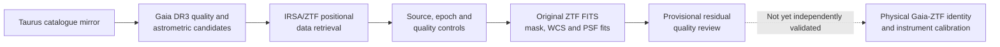

# StellarForge v2.0

**Scientific Python · Data engineering · Astronomy time series · Reproducible research**

[](https://github.com/ismaelberja/stellarforge/actions/workflows/tests.yml)
[](pyproject.toml)
[](RELEASE_MANIFEST_v2.0.json)


*Conceptual project artwork created with generative AI. **Not a photograph of Taurus or any Gaia/ZTF survey frame**; decorative grid coordinates are not measured astrometry.*

**Engineering release 2.0.0, 10 November 2026.** StellarForge is an open-to-inspection scientific-software portfolio project for quality-controlled astronomical data workflows around the Taurus young-star region. It combines traceable catalogue ingestion, Gaia DR3 astrometric checks, ZTF/IRSA light-curve analysis, original FITS science/mask inspection, and PSF reconstruction and testing.

**Author and scientific direction:** Ismael Berja Ruiz. Development includes AI-assisted implementation with regression testing, explicit observational provenance and human scientific review requirements.

> **Scientific boundary:** The software is tested and has processed real historical Gaia/ZTF survey products, but **physical Gaia–ZTF stellar identifications, independent instrument PSF/WCS calibration, and new astrophysical variability/companion discoveries are not confirmed**. The newer *different-whole-star empirical PSF* pipeline is tested synthetically; its strict original CIDA 11 live pilot is **not yet run**. A green CI badge is not proof of an astronomical discovery.

## See the work at a glance

**Evidence and illustration are different:** the flowchart and numbered charts below summarize documented research; the astronomy-inspired images are **AI-generated illustrations, not actual telescope photographs, measured PSF curves or source detections**.



**1. Catalogue audit — how much of the Taurus mirror has a Gaia DR3 identifier?**


*Real catalogue-mirror counts from [the v1.1 selection-bias audit](reports/selection_bias_v1.1/REPORT.md). The mirror has not been checked byte-for-byte against the publisher's original table.*

**2. Real original ZTF images — how many source-profile fits passed preliminary checks?**


*This chart comes from [the real v1.16 science-pixel report](reports/masked_spatial_psf_v1.16/REAL_ZTF_PIXEL_RESIDUALS_EVIDENCE.md). These are original image fits and **same-star pixel-holdout screens**, not independent new-star empirical PSF validation; the three reviews are not companion detections.*

[Visual data provenance and limits](docs/V2_VISUAL_EVIDENCE.md)

### Visual concept — astronomy and PSF analysis


*AI-generated illustrative composite only. **The stars, coordinate grid, radial-profile curve, colour map and scale bar are fictional graphics, not authentic measurements.** For genuine observational measurements use the original ZTF [v1.16 report](reports/masked_spatial_psf_v1.16/REAL_ZTF_PIXEL_RESIDUALS_EVIDENCE.md) and the two audited charts above.*

## What the software does

- **Catalogues and source provenance:** audits an externally supplied 532-member Taurus catalogue mirror, keeps its 467 Gaia DR3 identifiers traceable, and builds a deliberately **nonrepresentative 24-source technical seed** without assigning unverifiable disc classes.
- **Time-domain data:** constructs safe Gaia/IRSA queries, retrieves and hashes original survey responses, validates quality flags and separates ZTF object IDs, filters and observation epochs. Explores period and event diagnostics **without automatically assigning a physical variable-star class**.
- **Real image QA:** checks ZTF science FITS, celestial WCS coordinates, original detector bitmasks, source-profile quality, spatial DAOPhot models and held-out *same-source* pixel residuals across historic exposures.
- **Scientific falsification:** handles missing data and survey HTTP errors as technical outcomes; distinguishes source-identification uncertainty from measurement quality; adds strict Gaia-only different-star holdouts, synthetic PSF perturbation tests and explicit evidence gates.
- **Engineering quality:** modular Python package, CLI, pytest, GitHub Actions, versioned research reports and bilingual reproduction guides. Original raw survey files are not committed.

## Results and evidence boundaries

| Category | Verified result | What it **does not** prove |
| --- | --- | --- |
| Catalogue mirror | 532 Taurus members; 467 Gaia DR3 IDs; 24-source technical seed | Publisher-original byte identity, unbiased source selection, disc classification |
| Original IRSA queries | 2,212 real positional-query photometry rows across six ZTF object IDs | Certain physical association with FT Tau or CIDA 11 |
| Original ZTF images | Four historical dated g-band science exposures (two per field) | Four new observations or a representative astronomical sample |
| Original DAOPhot PSF | Four center-PSF reconstructions checked against original survey center FITS products | Independent local star-specific PSF calibration |
| Original masked image profiles | 16 source-image PSF fits; **13** provisional same-source residual screens passed; **3** require review | Independent held-out-star validation or new companions |
| New empirical PSF method | Different whole-star training/validation and fail-closed 4-training/3-holdout pilot orchestration, tested with synthetic FITS | Completed real CIDA 11 empirical validation; absolute instrument error model |
| Automated verification | **752 passed** at the v1.22 main-branch baseline, with expanded v2.0 release checks | External survey source identity, physical variability, astrophysical discoveries |

See the [audited v2.0 evidence manifest](RELEASE_MANIFEST_v2.0.json), [real v1.16 science-pixel evidence](reports/masked_spatial_psf_v1.16/REAL_ZTF_PIXEL_RESIDUALS_EVIDENCE.md), and [v2.0 reproducibility and science limits](docs/V2_REPRODUCIBILITY_AND_SCIENCE_LIMITS.md).

### Why the three flagged source profiles matter

The three historic high-positive-residual source profiles from v1.16 are **quality-review cases**, not confirmed 7-sigma astrophysical detections. Possible causes include PSF mismatch, source crowding, structured sky or correlated detector noise. They remain open for independent multi-epoch/multi-band research.

## Quick start

Requires **Python 3.10+**. Python 3.11 is used in GitHub CI.

```bash
git clone https://github.com/ismaelberja/stellarforge.git
cd stellarforge
python -m pip install -e ".[test,analysis,images]"
python -m pytest -q

# Both commands only print a query plan; they do not contact an archive:
stellarforge plan-gaia --ra 70 --dec 20 --radius-deg 0.1 --max-rows 10
stellarforge plan-ztf --ra 70 --dec 20 --radius-arcsec 2

# Verify the v2.0 historical evidence contract, offline:
python scripts/audit_v2_release_manifest.py
```

For the complete CLI, run `stellarforge --help`. The historical raw archive is **not needed** for normal installation, offline tests or query planning.

## Reproducing the original-data pilot (optional and manual)

The [original CIDA 11 FITS + Gaia pilot](.github/workflows/v120-original-empirical-psf-pilot.yml) uses live Gaia/IRSA data and was deliberately designed for **manual dispatch**. If you have the privately recovered two-target original IRSA source ZIP, first check its historic pinned SHA using:

```bash
python scripts/check_v122_historic_source_zip.py /private/path/ztf-historic-source-run.zip
```

That ZIP contains **historic positional-query responses, not the original CCD FITS**. Running the actual pilot also requires fresh access to Gaia DR3 and IRSA original source-mask-science products. Archive availability, source quality, mask/WCS and sample-size failures must be reported rather than converted into non-detections. The archive SHA matches the [no-raw v1.22 recovery receipt](data/research_seed/V122_ORIGINAL_IRSA_ARTIFACT_RECEIPT_NO_RAW.json); the ZIP itself remains outside Git.

Read the [Spanish practical guide](docs/V2_GUIA_ES.md) or [complete reproducibility checklist](docs/V2_REPRODUCIBILITY_AND_SCIENCE_LIMITS.md).

## Project structure and documentation

| Path | Purpose |
| --- | --- |
| `src/stellarforge/` | Data-quality, astrometry, time series, original FITS/PSF and scientific validation modules |
| `scripts/` | Bounded original-data runners and reproducibility audits |
| `tests/` | Unit, synthetic FITS and no-network integration/regression tests |
| `data/research_seed/` | Technical source seed and **derived, no-raw** evidence receipts |
| `reports/` | Research evidence, clearly labelled as original historic observations or simulations |
| `.github/workflows/` | Default offline CI and separately dispatched real-data workflows |
| `docs/` | Methods, limitations, bilingual guides and [archived v1.22 long-form README](docs/HISTORIC_README_v1.22.md) |

For a concise explanation suitable for recruiting and interviews, see [StellarForge on a CV — English/Spanish](docs/V2_PORTFOLIO_CV_ES_EN.md). The [research status](docs/PROJECT_STATUS.md), [roadmap](docs/ROADMAP.md) and [release notes](RELEASE_NOTES_v2.0.md) remain available for deeper technical review.

## Independent Taurus variability research — R1 and ongoing R2

StellarForge v2.0 remains a **finished software-engineering portfolio**.
The independent observational Taurus study continues with **24 fixed,
nonrepresentative technical Gaia DR3 candidate IDs**.

**Latest genuine ZTF archive access result (11 November 2026):**
the original Gaia exact-ID query found 24/24 source IDs (17 passing
preliminary Gaia-only astrometric quality gates). ZTF/IRSA access
progressed from 2/24 to 15/24 after a first diagnostic, and the latest
controlled original-data run retrieved **7 more** sky-position tables.
Thus **22 of 24 original positions now have parsed ZTF positional
source data** across three documented runs. One of the remaining
positions yielded a **zero-row table under a five-visit filter**;
the other returned **HTTP 400** under a reduced-count request.

**Crucially, zero physical Gaia–ZTF counterpart identities and zero
new stellar variability results have been scientifically confirmed.**
Catalog positional matches are not proof of source identity, and
missing/empty archive responses are **not astrophysical nondetections**.
**New R2 original-image consistency evidence (11 November 2026):**
the *four already-studied historical single-exposure ZTF images* from
FT Tau and CIDA 11 were re-queried using their exact OID and dates.
**4/4** original science FITS cutouts and matching detector masks
were aligned and inspected, and **4/4** original native
`psfcat.fits` catalogues were parsed. Each had one catalogued
source within 1″ of the Gaia-predicted position, **no second native
catalogue source within 3″**, no additional bright-image peak
within 12″ under this particular heuristic, and no core detector
bad/saturation bits. These are same-instrument checks, **NOT**
independent physical counterpart matches or proof against blends.
CIDA 11 Gaia RUWE is approximately 8.57 and needs special review.

[Original-image results and limitations](research/taurus_variability/R2_REAL_FT_TAU_CIDA_11_FITS_SOURCE_GATES.md) ·
[Authentic original-data run](https://github.com/ismaelberja/stellarforge/actions/runs/43059114825) ·
[Permanent derived-only original-source ledger](reports/taurus_variability_r2/FOUR_ORIGINAL_FITS_MASK_NATIVE_PSF_SOURCE_QA_NO_RAW.json)

**New R2 original Gaia reference-control results (11 November 2026):**
A further real-data audit used **five fixed Gaia-only reference stars**
(four strict controls for CIDA 11, one exploratory for FT Tau)
on those same **four historical ZTF exposures**. CIDA 11 had
**four** acceptable strict controls on its first date but **only two**
on its second; its science target fails the combined source-quality
and high-RUWE gate. FT Tau has **only one exploratory control** on
either date. Therefore **0/4 target offsets qualify for a defensible
differential field correction**, and there is still **no
independently verified Gaia–ZTF source identity**. This is a
scientific quality-control *no-go*, not an astrophysical non-detection.

[Actual Gaia/native-source control outcome](research/taurus_variability/R2_REAL_GAIA_ONLY_CONTROL_OFFSET_NO_GO.md) ·
[Real-data source-control workflow](https://github.com/ismaelberja/stellarforge/actions/runs/43063054380) ·
[Immutable no-raw 7-source, 4-exposure ledger](reports/taurus_variability_r2/GAIA_ONLY_CONTROLS_ORIGINAL_PSF_OFFSETS_NO_RAW.json)

**New original ZTF ObjectID / filter / field review (11 November 2026):**
an exact **two-field** follow-up identified **four** separate ZTF
ObjectIDs for FT Tau (**two g, two r**, from **two different
field/CCD/quadrant combinations**), and **two** for CIDA 11
(**one g, one r**, same detector field). Both previously
documented historical g-band ObjectIDs appear in the original
2-arcsec positional tables and were also recovered by direct ID.
The two FT Tau same-band OID pairs do **not** share the same
original exposure metadata, but their similar catalogue sky
positions are **NOT independent physical Gaia/ZTF association
evidence**. No OIDs are concatenated and no new variability is claimed.

[Actual original ZTF ObjectID/field analysis](research/taurus_variability/R2_REAL_FT_TAU_CIDA_ZTF_ALTERNATIVE_OID_RESULTS.md) ·
[Two-source original IRSA run](https://github.com/ismaelberja/stellarforge/actions/runs/43066226324) ·
[Derived six-OID source ledger](reports/taurus_variability_r2/REAL_TWO_FIELDS_ORIGINAL_IRSA_ALTERNATE_OBJECTIDS_NO_RAW.json)

**New authentic FT Tau two-field g/r original science-image checks (11 November 2026):**
Four **predeclared exact ZTF ObjectIDs** yielded usable archival
science FITS cutouts, corresponding original detector masks and
same-exposure native PSFcat source catalogues. **All 4/4 images
passed the predefined provisional source/PSF/bitmask QA**.
Within both g and r, the closest two-field original exposure
pair is just **0.000451 day (~39 seconds) apart**. Their native
catalogue source-position differences across fields are
**13.568 mas (g)** and **79.473 mas (r)**, *descriptive only*;
the g images were from **2019** and the r images from **2018**.
These numbers are NOT independently calibrated field WCS errors,
physical source motion or evidence of a Gaia–ZTF unique match.
**No FT Tau OID curves were merged.**

[Actual four-image science results](research/taurus_variability/R2_REAL_FT_TAU_TWO_FIELD_GR_FITS_MASK_PSF_RESULTS.md) ·
[Authentic original FITS/mask/PSFcat run](https://github.com/ismaelberja/stellarforge/actions/runs/43069170818) ·
[Permanent no-raw evidence ledger](reports/taurus_variability_r2/FT_TAU_TWO_ORIGINAL_ZTF_FIELDS_GR_FITS_MASK_PSF_DERIVED_NO_RAW.json)

**New authentic FT Tau cross-field instrumental reference ensemble (11 November 2026):**
Reused **the same four original ZTF `psfcat.fits` files**,
each reverified against its previous original SHA-256.
A predeclared 360″ sky circle, 15″ FT Tau exclusion, native
PSF/flag/isolated-source QC and reciprocal 0.75″ matching
yielded **10 g-band** and **19 r-band** reasonably clean
matched native reference pairs. Both fall below the
**20 predeclared minimum** needed for split-fit/heldout
ensemble validation, so the scientifically correct result
is **NO-GO / underpowered in both bands**. The native ZTF
`mag` column is *instrumental* (−2.5 log10 detector DN flux),
**not absolute calibrated stellar brightness**.
No magnitude shift, physical Gaia–ZTF source ID, new
variability or OID-curve merging was inferred.

[Actual original 10-g/19-r source-control NO-GO](research/taurus_variability/R2_REAL_FTTAU_ORIGINAL_CROSSFIELD_INSTRUMENTAL_ENSEMBLE_NO_GO.md) ·
[Original four-PSFcat survey-data workflow](https://github.com/ismaelberja/stellarforge/actions/runs/43072549599) ·
[Permanent no-raw instrumental reference evidence](reports/taurus_variability_r2/FTTAU_REAL_ORIGINAL_NATIVE_TWO_FIELD_INSTRUMENTAL_ENSEMBLE_NO_RAW.json)

**New independent 720″ reference-field experiment (11 November 2026):**
Retained the preceding **360″/10 g/19 r NO-GO** as-is and
predeclared a new **720″ radius**, leaving the original 20-star
threshold, fit/quality/holdout rules and four original image epochs
unchanged. Authentic original SHA-reverified full ZTF source
catalogues then yielded **84 reciprocal g-band** and
**186 reciprocal r-band** reference pairs. Both passed the
predeclared train/heldout *instrumental* offset and coarse
inner-vs-outer spatial screens; raw instrumental difference
(field 609 minus field 1605) is **+0.118 mag (g)** and
**−0.004 mag (r)**. All four original science FITS headers
contained usable ZTF-pipeline **PS1-anchored** photometric
solutions and original calibrator counts. No independent
source-by-source PS1 DR2 catalogue was queried, color terms
were not applied, and this is **not AB-calibrated physical
FT Tau photometry or an independently validated WCS**.

[Actual 720″ ZTF ensemble and PS1-header study](research/taurus_variability/R2_REAL_FTTAU_720_ORIGINAL_INSTRUMENTAL_ENSEMBLE_PS1_HEADER_RESULTS.md) ·
[Original four-source real-data workflow](https://github.com/ismaelberja/stellarforge/actions/runs/43091456449) ·
[Permanent original-data no-raw evidence](reports/taurus_variability_r2/FTTAU_720_REAL_NATIVE_ENSEMBLE_ZTF_PS1_PIPELINE_HEADER_NO_RAW.json)

**New original MAST Pan-STARRS1 DR2 source-level calibration pilot
(11 November 2026):** A separately preregistered **720″
external source query returned 1,780 authentic PS1 DR2 mean
source rows**, of which **405** passed basic colour, detection,
error, neighbour and FT Tau-exclusion screening. Four original ZTF
PSF catalogues were again SHA-verified. Independent catalogue
positions provided **82 unique ZTF/ZTF/PS1 matched reference
triplets in g** and **180 in r**, with PS1 `g-r` colour terms
fit independently per ZTF field. Both bands' two-field fits
passed the preregistered PS1-source-ID held-out pilot tests;
held-out scatter ranges from **~0.024 to 0.036 mag**.

[Actual independently queried PS1 source-level pilot](research/taurus_variability/R2_REAL_FTTAU_EXTERNAL_MAST_PS1_DR2_SOURCE_COLOR_RESULTS.md) ·
[Original authentic MAST/ZTF archive workflow](https://github.com/ismaelberja/stellarforge/actions/runs/43102892830) ·
[Permanent external-source derived-only evidence](reports/taurus_variability_r2/FTTAU_REAL_ORIGINAL_MAST_PS1_DR2_EXTERNAL_SOURCE_COLOR_PILOT_NO_RAW.json)

**Scope:** the new PS1 source catalogue is genuinely queried
independently from ZTF, but **the original ZTF reduction also
uses PS1 references**. This is provisional catalogue-star
photometric/reference consistency, **not independent absolute
calibration**, nor a physical Gaia–ZTF match for FT Tau.
**Original Gaia proper-motion, PS1 and four-ZTF-source target-centroid
audit (12 November 2026):** Exact FT Tau Gaia DR3 five-parameter
covariance and **4/4 original native ZTF source catalogues** were
revalidated at the original observing epochs. In all four fixed
images, the nearest native catalogue source is within
**0.035–0.069 arcseconds** of the Gaia proper-motion and
approximate annual-parallax prediction; all four pass the
fixed PSF-quality/nearest-source screen. Newly retrieved
external original MAST PS1 mean positions, with **82 g and
180 r matched reference triples**, support an **internal**
source-position holdout comparison in both filters.
A single original PS1 mean-source row lies within 1″ of
Gaia's J2016 source position (at **0.056″**).
**The original PS1 query response SHA changed from the
previous study**, and the new complete 1,780-row catalogue is
explicitly flagged as a different archival byte snapshot.

[Real FT Tau original Gaia/PS1/ZTF target-source evidence](research/taurus_variability/R2_REAL_FTTAU_GAIA_PS1_ZTF_TARGET_ASTROMETRY_RESULTS.md) ·
[Original-data Gaia+PS1+ZTF run](https://github.com/ismaelberja/stellarforge/actions/runs/43188238685) ·
[Permanent no-raw target positional evidence](reports/taurus_variability_r2/FTTAU_GAIA_PS1_ZTF_FOUR_ORIGINAL_TARGET_ASTROMETRY_NO_RAW.json)

**Scientific scope:** despite compelling *positional* agreement,
PS1's mean-source epoch and proper motions, ZTF WCS/PSF
systematic uncertainties, source blending, original publisher
Taurus membership and an independently authenticated
physical Gaia–ZTF identity **remain open**. None of FT Tau's
four ZTF ObjectID lightcurves were merged and no original
stellar-variability discovery is claimed.

**Authentic FT Tau multi-night native ZTF candidate audit (12 November 2026):** Four fixed original OIDs yielded **8/8 newly selected dated original PSF catalogues** from 1871–2618 day baselines. **5/8 original nearest-source candidates** passed the pre-frozen PSF quality criteria; only **1/4 two-night source pairs** passed both frames. Three late epochs failed PSF quality and were deliberately not replaced. No physical counterpart identity or proper-motion detection is claimed. Original four OID light curves remain separate.

[Real original multi-night results](research/taurus_variability/R2_REAL_FTTAU_MULTINIGHT_NATIVE_ASTROMETRY_RESULTS.md) · [Workflow](https://github.com/ismaelberja/stellarforge/actions/runs/43270659201) · [Permanent derived evidence](reports/taurus_variability_r2/FTTAU_MULTINIGHT_ORIGINAL_ZTF_SOURCE_AUDIT_NO_RAW.json)

**Original three late-night FT Tau PSF failures independently diagnosed (12 November 2026):**
All **3/3 exact earlier original native PSF catalogues** were byte-SHA-verified again and their original same-date science/mask cutouts inspected. The **only** failed original profile gate in all three was the **PSF chi lower limit 0.5**: original χ **0.456 g/1605, 0.424 g/609 and 0.383 r/609**. Their respective native SNRs were 49.80, 65.01 and 43.43; original flags, sharpness and positive flux/sigflux passed. All three WCS-aligned science/mask cutouts had a central peak and zero disqualifying core/annulus mask pixels. **Clean masks do not prove no blends; low χ does not prove the cause of the PSF model/uncertainty discrepancy.** The original eight-epoch 5/8 source quality-pass fraction remains unchanged and no physical FT Tau Gaia–ZTF identity or variability inference is made.

[Real original native PSF + image-mask diagnosis](research/taurus_variability/R2_REAL_FTTAU_THREE_BAD_PSF_MASK_RESULTS.md) · [Original-data execution](https://github.com/ismaelberja/stellarforge/actions/runs/43273246447) · [Permanent derived-only source evidence](reports/taurus_variability_r2/FTTAU_THREE_FROZEN_BAD_PSF_MASK_DIAGNOSIS_NO_RAW.json)

**Original six-image chi-blind FT Tau reference controls (12 November 2026):** Six exact previously selected original dated ZTF PSF catalogues were reobtained and verified by original SHA. Among **1,095 same-image native control records selected independently of chi**, **240** were below the frozen chi lower bound 0.5, with per-image proportions 8.37%–35.19%; six SNR-matched subsets all had at least 20 sources. This shows the original lower threshold has selection effects but does **not** calibrate its optimal value or validate physical source identity. The original 5/8 quality passes, 3/8 failures and 1/4 acceptable two-night source pairs remain unchanged. No light curves merged, no confirmed variability or companions.

[Real original six-image chi sensitivity](research/taurus_variability/R2_REAL_FTTAU_SIX_ORIGINAL_CHI_REFERENCE_RESULTS.md) · [Real data workflow](https://github.com/ismaelberja/stellarforge/actions/runs/43275404347) · [Permanent source-level no-raw evidence](reports/taurus_variability_r2/FTTAU_SIX_ORIGINAL_ZTF_CHI_BLIND_REFERENCES_NO_RAW.json)

**Independent analytic Gaussian pixel residual pilot on six original FT Tau science+mask images (12 November 2026):** All six previously selected and full native PSFcat-byte-locked ZTF exposures were retrieved with their authentic original celestial-WCS science and same-date mask cutouts, **6/6 clean source cores**; 4/6 predeclared independent circular-Gaussian numeric fits completed, while **2/6 failed to yield a bounded fit**. The four computed sky-MAD-normalized residuals were high (8.58–18.95), even for original native-quality-PASS frames. **This is a NO-GO for claiming independent source-level PSF/noise calibration**, not evidence of companions or variability. The original three low-native-chi PSF source candidates remain rejected; no physical Gaia–ZTF FT Tau source identity or original lightcurve merge is validated.

[Real original six-image pixel Gaussian pilot](research/taurus_variability/R2_REAL_FTTAU_SIX_ORIGINAL_GAUSSIAN_PIXEL_RESULTS.md) · [Original-data ZTF run](https://github.com/ismaelberja/stellarforge/actions/runs/43279744985) · [Permanent no-raw original FITS evidence](reports/taurus_variability_r2/FTTAU_SIX_ORIGINAL_ZTF_INDEPENDENT_GAUSSIAN_PIXELS_NO_RAW.json)

**Actual native spatial DAOPhot PSF FT Tau six-image follow-up (12 November 2026):** SHA-locked **6/6 original ZTF PSFcats, science/mask FITS**, plus **6/6 original spatial `sciimgdao.psf` models and authentic field-center `sciimgdaopsfcent.fits` stamps, all retrieved successfully. The native source CCD spatial model passed **6/6 numeric same-source checkerboard pixel fits**, after the preceding crude Gaussian fit only handled 4/6. **4/6** passed the pre-existing same-image heldout-pixel engineering residual screen; **2/6 r609** require review. This is the ZTF pipeline's **own** PSF model (not independent different-star calibration): all three low-native-chi source rejections, old 5/8 provisional target passes and 1/4 valid two-night source pair are unchanged. No confirmed physical Gaia–ZTF FT Tau identity, variability or companions.

[Real original DAOPhot spatial PSF report](research/taurus_variability/R2_REAL_FTTAU_SIX_NATIVE_SPATIAL_DAO_RESULTS.md) · [Live original-source execution](https://github.com/ismaelberja/stellarforge/actions/runs/43310945601) · [Permanent no-raw original data evidence](reports/taurus_variability_r2/FTTAU_SIX_ORIGINAL_NATIVE_SPATIAL_DAOPHOT_PSF_NO_RAW.json)

**Verified external FT Tau name ↔ Gaia DR3 alias (12 November 2026):** Two strictly precommitted **CDS SIMBAD exact identifier lookups** returned the **same unique external object**, main ID **V* FT Tau**, for the historical FT Tau name and Gaia DR3 **149623711269425408**. One original row per query; original TAP responses SHA-256 verified from the official Harvard mirror. The SIMBAD vs Gaia catalogue coordinate difference is 0.36934″ without epoch correction, **not** a physical astrometric error estimate. This is **confirmed external catalogue alias correspondence**, not independent proof that the **four ZTF ObjectIDs** or six original PSF source detections are physically the same Gaia star. No earlier native χ threshold or provisional source status changed; physical source association and new variability claims remain scientifically OPEN.

[Authentic SIMBAD/Gaia identity audit](research/taurus_variability/R2_REAL_FTTAU_SIMBAD_GAIA_EXACT_ALIAS_RESULTS.md) · [Live official CDS mirror run](https://github.com/ismaelberja/stellarforge/actions/runs/43314507016) · [Permanent original no-raw source evidence](reports/taurus_variability_r2/FTTAU_SIMBAD_EXACT_GAIA_NAME_ALIAS_NO_RAW.json)

[Actual nine-position recovery and per-source limitations](research/taurus_variability/R2_REAL_NINE_IRSA_SOURCE_RECOVERY.md) ·
[Original live run](https://github.com/ismaelberja/stellarforge/actions/runs/43042786341) ·
[No-raw data ledger](reports/taurus_variability_r2/IRSA_NINE_ORIGINAL_RESPONSE_SOURCE_LEDGER_NO_RAW.json) ·
[R1–R6 research roadmap](research/taurus_variability/R1_TO_R6_RESEARCH_PLAN.md)

## Status after v2.0

**Portfolio software: complete for this version. Scientific validation: ongoing and inconclusive.**

A defensible external PSF/WCS calibration or discovery will require independent Gaia–ZTF source identification, knowledge of original ZTF DAOPhot training stars (or another independent source of calibration), exposure-specific instrument noise and statistically interpretable multi-epoch science. Until then, no source candidate here is a confirmed new physical object or variability event.
