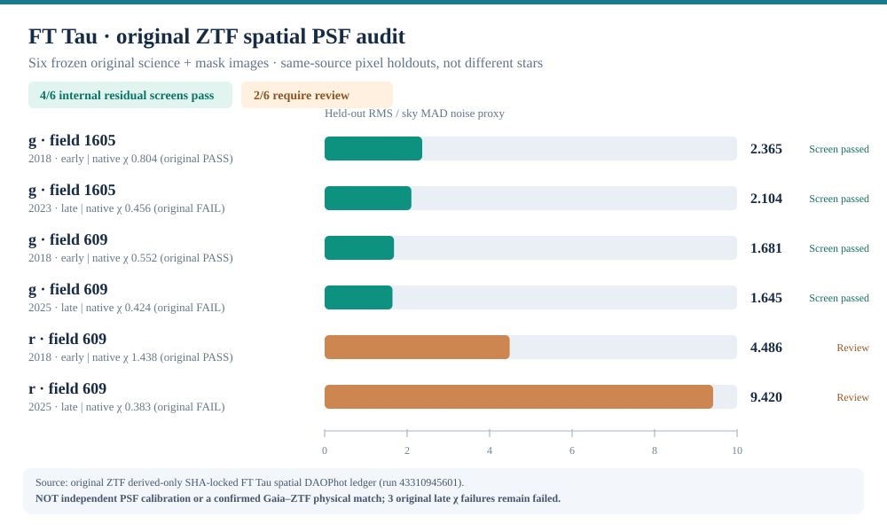

# StellarForge v2.1 — guía de inicio

**Python científico · ciencia de datos · observaciones astronómicas reproducibles.** Actualización del proyecto de portfolio del 13 de noviembre de 2026.

## ¿Qué es?

StellarForge es una plataforma de software Python que procesa datos astronómicos de Gaia DR3 y ZTF/IRSA. Incluye lectura de catálogos, validación de identidades y épocas, filtros de calidad, imágenes FITS y máscaras, coordenadas WCS, modelos de función de dispersión puntual (PSF), pruebas, automatización mediante GitHub Actions y evidencias trazables por SHA-256.

**El software está listo para GitHub y el CV.** La investigación científica continúa abierta: no se ha demostrado que los cuatro identificadores ZTF analizados correspondan físicamente a la misma fuente Gaia, ni se ha confirmado una nueva variabilidad, estrella o compañera.

## Resultados comprobados

La versión histórica 2.0 tenía un catálogo espejo de **532 miembros de Taurus** (467 con identificador Gaia DR3), **2.212 registros de dos consultas posicionales originales de IRSA**, cuatro exposiciones ZTF históricas y **16 ajustes de PSF a perfiles de fuentes** (13 controles internos provisionales superados y tres pendientes de revisión).

En las fases posteriores se estudiaron **seis exposiciones originales adicionales fijadas previamente en el análisis de FT Tau**: los seis catálogos PSF originales y las imágenes/máscaras se verificaron por hash; seis modelos espaciales DAOPhot produjeron un ajuste numérico y **4/6** superaron el control interno de residuos de píxeles de la misma imagen. Dos imágenes de la banda r requieren revisión. Estos seis fotogramas y los anteriores **no son recuentos de estrellas únicas ni muestras independientes que deban sumarse**.

Un estudio de referencia sobre seis catálogos originales encontró **1.095 registros de fuentes de control**, de los cuales **240** tenían χ inferior a 0,5; eso no demuestra que el umbral de χ deba cambiarse.

Una búsqueda con identificadores exactos en **SIMBAD** vinculó el nombre histórico FT Tau con Gaia DR3 **149623711269425408**, bajo el identificador principal *V* FT Tau*. Es una equivalencia de nombres en un catálogo astronómico, **no** la autenticación de las fuentes individuales de ZTF.

Consulta el [informe resumido de v2.1](../RELEASE_NOTES_v2.1.md) y el [manifiesto de evidencia](../RELEASE_MANIFEST_v2.1.json).

## Instalación y comprobación

Requiere Git y Python 3.10 o posterior; GitHub CI utiliza Python 3.11.

En Linux/macOS:

```bash
git clone https://github.com/ismaelberja/stellarforge.git
cd stellarforge
python -m pip install -e ".[test,analysis,images]"
python -m pytest -q
python scripts/audit_v21_release_manifest.py
stellarforge --version
stellarforge plan-ztf --ra 70 --dec 20 --radius-arcsec 2
```

En Windows (PowerShell):

```powershell
git clone https://github.com/ismaelberja/stellarforge.git
cd stellarforge
py -3.11 -m venv .venv
.\.venv\Scripts\python.exe -m pip install -e ".[test,analysis,images]"
.\.venv\Scripts\python.exe -m pytest -q
.\.venv\Scripts\python.exe scripts/audit_v21_release_manifest.py
.\.venv\Scripts\stellarforge.exe --version
```

Las pruebas normales y la auditoría son **offline**: no descargan nuevos datos astronómicos. Para repetir una consulta real hay que ejecutar de forma deliberada el flujo científico correspondiente de GitHub Actions o usar sus scripts siguiendo las condiciones originales de cada estudio. Los archivos FITS originales no se distribuyen en el repositorio.

## Gráficos y fotografías



Los diagramas de cifras son **gráficos científicos auténticos derivados de registros y resultados originales**, no imágenes del telescopio. Las imágenes de portada y collage creadas con IA **no son fotografías astronómicas reales**. [Origen de cada elemento visual](V21_VISUAL_EVIDENCE.md).

## ¿Cómo lo presento profesionalmente?

Como **proyecto personal de Python científico, análisis de datos, trazabilidad, calidad y automatización**, respaldado por código público y pruebas. Separa claramente la calidad del software de un descubrimiento astronómico. [Textos preparados para el CV, LinkedIn y entrevistas (ES/EN)](V21_PORTFOLIO_CV_ES_EN.md).

## ¿Y después?

La versión de **software 2.1 se puede cerrar** con su suite de pruebas. Si deseas continuar como investigación científica, la etapa siguiente requiere identificación externa **física** de las fuentes ZTF y calibración instrumental independiente (no basta con la coincidencia de nombres en SIMBAD). [Documento de límites científicos](V21_REPRODUCIBILITY_AND_SCIENCE_LIMITS.md).

**Dirección científica y autoría:** Ismael Berja Ruiz. El desarrollo incluye asistencia de IA, con pruebas de regresión, verificación de fuentes y revisión humana obligatoria. Ningún dato privado de TFM/ALMA está publicado aquí.
