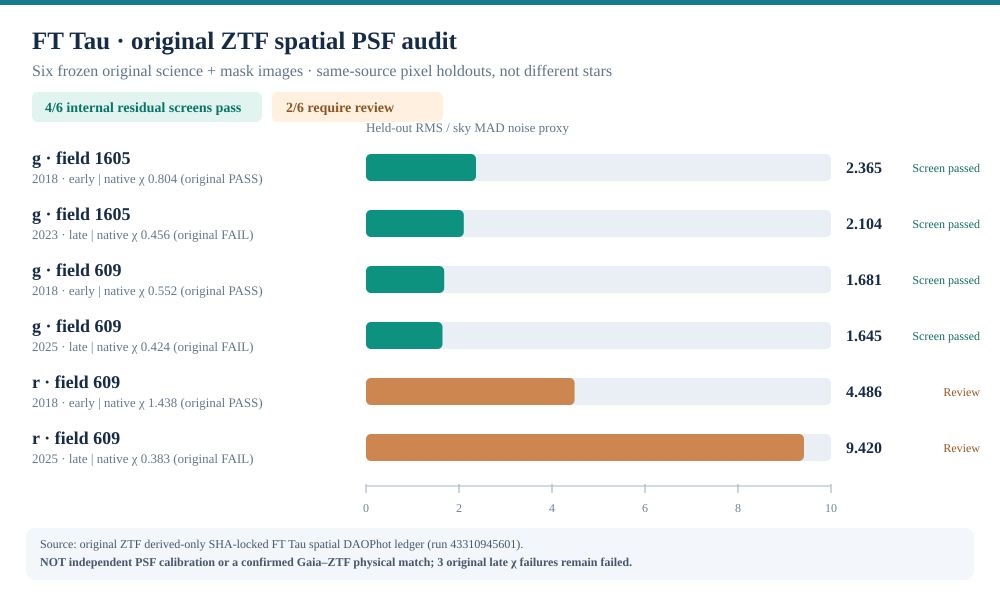

# StellarForge v2.1 — evidence-aware visual presentation

The [README](../README.md) distinguishes three types of graphics with visibly different captions: (1) **original-source-derived aggregate charts**; (2) **algorithm/workflow explanatory diagrams**; and (3) **AI-generated conceptual art**. No private ZTF original source FITS image pixels or catalogue rows were added merely to improve appearance.

## New v2.1 quantitative chart: six original native spatial PSFs

**Source:** [per-image original derived-only source receipt](../reports/taurus_variability_r2/FTTAU_SIX_ORIGINAL_NATIVE_SPATIAL_DAOPHOT_PSF_NO_RAW.json), generated from [real original ZTF run 43310945601](https://github.com/ismaelberja/stellarforge/actions/runs/43310945601). This chart uses all six exact original g/r early/late observations. Bars represent **same-source held-out checkerboard pixel residual RMS divided by a local sky MAD noise proxy**; four of six pass the already defined **internal** screen, and two r/609 sources require review.

The labels separately identify the original ZTF source PSFcat **χ gate status**. For the three preselected late-night FT Tau source candidates with χ below 0.5, the **original source-quality classification remains FAIL** even when a different derived same-image spatial PSF residual screen passed. **The chart is NOT independent different-star PSF validation, source confirmation, astrophysical variability, a photometric magnitude diagram or a telescope photograph.**

## Historical numeric charts

- [532 Taurus mirror sources, 467 Gaia identifiers](figures/taurus-gaia-coverage.svg), from the [v1.1 selection audit](../reports/selection_bias_v1.1/REPORT.md). The third-party mirror does not verify unbiased population membership or physical ZTF counterparts.
- [16 genuine historical masked ZTF source-image PSF fits (13 provisional, three review)](figures/ztf-original-psf-quality.svg), from the [v1.16 original pixel evidence](../reports/masked_spatial_psf_v1.16/REAL_ZTF_PIXEL_RESIDUALS_EVIDENCE.md). **Do not add the later six-image study to this denominator**; each is an experiment with its own source/sample selection.

## Non-observational illustrations

Two existing WebP illustrations — `stellarforge-conceptual-hero.webp` and `stellarforge-conceptual-atlas.webp` — were generated with AI and are **artwork only, not astronomy/telescope imagery or measured astronomical PSF curves**. Their source-byte SHA tests and original disclosures remain intact. More details and the former v2.0 graphics context: [visual source policy](V2_VISUAL_EVIDENCE.md).

All three derived numerical figures are self-contained accessible SVG files, using titles, descriptions, source links and explicit no-discovery warnings. Regression tests check that the newest values agree with the immutable original source evidence; no external images, scripts, fonts or private files are embedded.
