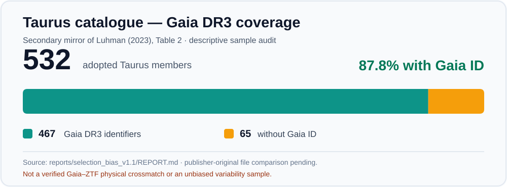
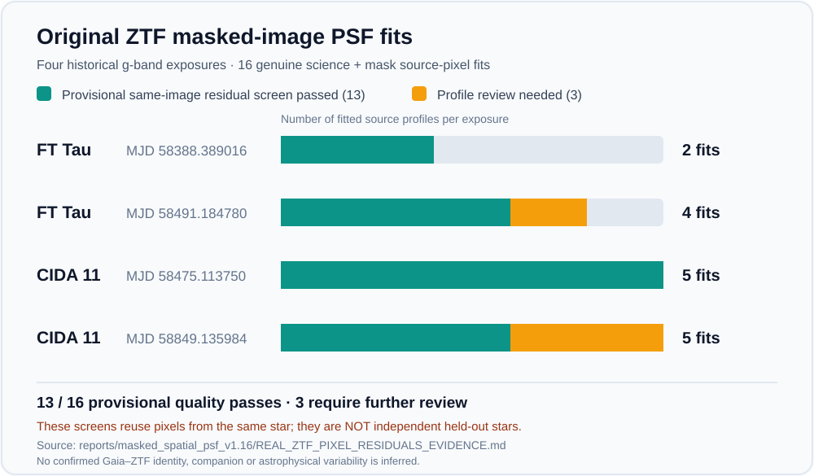

# StellarForge — Visual evidence and data provenance (v2.0)

This portfolio uses **real documented counts**, not fabricated astronomical
photographs, simulated telescope exposures or unreviewed source detections.
The diagrams are summaries of previously released reports. The original ZTF
science FITS, CCD masks and private IRSA source CSV payloads are **not
committed** just to make the repository visually attractive.

## Diagram: audit workflow

The [main README](../README.md) uses native GitHub Mermaid to summarize
the stages of the implemented catalogue, positional-data and original-image
quality-control workflow. The final dotted arrow marks physical source
identity and independent instrument calibration as **not yet established**.

## Figure 1: Taurus mirror and Gaia identifier coverage

**Source:** [v1.1 bias audit](../reports/selection_bias_v1.1/REPORT.md),
which records 532 adopted Taurus members in the third-party mirror
of Luhman (2023) Table 2, **467** with Gaia DR3 IDs and **65** without
(87.8% identifier coverage).

**Caveats:** original-publisher machine-readable bytes have not
been independently matched; a Gaia identifier does not prove a
Gaia-ZTF physical source match. The technical 24-star pilot is
not a statistically representative population.

## Figure 2: genuine original ZTF science-image PSF profile screens

**Source:** [v1.16 real masked-image pixel analysis](../reports/masked_spatial_psf_v1.16/REAL_ZTF_PIXEL_RESIDUALS_EVIDENCE.md)
which records four **historical** g-band ZTF exposure dates, not
four new observations:

| Field | Original MJD | Original masked source-profile fits | Provisional same-image passes | Review needed |
| --- | ---: | ---: | ---: | ---: |
| FT Tau | 58388.389016 | 2 | 2 | 0 |
| FT Tau | 58491.184780 | 4 | 3 | 1 |
| CIDA 11 | 58475.113750 | 5 | 5 | 0 |
| CIDA 11 | 58849.135984 | 5 | 3 | 2 |
| Total | Four historical exposures | 16 | 13 | 3 |

**Caveats:** the provisional source-profile quality screen uses
checkerboard held-out **pixels of the same star**, not a different
independent star. The report does not independently authenticate
Gaia-ZTF source identity, fully calibrate the instrumental PSF
or CCD noise, or establish new companions or variability events.
Three profiles are flagged for review, not counted as
discoveries. The newer v1.20 original-data distinct-star empirical
PSF live runner remains **unexecuted** as of this documentation.

## Source graphics and accessibility

Both figures are UTF-8 SVG text assets stored in
`docs/figures/`; GitHub can display them inline without an external
charting service, a binary asset upload or third-party image hosting.
Each SVG contains an accessible title, explanation and explicitly
labelled source/caveat. The figures deliberately show **aggregated
measurements and status counts**, not proprietary original
science pixels.

The chart values are under regression tests in
`tests/test_v20_portfolio_figures.py`, which compare figure
labels and per-epoch aggregates against committed research reports
and reject scripts or external image content.
