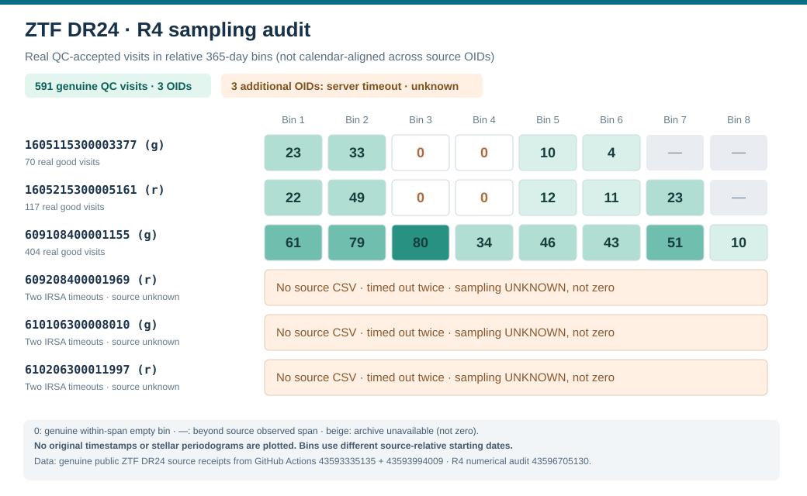

# Taurus R4 — original ZTF DR24 sampling audit and a synthetic window non-identifiability demonstration

**14 November 2026 | Methodological R4 feasibility result (real original source-coverage data, synthetic sampling counterexamples).** This does **not** establish physical Gaia-to-ZTF associations, astrophysical stellar variability, genuine star periods, period aliases measured from real timestamps, or new companions.

## Scientific question and preregistration

The [R1 protocol](R1_PREREGISTERED_SCIENCE_PROTOCOL.md) requires full light-curve source identification, 30 clean original epochs, ≥90 days and unbiased variability validation. We do not have source-level physical Gaia–ZTF identification for any of the 24 original targets. In R3, six preselected ZTF ObjectIDs yielded three original DR24 source-specific CSV responses and three twice-timed-out provider requests. We therefore [preregistered the R4 exact bin-count and synthetic-window method](R4_REAL_ZTF_SAMPLING_WINDOW_METHOD_PREREGISTRATION.md) before calculating frequency-window examples: **measure only real original 365-day-bin counts**, then demonstrate with **SYNTHETIC** timestamp allocations that annual totals do not uniquely determine an exact time-sampling spectral window.

The source evidence is real: [initial DR24 original source run 43593335135](https://github.com/ismaelberja/stellarforge/actions/runs/43593335135), [timeout-only original retry 43593994009](https://github.com/ismaelberja/stellarforge/actions/runs/43593994009), and [reproducible offline R4 analysis run 43596705130](https://github.com/ismaelberja/stellarforge/actions/runs/43596705130). R4 neither re-downloads source CSV nor edits R3 raw-rejection gates.

## Original ZTF empirical coverage — measurements actually supported

| Frozen original ZTF ObjectID (not an authenticated Gaia star) | Band | Raw source rows | Bit-15 QA-accepted | Accepted fraction | First-to-last span (days) | QC visits per 365 days of span | Genuine within-span 365-day bins | Longest consecutive zero-count bins |
|---|:---:|---:|---:|---:|---:|---:|---|---:|
| `1605115300003377` | g | 79 | 70 | 88.61% | 1870.876898 | 13.657 | 23, 33, 0, 0, 10, 4 | 2 |
| `1605215300005161` | r | 137 | 117 | 85.40% | 2528.096678 | 16.892 | 22, 49, 0, 0, 12, 11, 23 | 2 |
| `609108400001155` | g | 468 | 404 | 86.32% | 2617.952292 | 56.326 | 61, 79, 80, 34, 46, 43, 51, 10 | 0 |
| `609208400001969` | r | *Server timeout twice* | **Unknown** | — | — | — | **Unknown, not zero** | — |
| `610106300008010` | g | *Server timeout twice* | **Unknown** | — | — | — | **Unknown, not zero** | — |
| `610206300011997` | r | *Server timeout twice* | **Unknown** | — | — | — | **Unknown, not zero** | — |

Original three available source CSVs: **684 raw rows, 591 retained, 93 removed** by the original unchanged `catflags & 32768` rule. All three separate source ObjectIDs pass the R1 **technical** 30-visit/90-day rule. **Two sources have two contiguous completely empty relative 365-day bins** despite their multi-year overall baselines; one source has accepted observations in all eight within-span bins. Each bin's origin is the **first valid visit of that particular ObjectID**, **not a synchronized calendar year across observations**. Long total baseline is therefore not evidence of uniform sampling.



*This SVG shows only original-source derived year-bin counts, not raw ZTF source images, actual visit timestamps, star lightcurves or simulated periodograms.*

## Mathematical R4 counterexample — ALL window powers here are SYNTHETIC

We constructed **two explicitly synthetic** sets of hypothetical observation times per successful source: one grid of distinct integer days and one deterministic pseudo-random fractional-day distribution. Both constructions exactly preserve the original source-specific **number of accepted observations in each relative 365-day bin** and the **same overall first-to-last time span** (first hypothetical visit at time zero, last at the exact observed span). No invented times were claimed to be original source epochs.

Each hypothetical schedule was evaluated at **one fixed demonstration frequency, 1 cycle/day**, using only `W = |N⁻¹ Σ exp(2πi t_j / 1 day)|²`.

| ZTF source ID | **SYNTHETIC** daily-grid W(1/day) | **SYNTHETIC** subday-diverse W(1/day) |
|---|---:|---:|
| `1605115300003377` | 0.991987 | 0.002066 |
| `1605215300005161` | 0.996968 | 0.005382 |
| `609108400001155` | 0.999780 | 0.003877 |

Although the **original** bin counts and total spans are **identical** for each pair of imaginary schedules, the example 1-day window scores differ drastically. This proves that the true spectral-window statistic **cannot be reconstructed uniquely from the publicly committed coarse bin counts alone**.

**Important:** These are **illustrative, purpose-built synthetic counterexamples**, *not* observed ZTF per-epoch spectral windows, statistically sampled distributional bounds, measured one-day stellar periods, alias detections, false-alarm probabilities, red-noise controls or astrophysical inference. We lack the real individual timestamps in the committed no-raw source receipts. No period or variability of FT Tau/CIDA 11 has been determined.**

## R4 methodological interpretation and gates

- **Real:** three original ZTF ObjectIDs with genuine, per-source photometric quality-accepted year-bin counts; two source-specific multi-year coverage holes and a third source without entire empty bins; three additional ObjectIDs with archive access **unknown** after two timeouts, not zero data.
- **SYNTHETIC-only mathematical point:** 365-day aggregate sampling does not determine the original one-day spectral window. Any R4 source physical variability or alias claim would require independently verified source identity and actual individual observing times/uncertainties and false-alarm calibration.
- **Research status:** `R4_METHOD_CADENCE_FEASIBILITY_COMPLETE`; `R4_PHYSICAL_STELLAR_VARIABILITY_BLOCKED`; `R2_PHYSICAL_GAIA_ZTF_IDENTITY_OPEN`; `R5_INDEPENDENT_VALIDATION_NOT_YET_MET`. Source technical pass ≠ physical source match; original R1–R6 Taurus cohort (24 Gaia IDs) remains nonrepresentative. No ObjectID lightcurves were merged, no authentic stellar periods/variables or companions claimed.

## Falsifiability, program and source provenance

The source-derived permanent [R4 numeric and synthetic-labelled no-raw summary](../../reports/taurus_variability_r4/R4_REAL_ORIGINAL_ZTF_ANNUAL_COVERAGE_AND_SYNTHETIC_1DAY_EXAMPLES_NO_RAW.json) is pinned to the original derived-only GitHub Actions R4 artifact [14114716328](https://github.com/ismaelberja/stellarforge/actions/runs/43596705130/artifacts/14114716328), original artifact ZIP SHA-256 `99a458146f63d19ac4f59fc741eaaab1ff36e6d661b53b82a45fd5d3983a5ad6`, derived JSON SHA-256 `83b141c6f3b45273bb6b9d3646d21a776ca003a4b0a4f64ab374cd77972077f3`, and original generated SVG artifact SHA-256 `bf16103fd174441b353823997bac5885656f815d1db7e836d08f8a867d8084f4`. The committed SVG is a more compact re-rendering of the same authentic derived bin counts (not necessarily the exact original generated SVG bytes). Re-run `python -m scripts.run_taurus_r4_sampling_window_feasibility` offline to regenerate the canonical full output and canonical SVG.

```bash
python -m pytest -q tests/test_research_r4_original_ztf_cadence_feasibility.py
python -m scripts.run_taurus_r4_sampling_window_feasibility
python -m scripts.audit_taurus_r4_cadence_feasibility
```

All calculations and original evidence checks work **offline** without querying Gaia, ZTF/IRSA, SIMBAD or original journal tables, and do not publish raw survey observation dates, per-epoch photometry, original FITS pixels or the unpublished TFM/ALMA project.

**Next R5:** audit literature and instrumental/selection limitations independently. If physical Gaia–ZTF identity cannot be achieved, R6 should conclude an **inconclusive, evidence-backed technical feasibility study**, not fabricate confirmed variable stars or new astrophysical discoveries.
