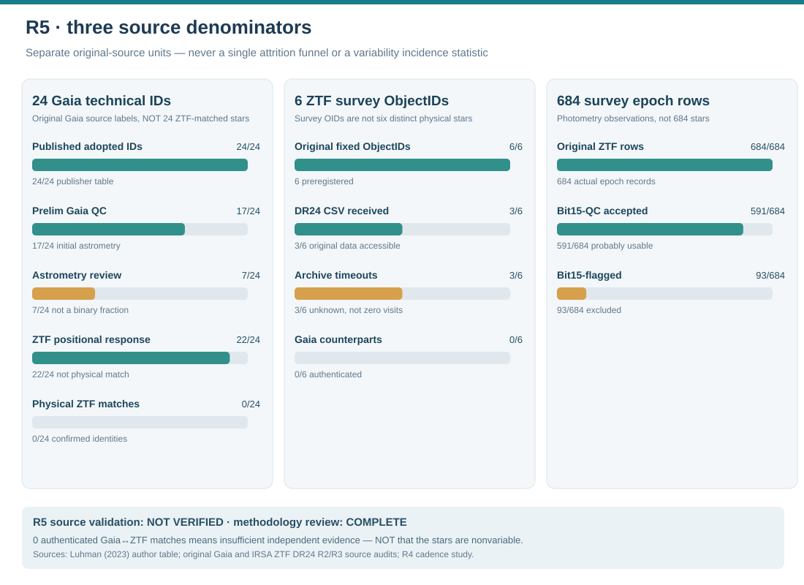

# Taurus / StellarForge R5 — critical independent-literature, selection and falsification assessment

**14 November 2026 · Completed methodological critical review; independent astrophysical source validation NOT MET.**

This is an explicit scientific **NO-GO** for attributing new variable stars, companions, periods or population variability fractions to the frozen Taurus Gaia sample. It is **not** an independent demonstration that those stars are nonvariable. The positive outcome is a reproducible **source-provenance, selection-bias and falsification feasibility study**, suitable to underpin an appropriately limited R6 methods report. This document is separate from the already released and tested StellarForge **v2.1.0 software portfolio**.

[Prospectively frozen R5 questions and denominators](R5_CRITICAL_VALIDATION_SELECTION_LITERATURE_PREREGISTRATION.md) · [source-derived machine-readable 8-gate decision](../../reports/taurus_variability_r5/R5_CRITICAL_VALIDATION_AND_SELECTION_DECISION_NO_RAW.json) · [distinct-denominator quantitative figure](../../docs/figures/taurus-r5-original-source-denominators-no-funnel.svg) · [fully offline source-audit implementation](../../scripts/run_taurus_r5_critical_falsification.py).

## 1. What has actually been independently reviewed?

The original scientific protocol [R1](R1_PREREGISTERED_SCIENCE_PROTOCOL.md) established a fixed, deliberately **nonrandom** 24-source technical Gaia cohort before variability analysis. Subsequent real-data operations establish:

- [R2 authentic original publisher Luhman (2023) Table 2](R2_FINAL_24_SOURCE_SCREENING_DECISION.md): **532** original author-adopted Taurus member rows, **467** with Gaia IDs, and the **24/24** preregistered technical source Gaia IDs plus catalogue positions verified in the original author-published MRT table. This validates **published source-list provenance**, not independently reassessed physical Taurus membership, *nor* Gaia↔ZTF identity.
- R2 exact original Gaia source retrieval: **24/24**, **17/24** preliminary Gaia-only astrometric screening passes, **7/24** requiring astrometric review, **4/24** with catalogued Gaia neighbours inside 5 arcsec. No catalogued neighbour inside 2 arcsec is **not** image-resolved source deblending. Source-level ZTF positional response tables had **22/24** successful target positions, but **0/24 physically authenticated counterparts**.
- [R3 authentic original ZTF DR24 exact-ObjectID source study](R3_REAL_SIX_ORIGINAL_ZTF_DR24_QC_RESULTS.md): six *survey ObjectIDs* at two Gaia working-label positions, not six separate authenticated stars. **3/6** originally received valid public CSV source tables (684 per-epoch rows, **591** accepted using original bit-15 mask, **93** rejected). The other **3/6** original requests timed out, then timed out again during a fixed preregistered network retry. No observational zero detections can be inferred from those technical failures.
- [R4 original year-bin cadence and wholly SYNTHETIC window pilot](R4_REAL_ZTF_SAMPLING_WINDOW_FEASIBILITY_RESULTS.md): **2/3** returned original ZTF ObjectID series contain **two consecutive 365-day bins with zero accepted measurements** (within their own source-relative observing spans); the third covers 8/8 source-relative bins. **True per-epoch cadence, true spectral windows, real periodograms and inferred astrophysical periods were not measured.** Two synthetic timestamp schedules with the same genuine year-bin counts and overall spans cannot certify the true ZTF window.
- Original image-level source checks exist for **four historical ZTF science/mask/PSFcat exposures across FT Tau and CIDA 11** and a later fixed original six-image FT Tau spatial-PSF pilot. The six original FT Tau spatial models were numerically fit; their same-image residual evaluations and other native PSF quality flags **do not amount to independently calibrated reference-star WCS/PSF source-deblending or covariance**. Original low-χ failures remain failures.

Every numerical claim is tied to source-derived R2/R3/R4 SHA receipts, archived original Actions runs and offline auditors. This R5 analysis **does not** download new FITS frames, Gaia source tables or actual per-epoch magnitudes/timestamps, and it does not force an original survey source association by proximity.

## 2. Selection and availability: three different denominators

**These fractions describe exactly the technical dataset we have; none is a statistically representative Taurus population fraction, membership completeness, astrophysical variability incidence, or properly calibrated discovery efficiency.**

| Measured scope | Exact fraction | Descriptive percentage | What it cannot establish |
|---|---:|---:|---|
| R1 fixed Gaia IDs / original published adopted Taurus members | 24/532 | 4.51% | Randomly sampled or unbiased Taurus population |
| R1 fixed Gaia IDs / published members with Gaia identifiers | 24/467 | 5.14% | Selection completeness |
| Preliminary Gaia-only astrometric-screen passes | 17/24 | 70.83% | Confirmed unique or physically ZTF-matched stars |
| Gaia astrometric quality review required | 7/24 | 29.17% | Binary-star fraction or Gaia false matches |
| Catalogue Gaia neighbour within 5 arcsec | 4/24 | 16.67% | All faint/blended stellar multiplicity |
| Some authentic original ZTF positional response available | 22/24 | 91.67% | 22 identifiable photometric Gaia counterparts |
| Physically authenticated Gaia↔ZTF sources meeting R2 | **0/24** | **0.00%** | Nonvariable stars (not tested) |
| Original fixed ZTF survey ObjectIDs with exact-DR24 CSV | 3/6 | 50.00% | Physical star sample coverage |
| Original fixed ZTF ObjectIDs timing out twice | 3/6 | 50.00% | Zero true visits or no variability |
| Original photometry rows retained after the bit-15 mask | 591/684 | 86.40% | Complete `catflags=0` clean dataset or calibrated uncertainties |
| Original photometry rows rejected by the bit-15 mask | 93/684 | 13.60% | Fraction of poor-quality stars |
| Retrieved ZTF survey OIDs with two adjacent in-span empty 365-day bins | 2/3 | 66.67% | Population incidence of poor observing cadence |



*The figure deliberately contains **three separate comparison panels, not an attrition funnel**; Gaia-source IDs, survey ObjectIDs, and raw photometric rows are different kinds of entities. Zero authenticated physical matches is **absence of adequate verification evidence**, not a physical null-variable result.*

The **R1 preselection** already used prior brightness/group criteria and was not a random draw from the 532-member author catalogue. Comparing 24/532 therefore merely reports the share of that published list appearing in this original technical subset. We have no validated inclusion probabilities or full observational selection function, and no comparable non-YSO control-star sample. We make **no population-rate estimate or associated inferential confidence interval**.

## 3. Independently consulted original literature and technical documentation

The following sources were checked against the public original publisher/provider descriptions on **14 November 2026**. They contextualize methods and instrument flags; **they are not independent instrumental verification of StellarForge's particular physical ZTF source assignments**.

| Independent published/provider reference | Verified relevant scope | Scientific consequence in StellarForge |
|---|---|---|
| **[Luhman (2023), AJ 165, 37](https://doi.org/10.3847/1538-3881/ac9da3)**, *A Census of the Taurus Star-forming Region and Neighboring Associations with Gaia* | Original adopted-member catalogue of 532 Taurus entries, and the author MRT Table 2 original retrieval verified the 24 frozen Gaia IDs/positions | Publisher provenance success is not independent source-level Gaia↔ZTF proof |
| **[Mas et al. (2026), A&A 705, A172](https://doi.org/10.1051/0004-6361/202554522)**, *Exploring the variability of young stars with Gaia DR3 light curves* (published 19 January 2026) | Literature already applies YSO Gaia Q–M diagnostics, GLS, structure functions and discusses one-day aliases in ZTF comparisons; sparse sampling creates morphological uncertainty | **Do not** claim the invention of Q–M, GLS or one-day alias awareness, or infer real periods from R4's imaginary schedules |
| **[ESA Gaia DR3 `gaia_source` reference](https://gea.esac.esa.int/archive/documentation/GDR3/Gaia_archive/chap_datamodel/sec_dm_main_source_catalogue/ssec_dm_gaia_source.html)** | RUWE is a renormalised measure of the astrometric solution's single-source model fit, not an independent binary or physical cross-survey identity classifier | Seven high-RUWE / astrometric review cases require review, **not** automatic companion discoveries |
| **[IRSA official ZTF release portal](https://irsa.ipac.caltech.edu/Missions/ztf.html)** and **[lightcurve API interface](https://irsa.ipac.caltech.edu/docs/program_interface/ztf_lightcurve_api.html)** | Public DR24 published 22 January 2026; exact `ID`, `POS`, `COLLECTION`, `TIME` query contracts differ; one sky position can have more than one survey ObjectID | Positional query rows, exact ObjectID data, cross-filter IDs and physical stellar identity must remain separate |
| **[Official IRSA ZTF quality-flag explanation](https://irsa.ipac.caltech.edu/data/ZTF/docs/releases/dr06/src/dr06.html)** | Removing `catflags & 32768` bad overall image-quality epochs yields **probably usable** measurements, while strict `catflags = 0` excludes other potentially problematic source-level quality bits | The 591 bit-15-accepted original observations are a *preliminary technical quality set*, **not** an independently calibrated and completely unflagged dataset |

The Mas et al. results concern their own Gaia YSO source sample; no physical FT Tau/CIDA 11 source intersection or literature-normalized variability result has been established here. ZTF release notes and Gaia DR3 docs do not automatically calibrate the unique original ZTF sources observed by StellarForge.

## 4. Eight independent falsification gates — what survives?

| Scientific gate | R5 adjudication | What would be needed for a positive stellar-science claim |
|---|---|---|
| Exact author-published Taurus member-list entry | **PASS within published-catalogue scope** | Independent later literature review for claims beyond its original adopted-membership list |
| Independent Gaia↔ZTF physical identity | **NOT VERIFIED: 0/24** | Propagate Gaia astrometry by epoch, with errors and original ZTF source/OID/field validation |
| External same-field PSF/WCS and deblending calibration | **NOT VERIFIED** | Independent reference stars, original-image covariance, blend and crowding controls |
| Full source flags, photometric calibration and uncertainties | **LIMITED** | Original per-epoch `catflags=0` sensitivity, magnitude/error calibration and covariance |
| Real per-epoch timestamps and physically interpretable periods | **NOT VERIFIED** | Authentic times/magnitudes/errors, true cadence window and false-alarm controls |
| Same-field magnitude-matched non-YSO controls | **NOT VERIFIED** | Preregistered independent comparison stars and matching selection function |
| Independent original-image, alias and literature reconciliation | **NOT VERIFIED** | Source-matched image checks, real frequency alias tests and existing-study comparisons |
| Population-representative, quantified selection probabilities | **NOT VERIFIED** | Full parent-sample selection function and sensitivity/crowding model |

### Why an independent astrophysical validation result cannot be claimed

The eight gates are not interchangeable. A successful literature catalogue entry is **not** source-identification success; a numerically fitted original PSF is **not** an externally calibrated physical counterpart; three source-specific original ZTF technical light curves are **not** six separate stars; and arbitrary simulated observation times can *demonstrate* a methodological limitation but cannot deliver a real source periodogram.

The critical review therefore yields **R5 methods/literature/selection audit COMPLETE; R5 independent physical stellar validation NO-GO**. Do not overwrite any original failed R2 PSF quality flags, label source API timeouts as stellar nondetections, change the original R1 30-visit/90-day threshold, silently select alternate photometry epochs, or use a posteriori quality filters to improve claimed discoveries.

## 5. Required scientific next stage — R6 scope and falsification conditions

**Defensible R6:** a concise **observational data-access, identity-matching and time-sampling feasibility report** with one nonrandom 24-target Taurus technical cohort, provenance against the Luhman author catalogue, genuine Gaia and ZTF archive retrievals and their limitations, original image/PSF technical work, the R3 591 quality-screened source visits, authentic R4 cadence gaps, explicit synthetic-only example, independent prior literature comparisons, external survey documentation and the *negative/inconclusive* scientific gate decisions.

**Not supported:** “24 new Gaia↔ZTF physical matches,” “FT Tau's new optical period,” “new stellar companion,” “new variable stars,” “Taurus population variability rate,” or “independent ZTF instrument calibration.” For any real astrophysical R6 claims, additional actual physically identified original Gaia-ZTF matches, independent reference-star field calibration/deblending, original per-epoch observations, controls and critical scientific human review would be required. A journal submission would additionally need a clearly justified novel contribution and external peer review.

The scope of this work is **scientific methodological evidence and falsifiability**, not claiming an astronomy discovery. This allows R6 to be concluded honestly without delaying indefinitely for survey access, while keeping its scientific limitations prominent.

## Reproducible validation

```bash
python -m pytest -q
python -m scripts.audit_taurus_r2_24_go_no_go --root .
python -m scripts.audit_taurus_r3_six_original_source_receipts --root .
python -m scripts.audit_taurus_r4_cadence_feasibility --root .
python -m scripts.run_taurus_r5_critical_falsification --root .
python -m scripts.audit_taurus_r5_critical_falsification --root .
```

All scripts operate **offline** using original source-derived no-raw archived receipts; no new original ZTF CCD FITS, per-epoch photometry, original time stamps or private/unpublished ALMA/TFM data are introduced. The finished R5 source ledger, public quantitative SVG and all claimed denominators are checked against the prior independent R2/R3/R4 auditors.
