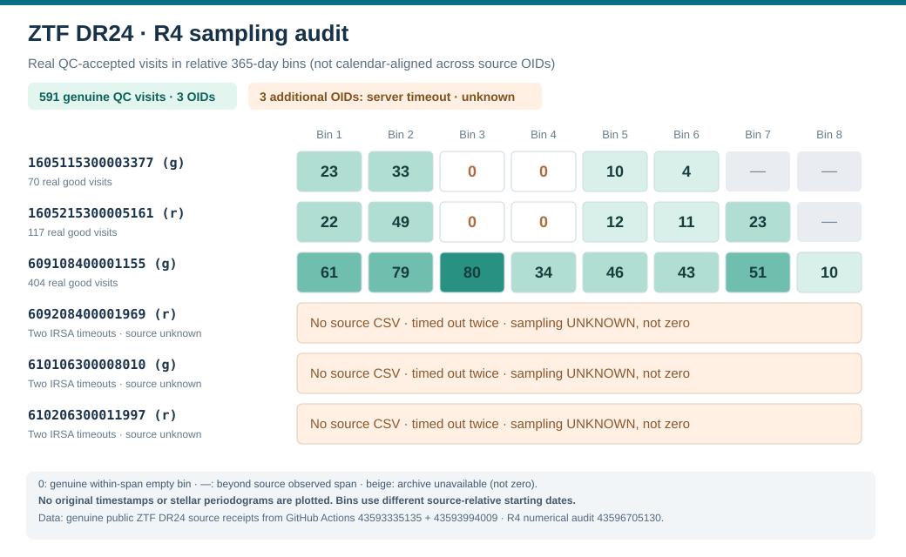
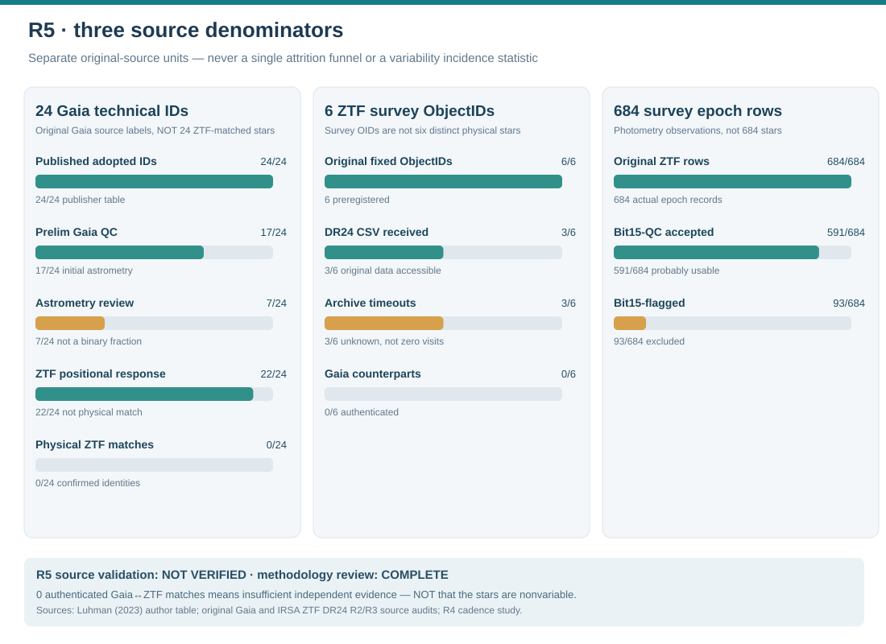

# StellarForge / Taurus R1–R6: An original-data observational feasibility and source-attribution audit for optical variability in a fixed Gaia DR3 pilot sample

**Author:** Ismael Berja Ruiz  
**Research-note date:** 15 November 2026  
**Research status:** *Completed independent methodological/observational feasibility study; astrophysical source-level variability science inconclusive.*  
**Document type:** Public GitHub technical research manuscript, **not** a peer-reviewed paper, published journal article, arXiv submission or discovery announcement. In plain terms: this is **not a peer-reviewed scientific article**; neither journal acceptance nor external scientific review is claimed.  
**Software:** [StellarForge](https://github.com/ismaelberja/stellarforge), engineering release 2.1.0 (unchanged).  
**Frozen source baseline:** [R5-integrated main commit `05340f6fea6c524e2067d578ed49efdacb9945f5`](https://github.com/ismaelberja/stellarforge/commit/05340f6fea6c524e2067d578ed49efdacb9945f5), verified at [Actions 43610495397](https://github.com/ismaelberja/stellarforge/actions/runs/43610495397). The eventual **R6 final merge commit** is identifiable from the final PR/main GitHub history after this text is merged, not falsely forecast here.

---

## Abstract

We examine whether reproducible public-archive workflows can support scientifically defensible Gaia-to-ZTF optical variability analysis for a fixed, nonrandom 24-source Taurus technical cohort. The cohort was registered before any variability-based filtering, and every provisional original-data and scientific-quality decision was preserved through a six-phase programme. Authentic publisher-original Luhman (2023) Table 2 retrieval verified the catalogue Gaia DR3 identifiers and published sky positions for all **24/24** preregistered targets among **532** adopted Taurus members, of whom **467** have Gaia source identifiers. Exact Gaia source records were retrieved for all 24; **17** passed an initial Gaia-only astrometric screen, **7** required review, and **4** had catalogue Gaia neighbours within 5 arcsec. Original IRSA/ZTF **positional** queries returned some parseable rows around **22/24** source positions. However, the independent criteria for physical Gaia-to-ZTF counterpart identity and calibrated per-image deblending were not met for **any of the 24** sources. A separately preregistered DR24 exact-ObjectID technical pilot queried **six ZTF survey ObjectIDs**, recovering valid original lightcurve CSV for **three**, comprising **684 per-epoch source rows**, **591** retained by a preregistered bit-15 quality flag and **93** excluded. The other three original exact-ID queries timed out twice and therefore remain **archive-unavailable**, not astrophysical non-detections. Original-data-derived relative 365-day bins reveal two adjacent within-span empty yearly bins for **two of the three** retrieved survey ObjectIDs. Fully **synthetic** within-bin timestamp allocations, constructed to reproduce those same real annual counts and source-specific time spans, demonstrate that the exact one-day sampling-window value cannot be inferred from coarse bins. Independent literature and instrument-control review confirms that numerical survey-access success, preliminary image PSF fits and catalogue name aliases do not constitute authenticated physical stellar time series. The study therefore reports a **completed, reproducible observational feasibility and falsification audit**, but **no physically attributed Gaia-star variability, real stellar period, newly identified variable or companion, or Taurus population incidence**.

**Keywords:** Taurus molecular cloud; Gaia DR3; Zwicky Transient Facility; photometric time series; cross-identification; observational selection effects; astronomical data provenance; reproducible research; inconclusive feasibility.

## Resumen en español

El proyecto ha terminado su investigación metodológica R1–R6 con datos originales de Gaia, el catálogo de Luhman (2023) y ZTF/IRSA. Se verificaron **24 identificadores Gaia y posiciones originales** del catálogo publicado; ZTF devolvió información posicional para **22 de 24** posiciones, pero **ninguna asociación física estrella Gaia ↔ identificador ZTF quedó científicamente autenticada**. En una prueba adicional de seis identificadores ZTF se obtuvieron datos reales de tres (684 registros, 591 tras el filtro instrumental básico); otros tres no respondieron al servidor, incluso tras un reintento. Dos series recuperadas tienen grandes lagunas temporales. El análisis matemático de calendarios **simulados** explica por qué los recuentos no permiten reconstruir un periodo observado. El resultado final es un **estudio de viabilidad científica reproducible y honesto**, no un descubrimiento de estrellas variables ni un artículo ya publicado. La parte de programación sí está completada y validada por pruebas.

---

## 1. Context, question and scope

Young stellar objects in nearby star-forming regions can vary in optical brightness owing to physical processes including photospheric modulation, variable accretion, extinction and other mechanisms. Catalogues and multi-epoch surveys enable comparisons, but those interpretations require that the observations are correctly associated with the *physical object* of interest and that time sampling, noise, blending and detector flags are quantified.

[Luhman (2023)](https://doi.org/10.3847/1538-3881/ac9da3) assembled a Gaia-informed census of Taurus and nearby populations. [Mas et al. (2026)](https://doi.org/10.1051/0004-6361/202554522) investigated Gaia DR3 young-star light-curve morphology using Q–M diagnostics, generalized Lomb–Scargle periodograms and structure functions, and highlighted survey-specific sampling and alias issues. StellarForge **does not claim to originate these methods or remeasure the latter paper's stars**.

Our [R1 preregistered research question](R1_PREREGISTERED_SCIENCE_PROTOCOL.md) was: *Can the optical variability of a small, predeclared set of literature-associated Taurus young-star candidates be characterised reproducibly from public Gaia DR3 and ZTF data while controlling source association, survey sampling and uncertainty?*

The answer for this fixed pilot is **not yet at the physical-stellar-variability level**: provenance and technical survey access were partially established; independent physical target attribution was not. A negative or inconclusive feasibility outcome was explicitly permitted in the original R1 research protocol. The subsequent R1–R6 programme documents **what was tested, where it failed, what was not tested, and which original source evidence survives scientific scrutiny**.

## 2. Materials, provenance and methods

### 2.1. Preregistration and technical sample

We retained **all 24** original Gaia DR3 technical seed IDs from the existing file `data/research_seed/TAURUS_24_PROVISIONAL_GAIA_POSITIONS.csv`. Its pre-R2 checksum is SHA-256 `9cecb94704f028a981045629ad16ecb770f51bba4b6bb3bf13dda769327ff37e`. The original selection was previously constrained by technical group/brightness criteria and derived from a literature mirror; it was **not a random sample of Taurus** and was not optimized on observed variability amplitude or period strength.

The genuinely retrieved [publisher-original Luhman (2023) machine-readable author Table 2](https://content.cld.iop.org/journals/1538-3881/165/2/37/revision1/ajac9da3t2_mrt.txt) had **201,726 bytes**, SHA-256 `8ffd84c876afe6b6d7690f8e4ba4f97ec94f643e0e924c98f6c101b8656c0493`. Its **532** adopted Taurus entries include **467** entries with Gaia identifiers, and **all 24** frozen Gaia IDs and original positions matched its adopted-member entries to the predeclared numerical precision. This verifies membership in the *author's published adopted-member list*, **not** that all memberships were independently reclassified by this project, nor that ZTF photometry has a corresponding physical source. [Original-source receipt](../../reports/taurus_variability_r2/R2_PUBLISHER_LUHMAN2023_ORIGINAL_24_OF_24_NO_RAW.json).

### 2.2. Gaia quality and ZTF position/source association

The [R2 source-by-source ledger](R2_FINAL_24_SOURCE_SCREENING_DECISION.md) recorded exact Gaia DR3 source record retrieval, preliminary RUWE/quality checks and Gaia catalogue neighbours. **Gaia-only RUWE is a goodness-of-fit/review diagnostic**, not an individual multiplicity measurement or physical ZTF crossmatch. Separate positional IRSA/ZTF queries provided candidate survey data around a technical sky coordinate; *positional coincidence was never accepted as a unique physical source association*. The original ZTF image/mask/PSFcat experiments and later spatial PSF models can inspect extraction and image residual behaviour, but available tests did **not** supply fully independent astrometric reference-star covariance, successful source deblending and per-epoch physical Gaia-to-ZTF identification.

We therefore kept all 24 Gaia target identities **pending** for physical light-curve attribution and disallowed joining different ZTF ObjectIDs into one asserted Gaia-star light curve. A SIMBAD name-to-Gaia catalogue alias for FT Tau, where present, is a **curated object-name relation**, not an independent instrumental identification of four candidate ZTF survey ObjectIDs as FT Tau.

### 2.3. Original exact-ObjectID ZTF DR24 pilot and quality mask

A separate [R3 preregistration](R3_SIX_FIXED_ZTF_OIDS_PHOTOMETRY_QC_PREREGISTRATION.md) fixed six original ZTF survey ObjectIDs and their native g/r bands **before** the new archive requests, using the genuine earlier R2 positional candidate survey identifiers. Data were requested with the official [IRSA ZTF lightcurve interface](https://irsa.ipac.caltech.edu/docs/program_interface/ztf_lightcurve_api.html) using explicit `ID=<frozen ObjectID>`, `FORMAT=csv`, and `COLLECTION=ztf_dr24`. Each source response was required to contain only its specified ObjectID/band and kept separate by original reported time scale.

The preregistered preliminary quality mask rejected rows whenever `catflags & 32768 != 0`; it did **not** require `catflags=0`, model all noise covariance or establish independent photometric deblending. The original R1 *technical* acceptance condition was **at least 30 accepted visits and 90 days between first and last accepted source epoch per OID/band/time scale**. These values are pragmatic pilot thresholds, not universal error-corrected astrophysical classification criteria. We neither sigma-clipped on apparent variability nor used resulting periods to select sources.

The first [real original-source DR24 run 43593335135](https://github.com/ismaelberja/stellarforge/actions/runs/43593335135) allowed 40 seconds per request, using at most two workers. It returned three successful exact survey ObjectID CSVs, and three provider timeouts. A distinct, prospectively recorded [retry-only protocol](R3_THREE_ORIGINAL_ZTF_TIMEOUTS_RETRY_PREREGISTRATION.md) queried **only those three** previously timed-out exact original ObjectIDs once more, serially with an 85-second timeout per request. All three again timed out. These errors describe archive accessibility in these bounded runs and cannot be interpreted as zero astrophysical photometric visits.

### 2.4. Temporal coverage and synthetic illustration

R4 inspected only genuine **derived, source-specific 365-day bins**: bins begin at the first accepted original epoch **of that ObjectID** and cannot be aligned as common calendar-year dates across separate survey ObjectIDs. Missing bins beyond each reported source's temporal span are not within-span zero-count bins. The exact original survey per-visit timestamps and per-epoch magnitudes are **not preserved in the repository**, preventing independent reconstruction of a true sampling spectral window or stellar period from these coarse summaries.

The fixed [R4 method](R4_REAL_ZTF_SAMPLING_WINDOW_METHOD_PREREGISTRATION.md) provided a transparent **mathematical identifiability counterexample**: two wholly **synthetic** hypothetical timestamp arrangements reproduce exactly the same genuine per-bin accepted counts and overall original source time span, yet their test value of

\[
W_{\mathrm{synthetic}}(1\,{\rm day}^{-1})=
\left|\frac{1}{N}\sum_{j=1}^{N}\exp(2\pi i\,t_j/1\,{\rm day})\right|^2
\]

differs markedly. **These are deliberately constructed, not observed or random-population-representative schedules. No real ZTF one-day window, false-alarm probability, original periodicity or physical stellar light curve is measured by R4.**

### 2.5. Independent context, validation gates and numerical denominators

R5 compared original R1–R4 evidence against independent publisher literature and official [ESA Gaia DR3 `gaia_source` model](https://gea.esac.esa.int/archive/documentation/GDR3/Gaia_archive/chap_datamodel/sec_dm_main_source_catalogue/ssec_dm_gaia_source.html), the [IRSA ZTF release portal](https://irsa.ipac.caltech.edu/Missions/ztf.html) and [official IRSA image/source flag documentation](https://irsa.ipac.caltech.edu/data/ZTF/docs/releases/dr06/src/dr06.html). It recorded **eight** scientific acceptance/falsification questions, explicitly distinguished **24 target Gaia IDs, six original survey ObjectIDs and 684 individual original photometric measurements**, and forbade converting those three units into a single attrition funnel or claiming unbiased survey rates. The positive publisher-catalogue provenance gate does **not** substitute for six outstanding physical instrumental/data-calibration validation gates.

No new original full lightcurve CSV, CCD FITS pixel array, full journal table or unpublished/private ALMA/TFM inputs were committed as part of these research reports. Only reproducibility metadata, digests, source-level aggregated counts, reference identifiers, labels and clearly separated simulated methodological constructs are included.

## 3. Results

### 3.1. Source provenance and preliminary Gaia eligibility

| Original scientific scope | Result | Correct scientific reading |
|---|---:|---|
| Author-published adopted Taurus entries in Luhman (2023) | 532 | Parent published *catalogue*, not a random crossmatched selection |
| Published adopted entries with Gaia IDs | 467 | Catalogue Gaia-ID availability, not star→ZTF source validation |
| Frozen original Gaia technical targets verified against author Table 2 | **24/24** | Exact member-list ID and position provenance passes |
| Preliminary exact-Gaia astrometric quality pass | **17/24** | Screen only; not guaranteed unblended source |
| Gaia astrometry requiring review | **7/24** | Does not establish physical multiplicity |
| At least one additional catalogue Gaia source within 5 arcsec | **4/24** | Does not exhaust unresolved faint companions or blend risks |
| Some original ZTF **positional-query** rows retrieved around target position | **22/24** | Archive access evidence only |
| Physically authenticated Gaia→ZTF source counterparts | **0/24** | Scientific matching criterion **not met**, not 24 proven nonvariables |
| Original ZTF ObjectID curves safely merged into Gaia stellar time series | **0** | No physical stellar period may be inferred |

Two R2 target-position requests lacked populated parsed original responses: one returned zero rows under a thresholded positional request; the other returned an HTTP 400. Neither is a measured astronomical absence of variability. The full original [24-source identity decision ledger](../../reports/taurus_variability_r2/R2_FINAL_24_TECHNICAL_SOURCE_ACCESS_AND_IDENTITY_DECISION_NO_RAW.json) preserves each case.

### 3.2. Genuine ZTF survey source photometry and archive missingness

The six fixed DR24 survey ObjectIDs were selected for this narrow technical pilot at two *working target sky contexts* labelled FT Tau and CIDA 11. They are **six survey identifiers, not six independently identified stars**, and even the three successfully queried OIDs have no independently authenticated Gaia stellar counterpart.

| Original survey context (not confirmed physical ID) | ZTF ObjectID | Filter | Original returned source rows | Bit15-accepted | Bit15-excluded | Original good-visit span (days) | Technical gate |
|---|---|:---:|---:|---:|---:|---:|---:|
| FT Tau working sky context | `1605115300003377` | g | 79 | 70 | 9 | 1,870.876898 | 30 visits / 90 days PASS |
| FT Tau working sky context | `1605215300005161` | r | 137 | 117 | 20 | 2,528.096678 | 30 visits / 90 days PASS |
| FT Tau working sky context | `609108400001155` | g | 468 | 404 | 64 | 2,617.952292 | 30 visits / 90 days PASS |
| FT Tau working sky context | `609208400001969` | r | **Timeout twice** | Unknown | Unknown | Unknown | Archive unavailable |
| CIDA 11 working sky context | `610106300008010` | g | **Timeout twice** | Unknown | Unknown | Unknown | Archive unavailable |
| CIDA 11 working sky context | `610206300011997` | r | **Timeout twice** | Unknown | Unknown | Unknown | Archive unavailable |

The three successful response CSVs contain **684** original source rows, **591** preliminary bit15 quality-accepted epochs (**86.40%**) and **93** masked original rows (**13.60%**). The remaining source access fraction is **3/6 returned**, **3/6 timed out twice**, not 50% of physical Taurus stars lacking optical observations.

### 3.3. Observed coarse time-coverage gaps

The authentic QC-accepted visit counts in source-relative 365-day bins are:

| ZTF survey ObjectID | Original source-specific successive 365-day QC counts | Empty within-span bins | Scientific interpretation |
|---|---|---:|---|
| `1605115300003377` | 23, 33, **0, 0**, 10, 4 | 2 consecutive | Two empty yearly-scale intervals |
| `1605215300005161` | 22, 49, **0, 0**, 12, 11, 23 | 2 consecutive | Two empty yearly-scale intervals |
| `609108400001155` | 61, 79, 80, 34, 46, 43, 51, 10 | 0 | Eight successive bins with retained points |
| Remaining three survey OIDs | **Unknown (two timeouts each)** | Unknown | No conclusion about actual visits |



**Figure 1.** Authentic source-level temporal-coverage statistics. Each leftmost bin starts at the first accepted observation of *that survey ObjectID*, so same-index columns are not the same calendar dates across OIDs. Zero within-span count, beyond-span absence and archive timeout are distinct concepts.

### 3.4. Falsification through two different observational units and simulated examples



**Figure 2.** Observed source/measurement denominator separation. The **24 Gaia identifiers**, **six ZTF ObjectIDs**, and **684 epoch rows** are **different kinds of entities**, not interchangeable quantities.

For transparency, the R4 theoretical example used entirely imaginary timestamps satisfying the **same genuine aggregate observations**:

| Original source label only | **SYNTHETIC** integer-day 1/day window | **SYNTHETIC** subday-diverse 1/day window | Observed real 1/day window |
|---|---:|---:|---|
| `1605115300003377` | 0.991987 | 0.002066 | **Not measured** |
| `1605215300005161` | 0.996968 | 0.005382 | **Not measured** |
| `609108400001155` | 0.999780 | 0.003877 | **Not measured** |

Those values are a **logical proof-by-construction of under-identification from coarse summaries**, not new ZTF periods, actual alias powers or an estimate of the true 1/day ZTF window. We cannot calculate photometric amplitude, intrinsic source scatter, star-specific Q–M indices, astrophysical modulation, false-alarm probabilities or population incidence from the persisted original-source summary alone.

### 3.5. Final eight-gate decision and phase completion

| Scientific gate | Decision at R6 | What the decision means |
|---|---|---|
| Original author-published Taurus Gaia ID and sky-position provenance | **PASS, catalogue source scope only** | Original author table checked for 24/24 |
| Independent *physical* Gaia-to-ZTF source identity | **NOT MET** | No survey ObjectID physically authenticated for a Gaia star |
| Independent reference-star astrometry / image PSF, WCS, deblend covariance | **NOT MET** | Same-image numerical fits do not establish independent source identity |
| Strict source-level photometric flags, calibration and uncertainties | **LIMITED** | Bit15-only mask is not full `catflags=0` or covariance validation |
| Actual per-epoch time series and genuine star-period validation | **NOT MET** | Source summary cannot yield original-stellar periodogram |
| Matched non-YSO comparison stars in same source field | **NOT MET** | No controlled false-positive or comparison sample |
| Independent original-image, literature and sampling-alias source validation | **NOT MET** | Prior literature consulted, no real physical target alias/falsification verified |
| Representative Taurus population selection function | **NOT MET** | Preselected 24 source sample unsuitable for population rate claims |

The **operational/methodological deliverables** differ from astrophysical gate acceptance:

| Phase | Technical/methodological deliverable | Physical astrophysical result |
|---|---|---|
| **R1** | Completed; frozen, nonrandom 24 Gaia technical source seed and quality protocol | No variable or physical match asserted |
| **R2** | Completed original publisher provenance and 24-source access/ambiguity audit | Physical Gaia–ZTF matching **NO-GO** |
| **R3** | Partial original survey ObjectID access/QC pilot (3/6 original CSVs) with all failures tracked | No Gaia-star light curves attributable |
| **R4** | Completed real original coarse source-cadence feasibility and explicitly synthetic-only counterexample | No real measured astrophysical period |
| **R5** | Completed independent literature, selection and eight-gate critical review | Independent physical star science **NO-GO** |
| **R6** | Completed bounded research manuscript, reproducibility/negative evidence and scientific closeout **when final tests pass** | **Inconclusive** for stellar variability; no discovery |

This distinction is intentional. Completing the workflow does **not** promote an unresolved physical-source science gate to a successful astrophysical conclusion.

## 4. Discussion and limitations

**Physical-source identification is the decisive failure mode.** A ZTF original positional response is a catalogue/query access event, whereas astrophysical variability must be attributed to a uniquely identified physical source. The original source-level ZTF ObjectIDs can differ across survey field, CCD, filter and pipeline extraction; without independently calibrated and propagated Gaia astrometry, reference-star uncertainty and blending tests, we cannot safely merge candidate time series or report physical stellar periods. FT Tau's SIMBAD-curated name-to-Gaia alias is insufficient evidence of a specific ZTF original ObjectID counterpart.

**Archive access is not an astrophysical absence of signal.** Three fixed exact-source IRSA requests timed out twice. No first/second failure establishes zero observations or a non-variable star. The R2 thresholded zero-row positional source request likewise cannot be treated as a stellar nondetection.

**Initial `catflags` acceptance is not a final source-quality certificate.** A `catflags & 32768` bit-15 image mask may retain per-source measurements carrying other quality flags. A stricter `catflags=0` sensitivity study, independently calibrated errors and per-source crowding/deblend controls would be required for astrophysical variability claims.

**Cadence aliasing cannot be inferred exactly from coarse bins.** R4's **two synthetic schedules** show that the same genuine year-bin counts and total span can yield very different illustrative 1-day spectral-window statistics. We deliberately report no actual spectral-window values or real star periodicity. Similarly, without controlled comparison sources, an apparent real source lightcurve variation could be affected by seasonal sampling and instrumental noise.

**Selection bias prevents Taurus-wide inference.** The preselected technical sample covers 24 of 532 adopted author-catalogue Taurus entries and 24 of the 467 with Gaia IDs, but neither fraction is a completeness estimate or inclusion probability. The 2/3 survey ObjectID gap fraction is not a fraction of Taurus young stellar objects with poor cadence. No population-variable incidence, physical companion fraction, confidence interval for a regional rate, or discovery efficiency is justified.

**Related work and novelty limitations.** [Mas et al. (2026)](https://doi.org/10.1051/0004-6361/202554522) already developed and applied relevant Gaia young-star Q–M and GLS variability diagnostics, while Luhman (2023) supplied the original census. We claim **no methodological invention of these established techniques**. The contribution of this bounded project is a transparent, reproducible source-provenance and failure-mode audit with defensible negative/inconclusive observational eligibility decisions, not a demonstrated novel physical Taurus result.

**Research ethics and publication status.** This report summarizes public original-provider data-derived evidence and explicitly identifies fully synthetic material. Numerical tests and successful Actions CI verify **software/evidence consistency**, not external scientific peer review, independent instrument calibration, or a publishable new astrophysical discovery. Any journal submission would require a separate contribution/novelty assessment, full source-level validation and qualified external scientific review. Work incorporated AI-assisted code and technical document drafting; the author must review all final scientific interpretations and bibliography before external circulation.

## 5. Conclusions

1. **Publisher-original provenance verified:** the 24 frozen technical Gaia DR3 IDs and published sky positions are present in Luhman's 2023 author-published Taurus adopted-member table (24/24); their presence is not a Gaia–ZTF physical identity result.
2. **Scientific source association unresolved:** independent astrophysical cross-survey physical source identification remains **0/24 confirmed**. The honest research decision is **NO-GO** for target-attributed variability/period analysis, not that 24 targets are physically nonvariable.
3. **Authentic ZTF technical observations studied:** three exact ZTF DR24 survey ObjectID responses provided **684 original source rows**, **591** preliminarily bit15 accepted and **93** rejected; three other fixed ObjectIDs were archive-unavailable after a controlled retry.
4. **Sampling limitations directly documented:** two genuine source-specific returned OIDs have two consecutive within-span empty relative 365-day bins. An explicitly synthetic identifiability illustration establishes that the true one-day spectral window is not uniquely recoverable from those coarse counts.
5. **R1–R6 programme closed as observational feasibility research:** preregistered cohort, provenance, source decisions, archival technical experiments, sampling analysis, independent literature/selection review and final traceable report are completed **as methodological deliverables**. **No new variable star, companion, original physical source light curve, real stellar period or Taurus population rate is reported.** The astrophysical target question remains inconclusive.

**The appropriate final description is:** *An independent, original-data-backed, reproducible scientific-software and Taurus optical-variability feasibility project, completed with an explicit non-detection of sufficient source-identification evidence—not a demonstrated absence of stellar variability or a new astrophysical discovery.*

## Data availability, evidence freeze and reproducibility

Everything needed to independently inspect the **aggregate recorded source claims**, scripts, source metadata, bibliography and evidence-checking routines is in the public [StellarForge repository](https://github.com/ismaelberja/stellarforge). A reviewer cannot reconstruct actual per-epoch light curves or physically identify Gaia-to-ZTF target stars from the public aggregate-only files. Raw original source catalogue/photometry and CCD FITS inputs were not redistributed by this final research note.

- [R1 original preregistration](R1_PREREGISTERED_SCIENCE_PROTOCOL.md) and [frozen cohort](../../data/research_seed/TAURUS_24_PROVISIONAL_GAIA_POSITIONS.csv).
- [R2 original publisher Table 2 and 24-source evidence](R2_FINAL_24_SOURCE_SCREENING_DECISION.md) · [original publisher Actions](https://github.com/ismaelberja/stellarforge/actions/runs/43499836719) · [original-source decision JSON](../../reports/taurus_variability_r2/R2_FINAL_24_TECHNICAL_SOURCE_ACCESS_AND_IDENTITY_DECISION_NO_RAW.json).
- [R3 original DR24 source/quality and timeout study](R3_REAL_SIX_ORIGINAL_ZTF_DR24_QC_RESULTS.md) · [initial original-source run](https://github.com/ismaelberja/stellarforge/actions/runs/43593335135) · [bounded retry run](https://github.com/ismaelberja/stellarforge/actions/runs/43593994009) · [authentic derived-only source ledger](../../reports/taurus_variability_r3/R3_SIX_ORIGINAL_DR24_FIRST_REQUESTS_NO_RAW.json).
- [R4 observed source annual-bin coverage and **SYNTHETIC-only** mathematical window demonstration](R4_REAL_ZTF_SAMPLING_WINDOW_FEASIBILITY_RESULTS.md) · [original-derived analysis run](https://github.com/ismaelberja/stellarforge/actions/runs/43596705130) · [real-source-only cadence SVG](../../docs/figures/taurus-r4-original-ztf-dr24-relative-365day-cadence.svg).
- [R5 external literature comparison and eight-gate falsification](R5_FINAL_CRITICAL_VALIDATION_AND_SELECTION_RESULTS.md) · [source evidence and critical decision](../../reports/taurus_variability_r5/R5_CRITICAL_VALIDATION_AND_SELECTION_DECISION_NO_RAW.json) · [three-denominator original-source-only SVG](../../docs/figures/taurus-r5-original-source-denominators-no-funnel.svg).
- [R6 research freeze and stop rule](R6_FINAL_RESEARCH_CLOSEOUT_PREREGISTRATION.md) · [R6 machine-verifiable final evidence and phase status](../../reports/taurus_variability_r6/R6_FINAL_ORIGINAL_SOURCE_RESEARCH_CLOSEOUT_NO_RAW.json) · [R6 scientific gate/provenance auditor](../../scripts/audit_taurus_r6_final_scientific_closeout.py).
- Frozen starting `main` source commit: [`05340f6fea6c524e2067d578ed49efdacb9945f5`](https://github.com/ismaelberja/stellarforge/commit/05340f6fea6c524e2067d578ed49efdacb9945f5). Final R6 code commit = the final R6 merge **after** CI (visible in PR/main Git history); no fictitious commit ID is given here.

```bash
python -m pip install -e '.[test,analysis,images]'
python -m pytest -q
python -m scripts.audit_taurus_r2_24_go_no_go --root .
python -m scripts.audit_taurus_r3_six_original_source_receipts --root .
python -m scripts.audit_taurus_r4_cadence_feasibility --root .
python -m scripts.audit_taurus_r5_critical_falsification --root .
python -m scripts.audit_taurus_r6_final_scientific_closeout --root .
```

The audits **do not** need new network requests and fail if originally documented source counts, digests, scientific status or real-versus-synthetic boundaries are altered.

### References

1. Luhman, K. L. (2023), *A Census of the Taurus Star-forming Region and Neighboring Associations with Gaia*, **The Astronomical Journal**, 165, 37. DOI [10.3847/1538-3881/ac9da3](https://doi.org/10.3847/1538-3881/ac9da3).
2. Mas, C., Roquette, J., Audard, M., et al. (2026), *Exploring the variability of young stars with Gaia DR3 light curves*, **Astronomy & Astrophysics**, 705, A172. DOI [10.1051/0004-6361/202554522](https://doi.org/10.1051/0004-6361/202554522).
3. ESA / Gaia Collaboration, [Gaia DR3 archive `gaia_source` data model](https://gea.esac.esa.int/archive/documentation/GDR3/Gaia_archive/chap_datamodel/sec_dm_main_source_catalogue/ssec_dm_gaia_source.html).
4. NASA/IPAC Infrared Science Archive, [ZTF survey public data products and DR24 release](https://irsa.ipac.caltech.edu/Missions/ztf.html); [ZTF lightcurve query interface](https://irsa.ipac.caltech.edu/docs/program_interface/ztf_lightcurve_api.html); [public ZTF quality flags](https://irsa.ipac.caltech.edu/data/ZTF/docs/releases/dr06/src/dr06.html).

**Acknowledgement and responsibility.** The work used public ESA Gaia and NASA/IPAC IRSA/ZTF resources and cited original research by Luhman and Mas et al. Code, automated auditing and report drafting included AI assistance. The named author remains responsible for verifying scientific interpretation, source rights, accurate attribution and any future external publication decision. No peer review or journal acceptance is claimed.
